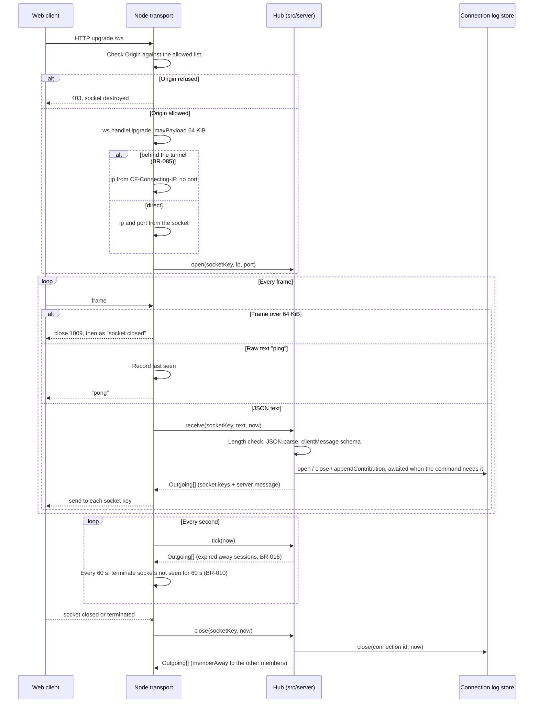

# Sequence diagram — platform — Node transport: socket life cycle

> **Feature**: platform (roadmap brick 7a)
> **Use cases**: UC1, UC3, UC4, UC10, UC13
> **Business rules**: BR-010, BR-011, BR-015, BR-060
> **Related ADRs**: ADR-0002, ADR-0007, ADR-0011; brick 7a owner choices D1 to D5 (below)

## Context

How the Node transport (`src/transports/node`) turns sockets into calls on the transport-neutral hub
(`src/server/hub.ts`, `platform/04c`). The Cloudflare transport (brick 9) wraps the same hub in the Hub
Durable Object. Does not cover what the hub does with each command (see `entry/02a`, `entry/02b`,
`rooms/02`, `platform/04c`).

## Diagram

## Notes

- **D1** (owner choice, 450/500): the Node transport uses the `ws` package with `noServer: true` and
  `maxPayload: 65536`, attached to the `upgrade` event of the `@hono/node-server` HTTP server. `ws` cuts an
  oversized frame before buffering it (close code 1009). `@hono/node-ws` was rejected: it exposes no
  `maxPayload` and lags behind `@hono/node-server` 2.
- **Origin check** (`security-and-rgpd.md`): the allowed origins are passed to the transport at start
  (default: the Vite dev origin `http://localhost:5173` and the server's own origin). A missing or other
  `Origin` header gets `403`.
- The hub also refuses a text frame over 65 536 UTF-16 code units, so the Cloudflare transport, whose
  incoming cap is not configurable, gets the same rule (D3, `platform/04`).
- **Heartbeat** (ADR-0011): the transport answers the raw text `ping` with `pong` without calling the hub,
  like the Durable Object auto-response. The sweep every 15 s (a quarter of the silence limit) terminates sockets whose
  last frame is older than 60 s, so a dead socket goes within 75 s; termination then follows the "socket closed" path, so the session goes away (BR-011).
- **Tick**: once a second the transport calls `hub.tick(now)`, which runs `expireAway`, `pruneFlood` and
  `pruneEntryAttempts`. On Cloudflare the single alarm calls the same `tick` (`platform/05`).
- The IP and source port come from `req.socket.remoteAddress` and `remotePort` (`entry/02a`), or from
  `CF-Connecting-IP` only when the transport runs behind the tunnel (BR-085, ADR-0018). They reach
  only the hub, which passes the IP to the domain and both to the connection line (BR-060).
- The transport supplies the hub with `Random` (session ids, resume tokens with their HMAC-SHA-256 hash under
  a key drawn at process start) and `hashToken`, built on `node:crypto`. A restart changes the key, so
  old resume tokens stop working, which matches an eviction (`platform/05`).
- The same Node process serves `GET /api/stats` through the Hono app (`platform/04`). In development, Vite
  serves the client and proxies `/ws` and `/api` to the Node server on port 8787 (`pnpm dev`).
- Node binds `127.0.0.1` by default: brick 7a is for development and tests, not production (brick 9).
