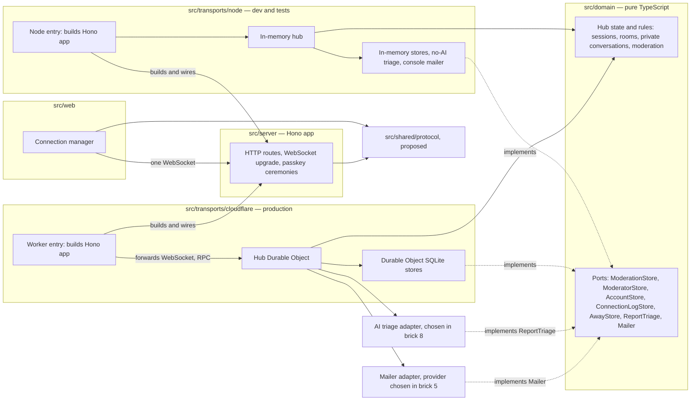

# Component diagram — platform — structure and dependencies

> **Feature**: platform (roadmap bricks 2, 6, 8)
> **Requirements**: ASV-NF-003, NF-009, NF-010
> **Related ADRs**: ADR-0002, ADR-0003, ADR-0007, ADR-0008, ADR-0010, ADR-0011

## Context

Folders of the single package and the direction of dependencies. Two transports adapt the same domain
and the same server. Does not cover the web modules (see `web-ui`).

## Diagram

## Notes

- Every arrow into `src/domain` is inbound. The domain imports nothing from other folders (lint rule).
- `src/server` never imports a transport. Each transport entry point builds the Hono app and plugs in its hub.
- Time and randomness are passed to domain functions as arguments (`now`, `random`), not as ports.
- Passkey verification (SimpleWebAuthn) lives in `src/server` and reaches stores only through the hub (ADR-0008).
- `src/shared/protocol` holds only message types and their validation schema. Confirmed in brick 2.
