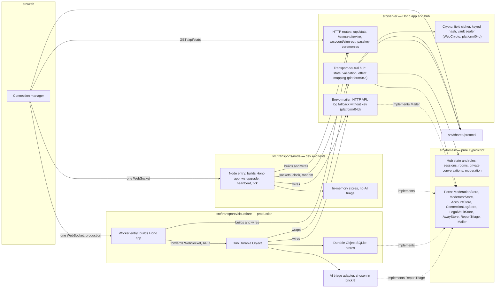

# Component diagram — platform — structure and dependencies

> **Feature**: platform (roadmap bricks 2, 7a, 9; adapters in 5 and 8)
> **Requirements**: ASV-NF-003, NF-009, NF-010, NF-011
> **Related ADRs**: ADR-0002, ADR-0013, ADR-0017, ADR-0003, ADR-0007, ADR-0008, ADR-0010, ADR-0011, ADR-0014

## Context

Folders of the single package and the direction of dependencies. Two transports adapt the same domain
and the same server. Does not cover the web modules (see `web-ui`).

## Diagram

## Notes

- Brick 5: the Brevo mailer and the crypto module live in `src/server` because both use only `fetch` and
  WebCrypto, available on Node and Workers. Each transport wires them with its secrets. Stores stay in
  memory on Node until brick 9 (ADR-0017).

- Every arrow into `src/domain` is inbound. The domain imports nothing from other folders (lint rule).
- Lint rule (ESLint `no-restricted-imports`): files in `src/domain` import only relative modules of
  `src/domain`: no package, no Node built-in, no path into `src/server`, `src/web`, `src/transports`
  or `src/shared`. Files in `src/server` may not import `src/transports`. Files in
  `src/shared/protocol` may import only `zod/mini`.
- **Hub placement** (brick 7a, owner choice D2, 485/500): the hub logic lives once in `src/server/hub.ts`
  (`platform/04c`). The Node entry and the Hub Durable Object only own sockets, clock, randomness and
  storage, and call it. The Node transport is wired in `platform/02-sequence-node-transport`.
- `src/server` never imports a transport. Each transport entry point builds the Hono app and plugs in its hub.
- Time and randomness are passed to domain functions as arguments (`now`, `random`), not as ports.
- The SQLite stores include the legal vault table behind `LegalVaultStore` (record, purgeExpired), added in brick 5 (ADR-0014).
- Passkey verification (SimpleWebAuthn) lives in `src/server` and reaches stores only through the hub (ADR-0008).
- `src/shared/protocol` holds only message types and their Zod Mini validation schemas (ADR-0015).
