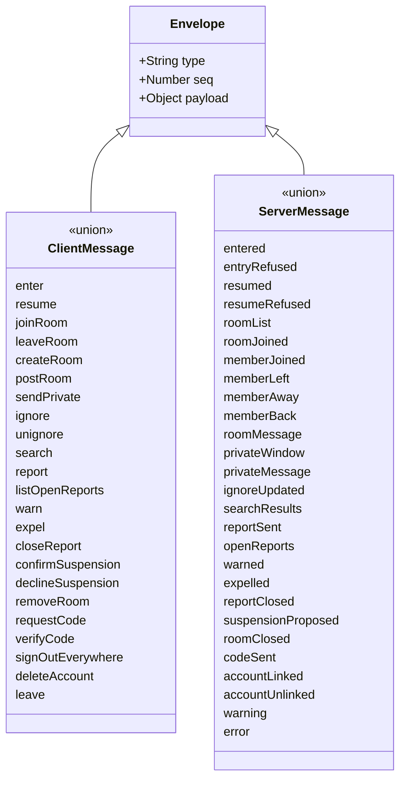

# Class diagram — platform — WebSocket protocol contract

> **Feature**: platform
> **Use cases**: all chat use cases
> **Related ADRs**: ADR-0007, ADR-0011

## Context

JSON messages exchanged over the single WebSocket, as a discriminated union on `type`. This is the
contract shared by client and server. Does not cover passkey ceremonies, which use HTTPS, or the
heartbeat, which is the raw text `ping` auto-answered `pong` (ADR-0011).

## Diagram

## Payloads (one line each)

Client to server:

| Type | Payload |
|---|---|
| enter | pseudo, gender?, age, city?, adultConfirmed, termsAccepted, moderatorGrant? |
| resume | resumeToken, profile (gender?, age, city?) |
| joinRoom / leaveRoom | roomId |
| createRoom | name |
| postRoom | roomId, text |
| sendPrivate | targetPseudo, text |
| ignore / unignore | targetSessionId |
| search | query |
| report | targetKind, targetPseudo?, targetRoomId?, reason, excerpt, context (≤ 20 lines) |
| listOpenReports | — |
| warn | targetSessionId, text (chat warning only, no strike; strikes come from `closeReport` with outcome warned, BR-074) |
| expel | targetSessionId, duration (1h, 24h, 7d), severe?, reportId? |
| closeReport | reportId, outcome |
| confirmSuspension / declineSuspension | accountId, reportId |
| removeRoom | roomId |
| requestCode | email, remember |
| verifyCode | code |
| signOutEverywhere / deleteAccount | — |
| leave | — |

Server to client:

| Type | Payload |
|---|---|
| entered | sessionId, resumeToken, roomList, isModerator, accountId?, staleDevice? |
| entryRefused | reason (rate, banned until, pseudo invalid, pseudo taken, age) |
| resumed | resumeToken, rooms, windows, buffered, accountId? |
| resumeRefused | — |
| roomList | rooms (id, name, kind, count) |
| roomJoined | roomId, members (sessionId, pseudo, gender, age, city, away) |
| memberJoined / memberLeft / memberAway / memberBack | roomId?, sessionId, pseudo |
| roomMessage | roomId, authorSessionId, pseudo, gender, text, sentAt |
| privateWindow | conversationId, other (sessionId, pseudo, gender, away) |
| privateMessage | conversationId, authorSessionId, text, sentAt |
| ignoreUpdated | ignored (session ids) |
| searchResults | results (sessionId, pseudo, gender, age, city, rooms, away) |
| reportSent | reportId |
| openReports | reports (with triage) |
| warned | rule, text, activeStrikes |
| expelled | until |
| reportClosed | reportId |
| suspensionProposed | accountId, reportId, activeStrikes |
| roomClosed | roomId |
| codeSent | — |
| accountLinked | accountId, deviceClaim? |
| accountUnlinked | — |
| warning / error | code, message, replyTo (seq) |

## Notes

- Every incoming message is validated against its schema before reaching the domain.
- `seq` lets the client match `warning` and `error` to the command that caused them.
- `error` codes include `offline` (private message target gone), `accountRequired`, `forbidden`, `invalid`.
- `entered` also carries `accountId` when a device cookie linked the session (ADR-0013).
- Two HTTPS routes complete the account flow: `POST /account/device` exchanges a device claim for the
  `HttpOnly` cookie, and `POST /account/sign-out` signs this device out and clears the cookie, since a
  WebSocket message cannot clear an `HttpOnly` cookie (ADR-0013).
