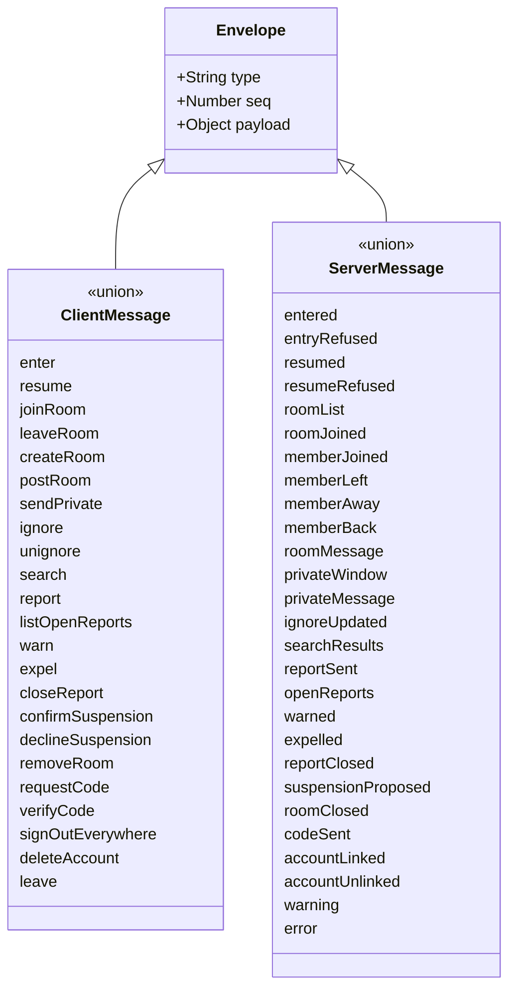

# Class diagram — platform — WebSocket protocol contract

> **Feature**: platform
> **Use cases**: all chat use cases
> **Related ADRs**: ADR-0007, ADR-0011

## Context

JSON messages exchanged over the single WebSocket, as a discriminated union on `type`. This is the
contract shared by client and server. Does not cover passkey ceremonies, which use HTTPS, or the
heartbeat, which is the raw text `ping` auto-answered `pong` (ADR-0011).

## Diagram

## Payloads (one line each)

Client to server:

| Type | Payload |
|---|---|
| enter | pseudo, gender?, age, city?, adultConfirmed, termsAccepted, moderatorGrant? |
| resume | resumeToken, profile (gender?, age, city?) |
| joinRoom / leaveRoom | roomId |
| createRoom | name |
| postRoom | roomId, text |
| sendPrivate | targetPseudo, text |
| ignore / unignore | targetSessionId |
| search | query |
| report | targetKind, targetPseudo?, targetRoomId?, reason, excerpt, context (≤ 20 lines) |
| listOpenReports | — |
| warn | targetSessionId, text (chat warning only, no strike; strikes come from `closeReport` with outcome warned, BR-074) |
| expel | targetSessionId, duration (1h, 24h, 7d), severe?, reportId? |
| closeReport | reportId, outcome |
| confirmSuspension / declineSuspension | accountId, reportId |
| removeRoom | roomId |
| requestCode | email, remember |
| verifyCode | code |
| signOutEverywhere / deleteAccount | — |
| leave | — |

Server to client:

| Type | Payload |
|---|---|
| entered | sessionId, resumeToken, roomList, isModerator, accountId?, staleDevice? |
| entryRefused | reason (rate, banned until, pseudo invalid, pseudo taken, age) |
| resumed | resumeToken, rooms, windows, buffered, accountId? |
| resumeRefused | — |
| roomList | rooms (id, name, kind, count) |
| roomJoined | roomId, members (member: see "Away member shape") |
| memberJoined / memberBack | roomId, member (so the members list shows age and city, brick 7a) |
| memberLeft / memberAway | roomId?, sessionId, pseudo |
| roomMessage | roomId, authorSessionId, pseudo, gender, text, sentAt |
| privateWindow | conversationId, other (member without age and city) |
| privateMessage | conversationId, authorSessionId, text, sentAt |
| ignoreUpdated | ignored (session ids) |
| searchResults | results (member + rooms) |
| reportSent | reportId |
| openReports | reports (with triage) |
| warned | rule, text, activeStrikes |
| expelled | until |
| reportClosed | reportId |
| suspensionProposed | accountId, reportId, activeStrikes |
| roomClosed | roomId |
| codeSent | — |
| accountLinked | accountId, deviceClaim? |
| accountUnlinked | — |
| warning / error | code, message, replyTo (seq) |

## Away member shape (issue #21, brick 7a owner choice D4, 470/500)

An away session has no profile (ADR-0011), so `member` is a union discriminated on `away`:

| `away` | Fields |
|---|---|
| `false` | sessionId, pseudo, gender, age, city? |
| `true` | sessionId, pseudo |

`otherChatter` (private windows) is the same union without age and city. The client keeps in memory the
last profile it saw for each session id, to colour an away pseudo with its `-away` token; a chatter never
seen connected shows in `--pseudo-unspecified-away` with "(absent)" (design pack). That memory is never
written to `sessionStorage`.

## Transport caps (issue #13, brick 7a owner choice D3, 475/500)

A frame over **65 536** bytes is cut by the transport (`ws` `maxPayload`, close 1009), and the hub refuses
any text over 65 536 UTF-16 code units with `error invalid`, so both transports apply the same cap. Each
string field is capped in the schema (`z.maxLength`, UTF-16 code units), with a margin over the business
limit so an honest client still gets the precise domain refusal (`tooLong`, `pseudoInvalid`) rather than a
generic `invalid`:

| Field | Business limit | Transport cap |
|---|---|---|
| any id (`roomId`, `sessionId`, `resumeToken`, `reportId`, `accountId`, `conversationId`) | — | 64 |
| `pseudo`, `targetPseudo` | 20 (BR-001) | 64 |
| `city` | 40 (BR-006) | 160 |
| room `text`, private `text`, `warn.text` | 500 code points (BR-020) | 2 000 |
| room `name` | 30 (BR-030) | 120 |
| `search.query` | — | 64 |
| `email` | 254 (RFC 5321) | 254 |
| `code` | 6 digits | 16 |
| `moderatorGrant` | — | 512 |
| `report.excerpt` | one message | 2 000 |
| `report.context` | 20 lines (BR-051) | 20 × 1 000 |

Worst case `report`: 2 000 + 20 × 1 000 code units plus envelope, about 44 KiB in UTF-8 for BMP text, under
the 64 KiB frame. Contract tests cover every cap at the limit and one over.

## HTTP routes

| Route | Response | Brick |
|---|---|---|
| `GET /api/stats` | `{ connected }`: number of sessions, connected and away; nothing else (D8, 450/500) | 7a |
| `POST /account/device`, `POST /account/sign-out` | see below | 5 |

## Notes

- Every incoming message is validated against its schema before reaching the domain.
- `seq` lets the client match `warning` and `error` to the command that caused them.
- `error` codes include `offline` (private message target gone), `accountRequired`, `forbidden` (command
  before `enter`), `invalid`, and `logUnavailable` (the connection or contribution line could not be written,
  the command was not applied, `rooms/02`, BR-060).
- `entered` also carries `accountId` when a device cookie linked the session (ADR-0013).
- Two HTTPS routes complete the account flow: `POST /account/device` exchanges a device claim for the
  `HttpOnly` cookie, and `POST /account/sign-out` signs this device out and clears the cookie, since a
  WebSocket message cannot clear an `HttpOnly` cookie (ADR-0013).
