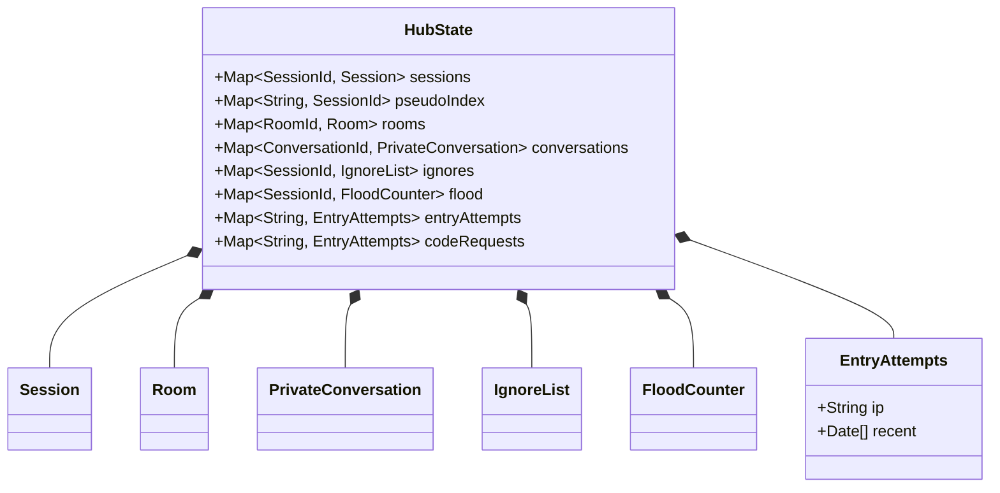

# Class diagram — platform — hub state aggregate

> **Feature**: platform
> **Related ADRs**: ADR-0007, ADR-0011
> **Business rules**: BR-002, BR-007, BR-021, BR-042

## Context

The single aggregate the domain functions take and return as `state`. Shows what lives in memory and
how it was to be rebuilt after hibernation (suspended by ADR-0020). Does not cover persisted records (see `moderation/04`, `entry/04`).

## Diagram

## Rebuild after hibernation (Cloudflare) — suspended by ADR-0020

Brick 9 runs the Hub Durable Object without hibernation (ADR-0020, BR-109): the hub state lives in memory, away
records included, and a deploy or restart empties it. The table below stays the target of ADR-0011, to be
restored by the follow-up that moves to hibernation.

| Part | Source on wake-up |
|---|---|
| Connected sessions (with connection id), pseudo index, ignore lists, room memberships, linked account ids | WebSocket attachments (`getWebSockets()`) |
| Accounts, devices, pending codes, e-mail blocks, strike carry-overs | Account store in hub storage (never held whole in memory) |
| Away sessions | Away records in storage |
| Official rooms | Configuration |
| User rooms | Derived from members' attachments and away records, which carry `{ id, name, ownerId }` of each user room (`rooms/07`) |
| Private conversations | Derived from attachments (open windows) and away records |
| Flood counters, entry attempts, code requests | Reset, accepted (ADR-0011) |

## Notes

- Domain functions are pure: `(state, command, now, random) → (newState, effects)`. Effects are messages
  to send, records to persist, alarms to set.
- `pseudoIndex` enforces BR-002 across connected and away sessions.
