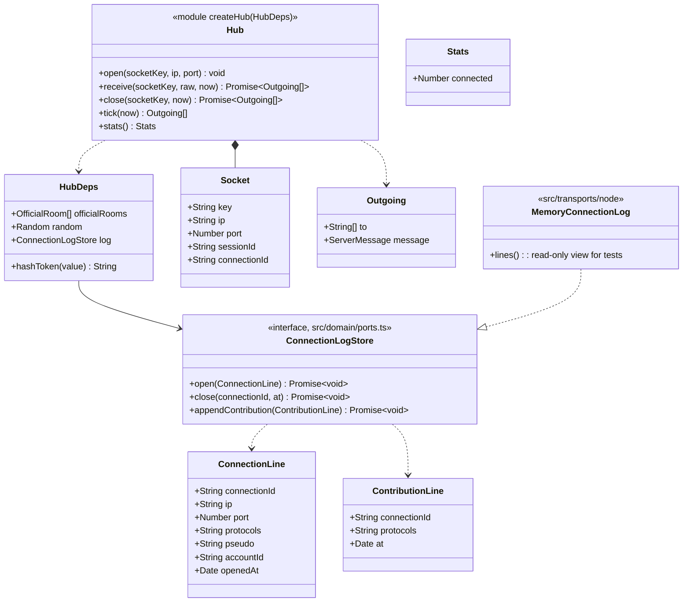

# Class diagram — platform — transport-neutral hub

> **Feature**: platform (roadmap brick 7a)
> **Use cases**: UC1, UC2, UC3, UC4, UC5, UC10, UC13
> **Business rules**: BR-001 to BR-034, BR-060
> **Related ADRs**: ADR-0002, ADR-0007, ADR-0011, ADR-0015; brick 7a owner choices D2 (485/500), D3, D4, D5 (455/500)

## Context

`src/server/hub.ts` holds the live hub state, validates incoming messages, calls the pure domain, writes
the connection log and maps domain effects to protocol messages for the right sockets. It knows no socket
API: transports give it socket keys and send what it returns. Written once, used by the Node transport
(brick 7a) and wrapped by the Hub Durable Object (brick 9). Does not cover private conversations,
accounts or moderation: those bricks add their commands here.

## Diagram

## Rules the code applies

- **One mutable place**: the hub keeps the current `HubState` (`emptyHubState(officialRooms)`) and a map
  socket key → `Socket`. Domain functions stay pure; the hub swaps in the returned state.
- **Incoming** (`receive`): text over 65 536 code units, invalid JSON or a message failing `clientMessage`
  → `error { code: "invalid", replyTo }` to the sender (`replyTo` when a `seq` could be read). The socket
  stays open.
- **Socket without session**: only `enter` and `resume` are accepted; anything else → `error forbidden`.
  `enter` or `resume` on a socket that already has a session → `error invalid`.
- **Commands of later bricks** (`sendPrivate`, `ignore`, `unignore`, `search`, `report`, moderation and
  account commands) → `error invalid` with message `notAvailable` until their brick wires them.
- **enter** (`entry/02a`): `activeBan` and `accountId` are absent until bricks 8 and 5. On `entered` the hub
  draws a connection id (`random.id()`), awaits `log.open`, stores session id and connection id on the
  socket, then sends `entered { sessionId, resumeToken, roomList, isModerator: false }`. If `log.open`
  fails, the hub calls `leave` for the new session and sends `error logUnavailable`.
- **resume** (`entry/02b`): the hub hashes the token with `hashToken` and passes `accountStillExists: true`
  until brick 5. On `resumed` it opens a new connection line like `enter`, then sends
  `resumed { resumeToken, rooms, windows: [], buffered }`, `rooms` built with `roomMembers` for each room of the
  session, and `memberBack` to the other connected members of each room.
- **leave**: `hub.leave`, `log.close` for the socket's connection id; the socket stays open without session,
  so the client can enter again.
- **Socket closed** (`close`): a connected session goes through `socketLost`; `log.close`; `memberAway` to
  the other connected members of each of its rooms. A socket without session is just forgotten.
- **Contribution first** (`rooms/02`, BR-060, D5): for `postRoom` and `createRoom` the hub computes the
  domain result, awaits `log.appendContribution` (connection id, protocols, now) when the result holds
  `roomMessage` or `roomCreated`, and only then keeps the new state and sends. If the write fails, the old
  state is kept and the sender gets `error logUnavailable`. The content id, operation and date fields are
  added only under an injunction (BR-060): not in brick 7a.
- **Effect mapping**:

| Domain effect | Sent | To |
|---|---|---|
| `entryRefused` | `entryRefused { reason, bannedUntil? }` | sender |
| `invalid` | `error { code: "invalid" }` | sender |
| `resumeRefused` | `resumeRefused` | sender |
| `roomJoined` | `roomJoined { roomId, members }` from `roomMembers` | the joiner |
| `memberJoined` / `memberLeft` | presence `{ roomId, sessionId, pseudo }` | connected members of the room except the subject |
| `wentAway` | `memberAway` per room of the session | connected members of each room except the subject |
| `resumed` | `memberBack` per room of the session | same |
| `roomMessage` | `roomMessage { …, gender, sentAt }`, gender from the author's profile | `recipients` |
| `roomRefused` | `warning { code: reason, message: reason, replyTo }` | sender |
| `roomCreated`, `roomDeleted`, `closed` | nothing of their own | — |

- **Member shape** (D4): `roomMembers` sessions map to the protocol `member` union: a connected session gives
  `{ away: false, sessionId, pseudo, gender, age, city? }` (city omitted when empty), an away session
  `{ away: true, sessionId, pseudo }`.
- **Room list**: after every command or tick that changed membership or the set of rooms, the hub sends
  `roomList` to every connected session. Fine at V1 traffic; to batch in the Durable Object if needed
  (brick 9).
- **tick(now)**: `expireAway` (sends the resulting `memberLeft`), `pruneFlood`, `pruneEntryAttempts`.
- **stats()**: `connected` = number of sessions, connected and away. No pseudo, no list (`GET /api/stats`).
- **Memory connection log** (Node, D5): keeps lines in memory only, never on disk, at most the last 10 000;
  enough for development and tests. The SQLite store with the 1-year retention arrives in brick 9.
- **Protocols** field: `"HTTP/1.1 WebSocket"` on Node (`ws` on plain HTTP in development); the Cloudflare
  transport passes its own value.
- `src/domain/ports.ts` declares only types (ports), so the dependency rule holds: `src/server` imports
  `src/domain` and `src/shared/protocol`, never a transport.
