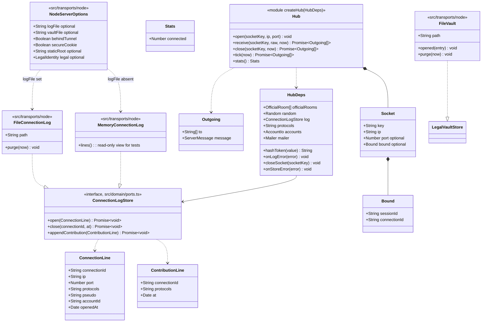
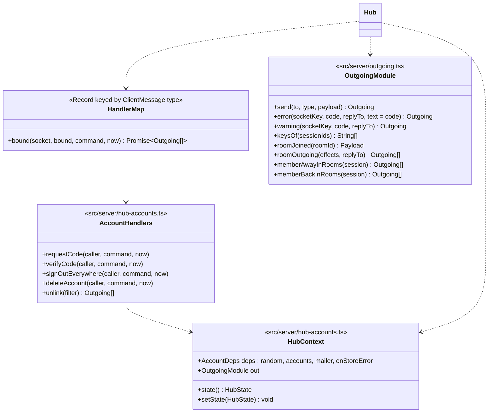

# Class diagram — platform — transport-neutral hub

> **Feature**: platform (roadmap brick 7a)
> **Use cases**: UC1, UC2, UC3, UC4, UC5, UC10, UC13
> **Business rules**: BR-001 to BR-034, BR-060, BR-084 to BR-086
> **Related ADRs**: ADR-0002, ADR-0007, ADR-0011, ADR-0015, ADR-0018; brick 7a owner choices D2 (485/500), D3, D4, D5 (455/500)

## Context

`src/server/hub.ts` holds the live hub state, validates incoming messages, calls the pure domain, writes
the connection log and maps domain effects to protocol messages for the right sockets. It knows no socket
API: transports give it socket keys and send what it returns. Written once, used by the Node transport
(brick 7a) and wrapped by the Hub Durable Object (brick 9). Does not cover private conversations
or moderation: those bricks add their commands to the handler map.

## Diagram

## Modules (issues #25, #36)

The hub is split by command group, all behind the same `createHub(HubDeps)`:

| Module | Holds |
|---|---|
| `src/server/hub.ts` | live state, sockets, serial queue, `receive`/`close`/`tick`, entry commands (`enter`, `resume`, `leave`), rooms commands, and the **handler map** |
| `src/server/outgoing.ts` | effect mapping: `sessionOf`, `toMember`, `send`, `error`, `warning`, `keysOf`, `roomJoined`, `roomOutgoing` (with the `roomList` broadcast), `memberAwayInRooms`, `memberBackInRooms` |
| `src/server/hub-private.ts` | brick 6 commands (`sendPrivate`, `closePrivate`, `ignore`, `unignore`, `search`), contribution first for `sendPrivate`, and the private presence of `close`, away and resume |
| `src/server/hub-accounts.ts` | account commands (`requestCode`, `verifyCode`, `signOutEverywhere`, `deleteAccount`) and their `warning unavailable` guard (`platform/04d`) |

- **Handler map**: every `ClientMessage['type']` except `enter` and `resume` has an entry, so the type
  checker refuses a missing command. `enter` and `resume` are handled before the map because they need a
  socket without session. Commands of later bricks map to one `notAvailable` handler.
- **Error text** defaults to the code (`error(key, "forbidden")` sends `message: "forbidden"`); only
  `frameTooLarge` and `notAvailable` pass a different text.
- Each account handler is wrapped in the same guard: a store failure answers `warning unavailable` and
  commits nothing. `unlink` also serves `signOutDevice`.

## Rules the code applies

- **Tester exposure files (ADR-0018, BR-084)**: `FileVault` and `FileConnectionLog` close, when they are built,
  every account and connection a previous process left open; the transport runs `purge` on both files at start-up and once a day, since the hub tick
  calls `purgeExpired` every second. With the tunnel flag the transport refuses to start without every
  ADR-0017 key or off loopback (BR-085).

- **Serial**: `receive`, `close` and `tick` run one after the other (a promise queue), so an awaited log
  write never lets another operation see a stale state; an operation that throws does not block the next.
- **One mutable place**: the hub keeps the current `HubState` (`emptyHubState(officialRooms)`) and a map
  socket key → `Socket`. Domain functions stay pure; the hub swaps in the returned state.
- **Incoming** (`receive`): text over 65 536 code units → `error { code: "invalid", message: "frameTooLarge" }`;
  invalid JSON or a message failing `clientMessage` → `error { code: "invalid", message: "invalid", replyTo }`
  (`replyTo` when a `seq` could be read). The socket stays open. An unknown socket key yields nothing.
- **Socket binding**: `bound` (session id and connection id) is set once `log.open` succeeds and cleared on
  `leave`; a socket without `bound` has no session.
- **Socket without session**: only `enter` and `resume` are accepted; anything else → `error forbidden`.
  `enter` or `resume` on a socket that already has a session → `error invalid`.
- **Commands of later bricks** (`report` and moderation commands) → `error invalid` with message `notAvailable` until their brick wires them.
- **enter** (`entry/02a`): `activeBan` and `accountId` are absent until bricks 8 and 5. On `entered` the hub
  draws a connection id (`random.id()`), awaits `log.open`, stores session id and connection id on the
  socket, then sends `entered { sessionId, resumeToken, roomList, isModerator: false }`. If `log.open`
  fails, the new state is dropped (the pseudo stays free) and the sender gets `error logUnavailable`; a
  failed resume likewise leaves the session away.
- **resume** (`entry/02b`): the hub hashes the token with `hashToken` and passes `accountStillExists: true`
  until brick 5. If the token matches a connected session still bound to another socket (not swept
  yet), that socket is unbound first as on `close` (`socketLost`, `log.close`), then `closeSocket` asks the
  transport to close it (the displaced page still pings); `memberAway` is sent only if
  the resume then fails. On `resumed` it opens a new connection line like `enter`, then sends
  `resumed { sessionId, pseudo, resumeToken, rooms, windows, buffered }` (brick 6: `windows` from `windowsOf`, `buffered` from the domain effect), `rooms` built with `roomMembers` for each room of the
  session, then `roomList` to the resumer only (its list is stale after the loss), then `memberBack` to the
  other connected members of each room, then `privateWindow` (the resumer as `other`) to each connected
  partner whose window on it is open.
- **leave**: `hub.leave`, `log.close` for the socket's connection id; the socket stays open without session,
  so the client can enter again.
- **Socket closed** (`close`): a connected session goes through `socketLost`; `log.close`; `memberAway` to
  the other connected members of each of its rooms, and `memberAway` without `roomId` to each connected
  partner whose window on it is open. A socket without session is just forgotten.
- **Contribution first** (`rooms/02`, BR-060, D5): for `postRoom` and `createRoom` the hub computes the
  domain result, awaits `log.appendContribution` (connection id, protocols, now) when the result holds
  `roomMessage` or `roomCreated`, and only then keeps the new state and sends. If the write fails, the old
  state is kept and the sender gets `error logUnavailable`. The content id, operation and date fields are
  added only under an injunction (BR-060): not in brick 7a. Brick 6: `sendPrivate` follows the same rule
  when the result holds `privateMessage` (`private-conversations/02`).
- **Log failures**: every failed write goes to `onLogError` for the operator. A failed `log.open` or
  `appendContribution` also refuses the command (`logUnavailable`); a failed `log.close` never refuses the
  close or the leave.
- **Effect mapping**:

| Domain effect | Sent | To |
|---|---|---|
| `entryRefused` | `entryRefused { reason, bannedUntil? }` | sender |
| `invalid` | `error { code: "invalid" }` | sender |
| `resumeRefused` | `resumeRefused` | sender |
| `roomJoined` | `roomJoined { roomId, members }` from `roomMembers` | the joiner |
| `memberJoined` | `memberJoined { roomId, member }` | connected members of the room except the subject |
| `memberLeft` | presence `{ roomId, sessionId, pseudo }` | same |
| `wentAway` | `memberAway` presence per room of the session | connected members of each room except the subject |
| `resumed` | `memberBack { roomId, member }` per room of the session | same |
| `roomMessage` | `roomMessage { …, gender, sentAt }`, gender from the author's profile | `recipients` |
| `roomRefused` | `warning { code: reason, message: reason, replyTo }` | sender |
| `privateRefused` | `error { code }` for `accountRequired` and `offline`, else `warning { code: reason }`, with `replyTo` | sender |
| `privateWindowOpened` | `privateWindow { conversationId, other }`, `other` = the other side as `otherChatter` | that side |
| `privateMessage` | `privateMessage { conversationId, authorSessionId, text, sentAt }` | `recipients` |
| `ignoreUpdated` | `ignoreUpdated { ignored }` | the session |
| `partnerLeft` | `memberLeft { sessionId, pseudo }` without `roomId` | `recipients` |
| search hits (`directory/07`) | `searchResults { results }` with `rooms` per hit | the searcher |
| `roomCreated`, `roomDeleted`, `closed` | nothing of their own | — |

- **Member shape** (D4): `roomMembers` sessions map to the protocol `member` union: a connected session gives
  `{ away: false, sessionId, pseudo, hasAccount, gender, age, city? }` (city omitted when empty), an away
  session `{ away: true, sessionId, pseudo, hasAccount }`. `hasAccount` is `accountId !== undefined`
  (brick 6).
- **Room list**: after every command or tick that changed membership or the set of rooms, the hub sends
  `roomList` to every connected session. Fine at V1 traffic; to batch in the Durable Object if needed
  (brick 9).
- **tick(now)**: `expireAway` (sends the resulting `memberLeft`), `pruneFlood`, `pruneEntryAttempts`.
- **stats()**: `connected` = number of sessions, connected and away. No pseudo, no list (`GET /api/stats`).
- **Memory connection log** (Node, D5): keeps lines in memory only, never on disk, at most the last 10 000;
  enough for development and tests. The SQLite store with the 1-year retention arrives in brick 9.
- **Protocols** field: `"HTTP/1.1 WebSocket"` on Node (`ws` on plain HTTP in development); the Cloudflare
  transport passes its own value.
- `src/domain/ports.ts` declares only types (ports), so the dependency rule holds: `src/server` imports
  `src/domain` and `src/shared/protocol`, never a transport.
