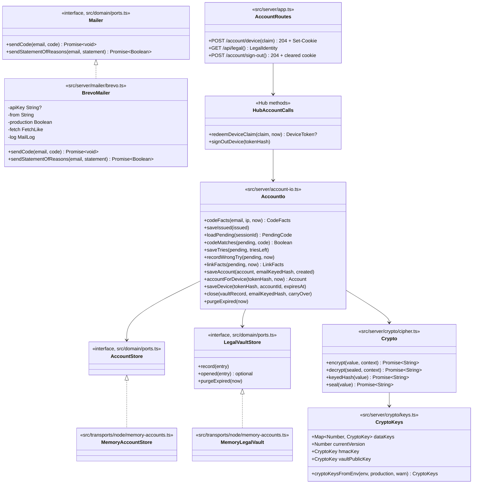

# Class diagram — platform — mailer, crypto and account routes

> **Feature**: platform (brick 5)
> **Use cases**: UC17, UC18, UC19
> **Business rules**: BR-070 to BR-073, BR-083
> **Related ADRs**: ADR-0013, ADR-0014, ADR-0017

## Context

The server-side pieces brick 5 adds around the hub: the Brevo mailer (reused from brasse-bouillon), the
crypto module, the in-memory account and vault stores of the Node transport, and the two HTTPS account
routes. The hub's account commands live in `src/server/hub-accounts.ts` (`platform/04c`, issue #36). Does not cover the domain rules (see `accounts`) or the Durable Object stores (brick 9).

## Diagram

## Rules the code applies

- **BrevoMailer** is the brasse-bouillon `MailerService` reduced to asv's two messages: `POST
  https://api.brevo.com/v3/smtp/email` with `api-key`, sender `asv <ASV_MAIL_FROM>`, French plain text
  and minimal HTML, 8-second timeout. It never throws: a non-2xx answer logs the allow-listed Brevo
  `code` and a scrubbed `message`; a network error logs the scrubbed error. Never the address, never the
  raw body. Without a key outside production it logs the subject and the code (dev only) and resolves;
  in production without a key it logs a send failure. `sendStatementOfReasons` resolves `true` only on
  a 2xx answer.
- **Crypto** (`encrypt`/`decrypt`): AES-256-GCM, random 12-byte IV, `context` (record id and field name) as additional
  data, output `v<version>.<iv>.<ciphertext>` in base64url. Decryption picks the key by version and fails
  on any unknown version or tampered value.
- **Crypto.keyedHash**: HMAC-SHA-256 with `ASV_HMAC_KEY`, base64url. E-mails are trimmed and lower-cased first.
  The six-digit code hash includes the session id so the same code in two sessions hashes differently.
- **Crypto.seal**: ephemeral ECDH P-256 key pair per value, shared secret with `ASV_VAULT_PUBLIC_KEY`,
  HKDF-SHA-256 (info `asv-vault-v1`) to an AES-256-GCM key; output `e1.<ephemeral public key>.<iv>.<ciphertext>`.
  No unseal method exists in the application; the owner opens values offline with the private key.
- **CryptoKeys.fromEnv**: `ASV_DATA_KEYS` is `version:base64key` pairs separated by commas, the highest
  version encrypts. In production every variable is required; in development missing ones are generated
  for the process lifetime with a warning (values then die with the process, like the in-memory stores).
- **Account routes**: both check the `Origin` header against the allowed origins (as the WebSocket
  upgrade does) and answer 403 otherwise. Every response carries the BR-086 headers (Hono `secureHeaders`,
  HSTS only with `secureCookie`). `/api/legal` returns the owner identity of the legal pages from the
  environment (ADR-0018), never stored in the bundle. `/account/device` takes `{ claim }`, asks the hub to redeem it
  and sets `asv_device=<token>; HttpOnly; Secure; SameSite=Lax; Path=/; Max-Age=2592000` (no `Secure`
  only on plain `http://127.0.0.1` in development). An unknown or expired claim answers 400.
  `/account/sign-out` hashes the cookie, calls `signOutDevice`, and always clears the cookie (204).
  Both answer `Cache-Control: no-store`.
- **WebSocket upgrade**: the transport reads `asv_device` from the upgrade request, hashes it with
  the transport's token hash (`random.hashToken`, as for resume tokens) and passes the hash to the hub with the IP, as `entry/02a` shows. The raw token never
  reaches the hub.
- **AccountIo** is the only place where the hub's clear values meet the stores: it computes keyed hashes,
  encrypts e-mails with the record context (`account:<id>:email`, `code:<sessionId>:email`), decrypts on
  load, compares the code hash in constant time, and seals the e-mail for the vault. `close` writes the
  vault record first, then deletes the account and its devices, then saves the carry-over. Every store
  error propagates to the hub, which answers `warning unavailable` and calls `onStoreError`.
- **Memory stores** implement the ports with `Map`s and receive already encrypted or hashed values. They
  apply the expiry rules in `purgeExpired(now)`, called by the existing sweep.
