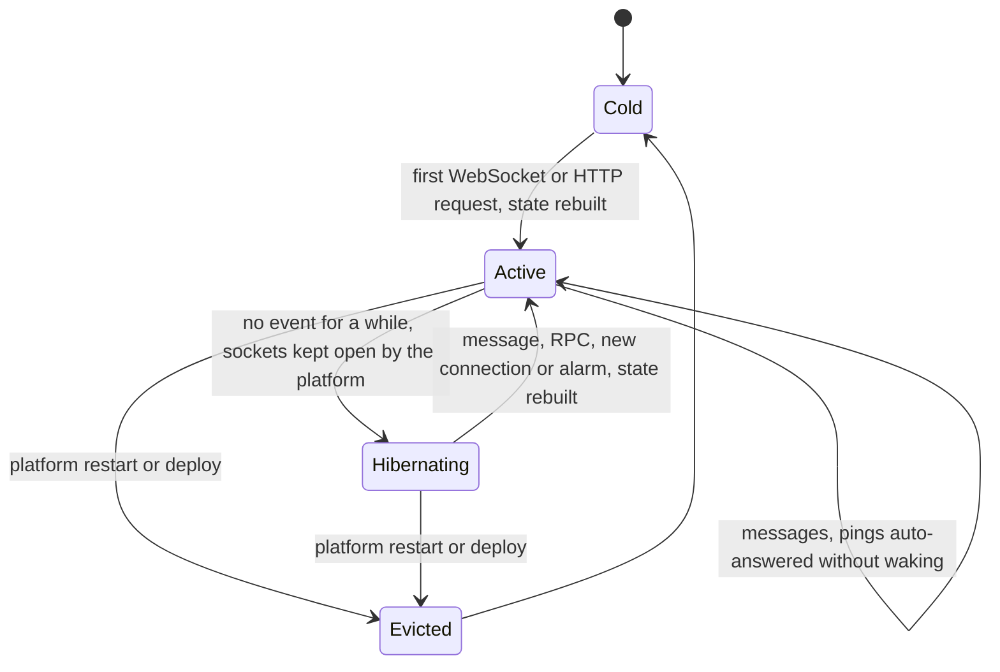

# State diagram — platform — hub lifecycle on Cloudflare

> **Feature**: platform
> **Related ADRs**: ADR-0007, ADR-0009, ADR-0011

## Context

How the Hub Durable Object lives with WebSocket hibernation and its single alarm. The Node hub simply
runs while the process runs. Does not cover the domain state inside the hub (see `04b-class-hub-state`).

## Diagram

## Alarm

One alarm is always set to the earliest of:

1. the next away deadline (expire the session, ADR-0009);
2. the next heartbeat sweep, every 60 seconds while sockets exist: close sockets whose last auto-response
   is older than 60 seconds;
3. the next daily retention purge (BR-060 to BR-062).

## Notes

- `ping` is auto-answered `pong` without waking the hub (ADR-0011).
- An eviction closes every socket. Connected sessions become lost: clients reconnect and resume only if an
  away record exists, otherwise they re-enter. Accepted for V1.
