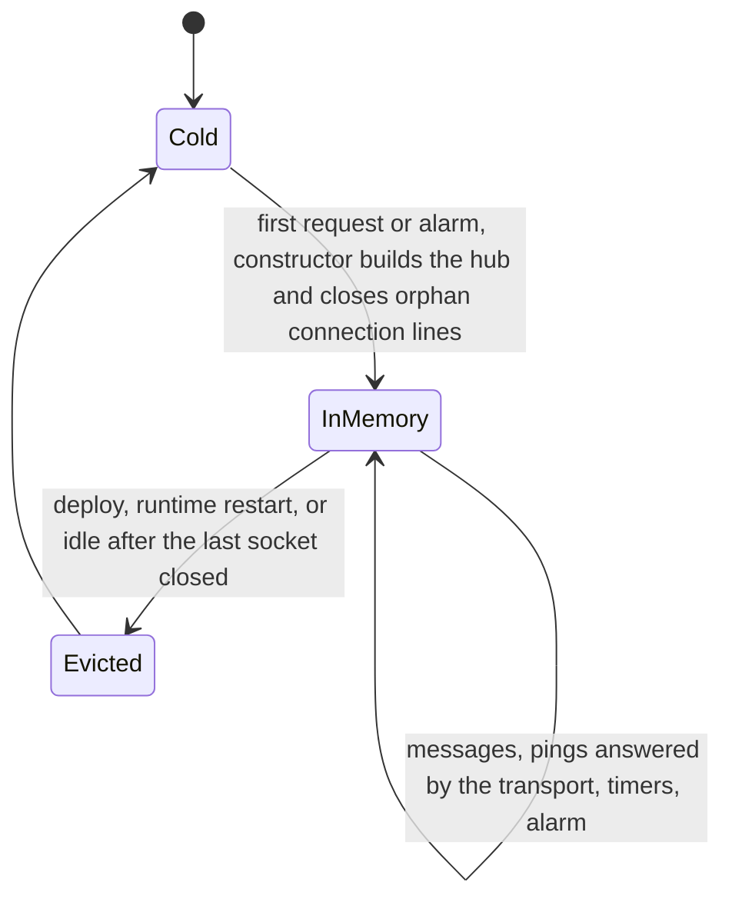

# State diagram — platform — hub lifecycle on Cloudflare

> **Feature**: platform
> **Related ADRs**: ADR-0007 (amended), ADR-0009, ADR-0011 (amended), ADR-0020
> **Business rules**: BR-109, BR-110

## Context

How the Hub Durable Object lives without hibernation (ADR-0020 D1, BR-109) and with its single alarm. The Node
hub simply runs while the process runs. Does not cover the domain state inside the hub (see `04b-class-hub-state`).

## Diagram

## Alarm

One alarm is always set to the earliest of:

1. the next due retry, every 10 minutes while an authority alert, a decision e-mail or a statement of reasons is
   pending (BR-076, BR-104, BR-107);
2. the next daily run: retention purge (BR-060 to BR-062, legal vault BR-081, access entries BR-082, expiries of
   BR-070 to BR-080, BR-105).

Away deadlines are not alarms: while the object is in memory the hub `tick` expires away sessions (ADR-0009), and
the alarm may run with no socket open.

## Notes

- Heartbeat: the transport answers `ping` itself with `pong` (BR-088; the auto-response API exists only for
  hibernating sockets). While sockets exist, a sweep every 15 seconds, as on the Node transport (`platform/02`),
  closes sockets with no frame for more than 60 seconds (ADR-0011 point 3).
- The constructor runs inside `blockConcurrencyWhile` before any socket is accepted: it migrates the schema and
  closes every open connection line at its start time (BR-109).
- An eviction closes every socket and drops everything in memory (BR-109). Clients reconnect and re-enter; a
  member signs back in through the device cookie. Accepted for V1.
