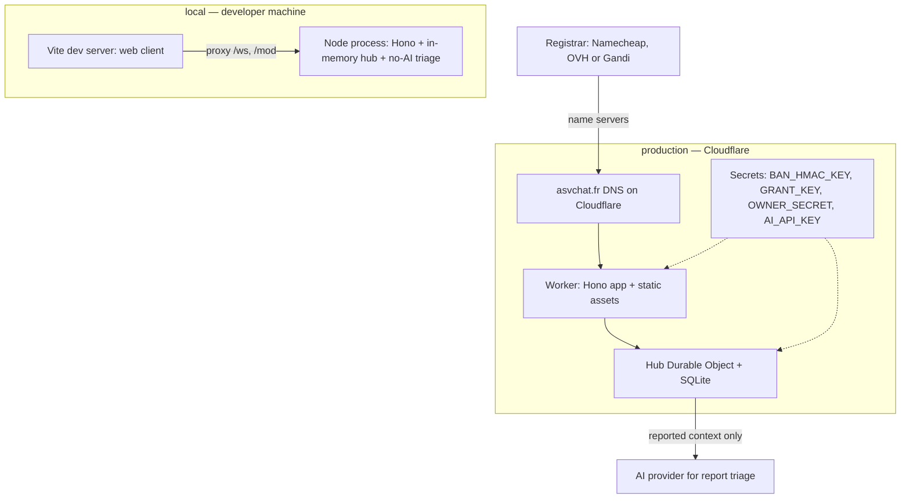

# Deployment diagram — platform — environments

> **Feature**: platform
> **Requirements**: ASV-NF-003
> **Related ADRs**: ADR-0001, ADR-0002, ADR-0007, ADR-0008, ADR-0010

## Context

Where each part runs in local development and in production. Mermaid has no native deployment diagram,
so nodes are drawn as nested boxes. Does not cover CI pipelines.

## Diagram

## Notes

- A staging environment (separate Worker and Durable Object namespace) is added before public launch,
  following the owner's environments convention.
- Exit door: the Node process can be containerised and run elsewhere (ADR-0002).
- Secret names are proposals for brick 8. Values live in Wrangler secrets, never in the repo.
