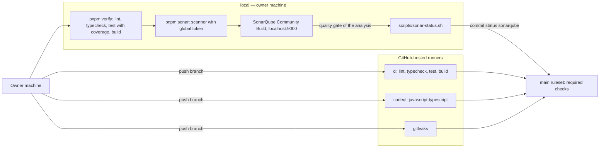

# Data-flow diagram — platform — checks before merge

> **Feature**: platform (roadmap brick 2)
> **Requirements**: ASV-NF-009, NF-010
> **Related ADRs**: ADR-0003, ADR-0015, ADR-0016

## Context

Which checks run where, and what the `main` ruleset requires. Does not cover deployment (brick 9,
see `07-deployment`).

## Diagram

## Notes

- No self-hosted runner: no code from a pull request runs on the owner's machine unless the owner
  checks it out (ADR-0016).
- The SonarQube token never leaves the machine. The status is posted with the owner's `gh` login.
- Lint enforces the dependency rule with ESLint `no-restricted-imports` (see `03-component`).
