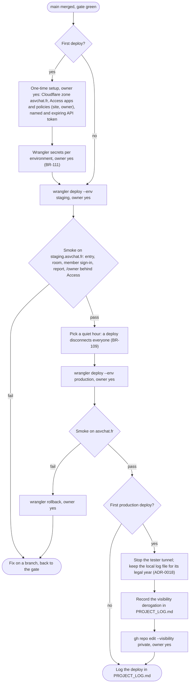

# Activity diagram — platform — deploy to staging and production, then the private switch

> **Feature**: platform (roadmap brick 9, issue #233)
> **Business rules**: BR-109, BR-111, BR-113
> **Related ADRs**: ADR-0018, ADR-0020

## Context

The owner-run procedure from a merged, green `main` to asvchat.fr, including the one-time setup and the switch
of the repository to private. Every step marked "owner yes" waits for the owner's explicit approval in chat.

## Diagram

## Notes

- Staging and production have separate Durable Object namespaces, so staging data never meets production
  data. Staging secrets are distinct values.
- The derogation reason: production holds a live chat with moderation, the legal vault and DPIA material;
  publishing the running code's history is no longer wanted.
