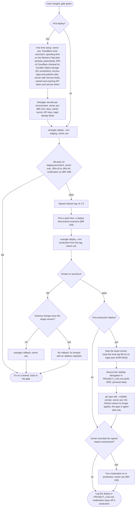

# Activity diagram — platform — deploy to staging and production, then the private switch

> **Feature**: platform (roadmap brick 9, issue #233)
> **Business rules**: BR-108, BR-109, BR-111, BR-113
> **Related ADRs**: ADR-0018, ADR-0020

## Context

The owner-run procedure from a merged, green `main` to asvchat.fr, including the one-time setup and the switch
of the repository to private. Every step marked "owner yes" waits for the owner's explicit approval in chat.

## Diagram

## Notes

- Staging and production have separate Durable Object namespaces, so staging data never meets production
  data. Staging secrets are distinct values. The staging allow-list is the owner only; the production one is
  the owner and the testers (BR-113).
- Production runs from the signed release tag, never from a branch. A rollback is allowed only when no schema
  change landed since the target version; migrations are additive only.
- The derogation reason: ADR-0005 of the owner's global rules (repository visibility), category "personal
  data": production holds accounts, moderation records, the legal vault and impact assessment material.
- One-time setup sets `workers_dev: false` and `preview_urls: false` per environment, and the Access
  application audience used by the Worker to verify `Cf-Access-Jwt-Assertion` (BR-113).
