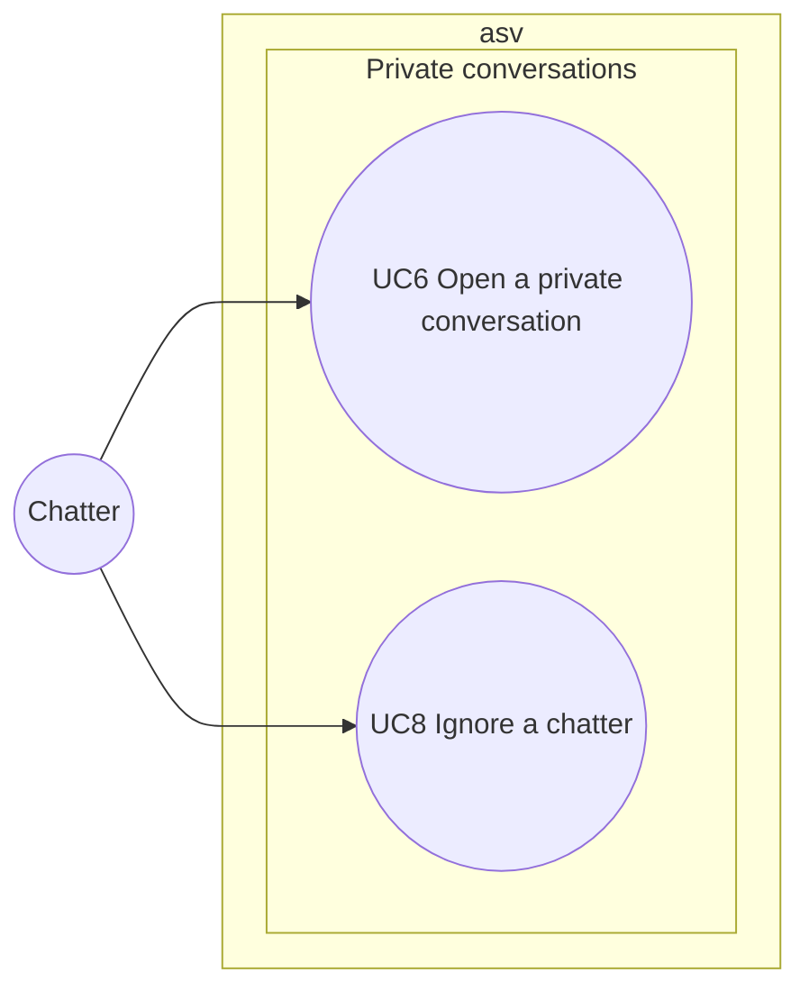

# Use case diagram — private-conversations — talk privately, ignore

> **Feature**: private-conversations (roadmap brick 6)
> **Requirements**: ASV-F-008, F-010, F-014 (away buffer only), F-020
> **Business rules**: BR-040 to BR-043, BR-013, BR-021
> **Related ADRs**: ADR-0005, ADR-0009, ADR-0012

## Context

One-to-one conversations between strangers and the ignore protection. Does not cover finding someone
(see `directory`) or reporting (see `moderation`).

## Diagram

## Use case specs

**UC6 — Open a private conversation** (planned)
- Preconditions: both chatters' sessions are linked to an account (ADR-0012). If the sender has none, the
  client starts UC17 first. A target without an account cannot receive private messages, and the
  "private message" entry is greyed on their pseudo.
- Main scenario: 1. Chatter clicks a pseudo (room list or search result) and types a first message.
  2. System checks length, flood and window limit (BR-020, BR-021, BR-043). 3. System opens a window on
  both sides with the message.
- Extensions:
  - 2a. Limits exceeded → refused with a warning.
  - 3a. Target ignores the sender → sender's window opens, message silently dropped (BR-041).
  - 3b. Target is away → message buffered (BR-013), the window shows "absent".
  - 3c. Target gone → `error` with code `offline`.
- Replies follow the same path inside the open window.
- Alternative (D1, BR-043): the chatter closes a window, which frees a slot. The other side is not told; a
  new message reopens the window on both sides.
- Extensions: 2b. More than 10 open windows → refused with `tooManyWindows`. 2c. Target is the sender →
  refused. 3d. The other chatter goes away, comes back or leaves → the window shows it.
- Extension (ASV-F-024): signing out of the account or deleting it closes the chatter's windows; the
  other side's next message gets `accountRequired`.

**UC8 — Ignore a chatter** (planned)
- Main scenario: 1. Chatter picks "ignore" on a pseudo. 2. System adds that chatter's session id to the
  ignore list and confirms with `ignoreUpdated`. 3. The ignored chatter's room messages and private
  messages are hidden both ways (BR-042).
- Alternative: the chatter removes the ignore during the same session.
- Extension: 2a. The list already holds 100 chatters (BR-044) → nothing changes.

## Notes

- "Receive a private message" is the trigger of UC6 on the other side, not a use case.
