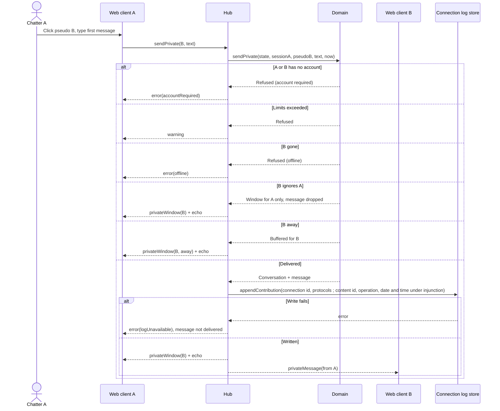

# Sequence diagram — private-conversations — open and reply

> **Feature**: private-conversations
> **Use cases**: UC6, UC8
> **Business rules**: BR-040 to BR-043, BR-060
> **Related ADRs**: ADR-0007, ADR-0009, ADR-0014

## Context

Both chatters hold their single socket to the hub. Does not cover the away buffer delivery, shown in
`entry/02b`.

## Diagram

## Notes

- The conversation is keyed by both session ids sorted, so replies use the same window.
- The contribution line is written for every accepted message, also when it is buffered for an away chatter or
  dropped by an ignore, and never holds the text (BR-060). The content id, operation, date and time are added only
  under a Prime Minister's injunction. Only the delivered branch is drawn.
- The line is written before delivery. If the write fails, the message is refused and not delivered.
- The ignored chatter is never told (Caramail behaviour, avoids escalation).
