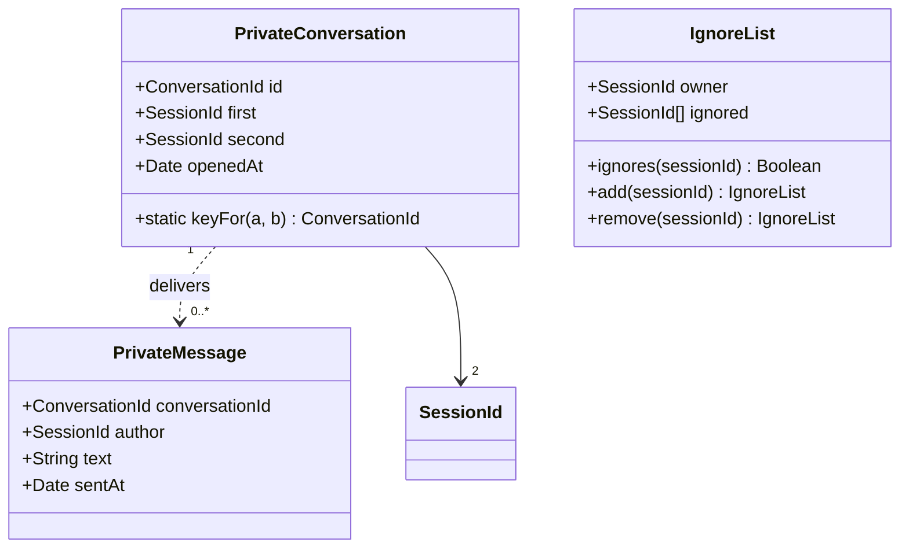

# Class diagram — private-conversations — conversations and ignore

> **Feature**: private-conversations
> **Business rules**: BR-040 to BR-043

## Context

Private conversation model in the hub state. Does not cover sessions (see `entry`).

## Diagram

## Notes

- Messages are delivered and forgotten, except the away buffer on the session (BR-013).
- `IgnoreList` belongs to the session and dies with it. It holds session ids, not pseudos, so a newcomer
  who takes a freed pseudo does not inherit someone else's ignore.
