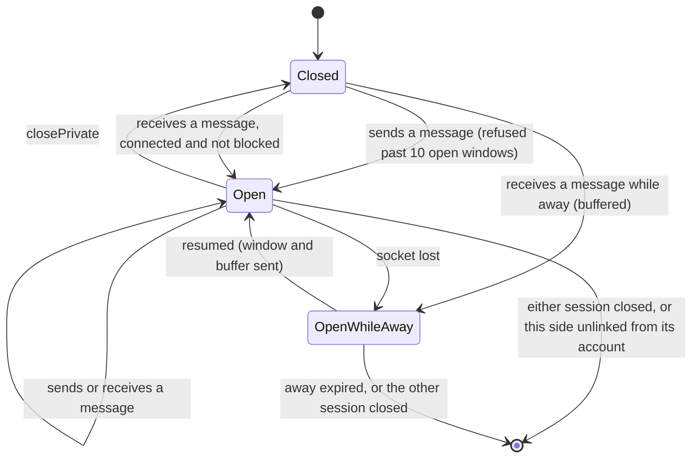

# State diagram — private-conversations — one side of a conversation

> **Feature**: private-conversations (roadmap brick 6)
> **Use cases**: UC6, UC8
> **Business rules**: BR-013, BR-041 to BR-043; brick 6 owner choice D1 (450/500)

## Context

The server-side life of one chatter's window on a conversation (`openFor` in `private-conversations/07`).
The client view of the same window is in `web-ui/07`. Does not cover the session itself (see `entry/05`).

## Diagram

## Notes

- A message between chatters where one ignores the other opens only the sender's side and is dropped for
  the other (BR-041); nothing is buffered.
- The conversation itself disappears when both sides are closed or when either session ends.
- A side that closes is not told to the other one (D1). The other side learns that the chatter went away,
  came back or left through presence messages without `roomId`.
