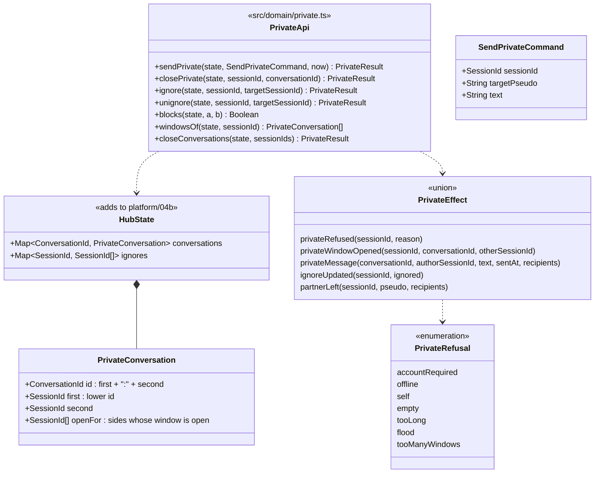

# Class diagram — private-conversations — domain API

> **Feature**: private-conversations (roadmap brick 6)
> **Use cases**: UC6, UC8
> **Business rules**: BR-013, BR-020, BR-021, BR-040 to BR-043, BR-060
> **Related ADRs**: ADR-0005, ADR-0009, ADR-0011, ADR-0012; brick 6 owner choice D1 (`closePrivate`, 450/500)

## Context

The pure functions of `src/domain/private.ts` and how they hook into the session close of `src/domain/hub.ts`,
like `entry/07` and `rooms/07`. Each function returns `{ state, effects }`; the hub maps effects to
messages (`platform/04c`). Does not cover search (see `directory/07`) or the client (see `web-ui/07`).

## Diagram

## Rules the code applies

- **sendPrivate** (UC6), checks in this order, the first failure wins:
  1. Sender not connected: no effect (the hub already refuses unbound sockets).
  2. Sender without account → `accountRequired` (BR-040; the client then opens the account panel).
  3. Target pseudo unknown (folded like `pseudoIndex`) → `offline`. Target is the sender → `self`.
  4. Target without account → `accountRequired`.
  5. Text trimmed empty → `empty`; over 500 code points → `tooLong` (BR-020).
  6. Flood: the shared counter of `rooms` (BR-021, 5 per 10 s across rooms and private) → `flood`.
  7. The conversation is not open for the sender and the sender already has 10 open windows →
     `tooManyWindows` (BR-043).
- On acceptance the flood counter counts the message, the conversation is created if missing (id
  `first:second`, sorted session ids) and the sender's side is opened (`privateWindowOpened` for the sender
  when it was closed).
- **Delivery**, against the target:
  - `blocks(sender, target)`: either one ignores the other (BR-041, BR-042) → `privateMessage` to the
    sender only (echo). The target's window is not opened and nothing is buffered.
  - Target away → the message goes to the target's away buffer (`bufferPrivate`, BR-013, oldest dropped
    past 50), the target's side is opened without effect (it comes back in `resumed.windows`), and the
    sender gets `privateMessage` (echo).
  - Target connected → the target's side is opened (`privateWindowOpened` for the target when it was
    closed, also past its own 10 windows: the cap limits what a chatter opens, not what it receives), then
    `privateMessage` to both.
- Every accepted message, also dropped or buffered, yields exactly one `privateMessage` effect, so the hub
  writes one contribution line per accepted message (BR-060, `private-conversations/02`).
- **closePrivate** (D1): removes the caller from `openFor`; the conversation is deleted when no side is
  open. Unknown id or a side already closed: no effect. The other side is not told; a new message reopens
  the window on both sides.
- **ignore / unignore** (UC8): the target must be another existing session, else no effect. The list holds
  session ids (`private-conversations/04`), at most 100 per session (bounded memory; past it, no effect).
  Both answer `ignoreUpdated { sessionId, ignored }` with the full list. Ignoring does not close windows:
  messages are just dropped both ways.
- **Rooms** (BR-042, `rooms/07` amended): `postRoom` removes from `recipients` every member for whom
  `blocks(author, member)`; the author's echo stays.
- **Session close** (`hub.ts` `leave` and `expireAway`, and `accounts.unlinkSessions`): `closeConversations`
  deletes every conversation of the closed or unlinked sessions, removes their ignore lists and drops their
  ids from the other lists. On close (not on unlink) it emits `partnerLeft` to the connected partners whose
  window was open, so their window shows the chatter gone (`memberLeft` without `roomId`). An unlinked
  session's partners are not told; their next message gets `accountRequired` (ASV-F-024 closes the
  unlinked side's windows).
- **Away and back**: `socketLost` changes nothing here; the hub tells the open partners with `memberAway`
  without `roomId`. On `resumed` the hub sends `resumed.windows` (the conversations open for the session,
  with the other side as `otherChatter`) and `buffered`, then `privateWindow` to each open partner so its
  window shows the chatter back (`platform/04c`).
- Session ids never leave the server except as the protocol's `sessionId` and `conversationId` fields.
- Nothing here is persisted: conversations and ignore lists live in the hub memory and die with the
  sessions (ADR-0011). The away buffer is part of the away record.
