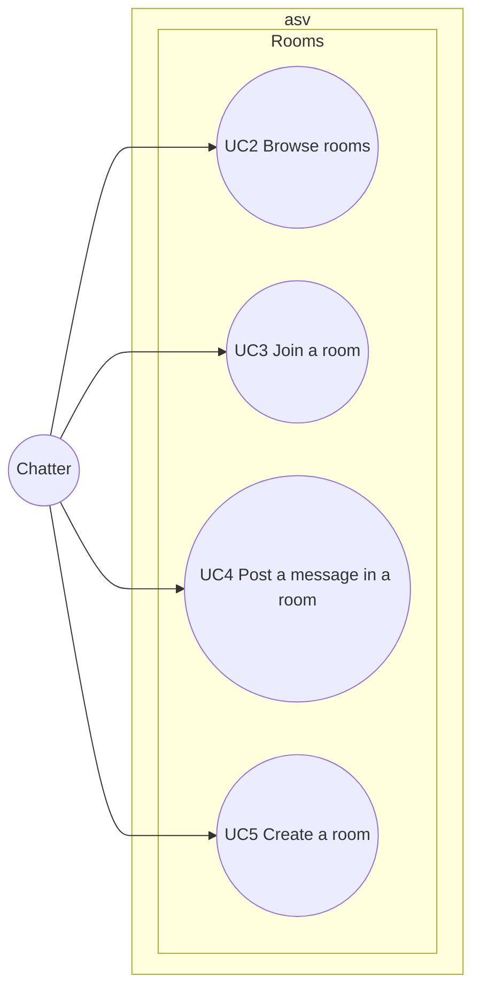

# Use case diagram — rooms — browse, join, post, create

> **Feature**: rooms (roadmap brick 4)
> **Requirements**: ASV-F-003 to F-007, F-018
> **Business rules**: BR-020 to BR-034
> **Related ADRs**: ADR-0007

## Context

Public conversation spaces. Does not cover private windows or reporting a room (see `moderation`).

## Diagram

## Use case specs

**UC2 — Browse rooms** (planned)
- Main scenario: 1. Chatter opens the room list. 2. System shows official rooms, then user rooms,
  each with name and live member count. The list updates live.

**UC3 — Join a room** (planned)
- Preconditions: session Connected.
- Main scenario: 1. Chatter picks a room. 2. System adds the session to the room. 3. System sends the
  member list (pseudo, colour, age, city, away flag) and broadcasts "X joined".
- Extensions: 1a. Room full (BR-023) → refused.
- Alternative ending: the chatter leaves the room → "X left" broadcast. If the room is a user room
  and becomes empty, it is deleted (BR-032).
- A chatter may be in several rooms at once.

**UC4 — Post a message in a room** (planned)
- Main scenario: 1. Chatter types a message. 2. System checks length (BR-020) and flood (BR-021).
  3. System broadcasts to members who do not ignore the author.
- Extensions: 2a. Too long or flood → refused with a warning.
- Rule: smiley codes render from a whitelist, text never as HTML (BR-022).

**UC5 — Create a room** (planned)
- Main scenario: 1. Chatter names a new room. 2. System checks the name (BR-030) and ownership limit
  (BR-031). 3. System creates the user room and joins the chatter into it.
- Extensions: 2a. Name invalid or taken, or chatter already owns a room → refused.

## Notes

- Official rooms are configuration (BR-033), for example "Lyon", "Paris", "Poésie", "Ciné", "Musique",
  "Blabla".
