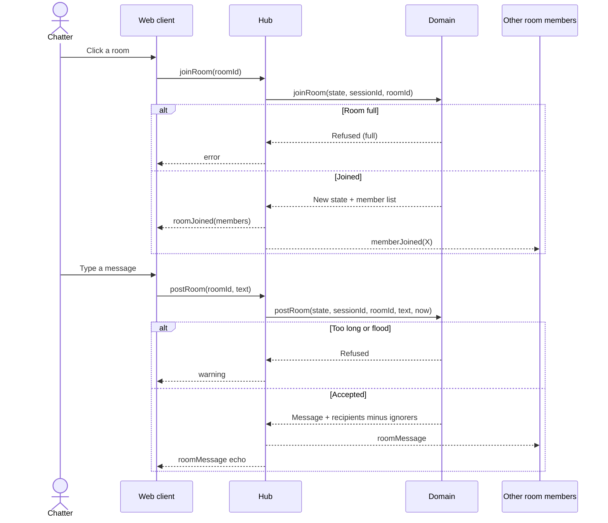

# Sequence diagram — rooms — join a room and post

> **Feature**: rooms
> **Use cases**: UC3, UC4, UC8
> **Business rules**: BR-020 to BR-023
> **Related ADRs**: ADR-0007

## Context

The chatter already has a session and its single WebSocket (see `entry`). Does not cover room creation,
which follows the same path with a `createRoom` command.

## Diagram

## Notes

- The domain decides presence, limits and ignore filtering. The hub only routes.
- No history (BR-034).
