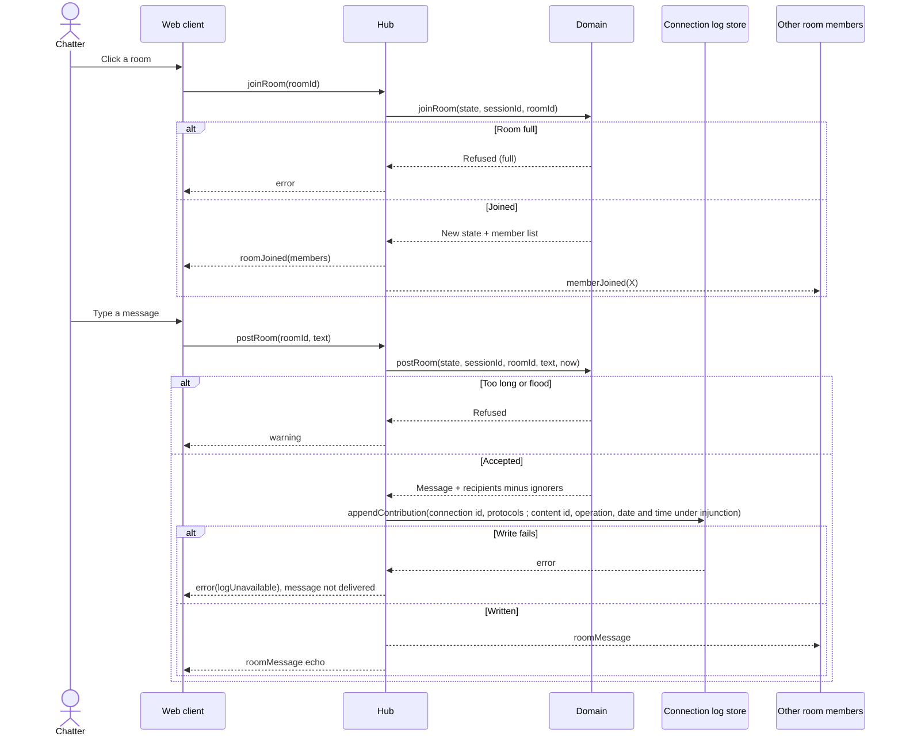

# Sequence diagram — rooms — join a room and post

> **Feature**: rooms
> **Use cases**: UC3, UC4, UC8
> **Business rules**: BR-020 to BR-023, BR-060
> **Related ADRs**: ADR-0007, ADR-0014

## Context

The chatter already has a session and its single WebSocket (see `entry`). Does not cover room creation,
which follows the same path with a `createRoom` command.

## Diagram

## Notes

- The domain decides presence, limits and ignore filtering. The hub only routes.
- No history (BR-034).
- The contribution line holds no text (BR-060). It always has the connection id and protocols; the content id,
  operation, date and time are added only while an injunction under CPCE L34-1 III is in force. The message
  itself is never stored.
- The line is written before delivery. If the write fails, the message is refused and not delivered.
