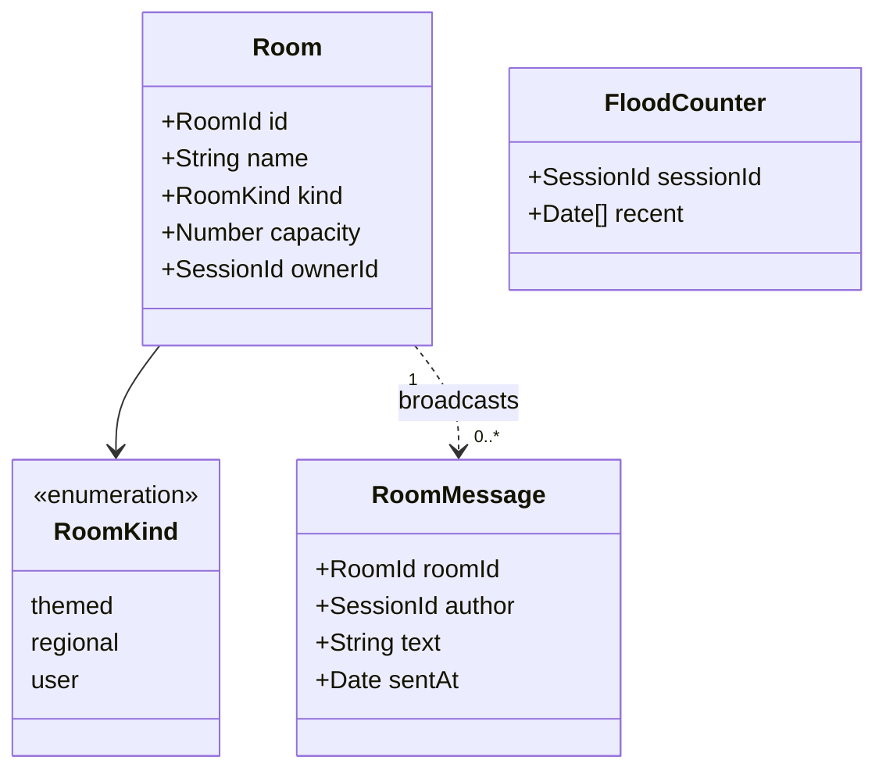

# Class diagram — rooms — rooms and messages

> **Feature**: rooms
> **Business rules**: BR-020 to BR-034

## Context

Room model inside the hub state. Does not cover sessions (see `entry`).

## Diagram

## Notes

- `ownerId` is set only for user rooms (BR-031).
- Members are the sessions whose `rooms` list the room id (`rooms/07`); capacity 50 is a domain limit (BR-023).
- Messages are not stored in the room, they are broadcast and forgotten (BR-034).
- `FloodCounter` is shared with private messages (BR-021).
