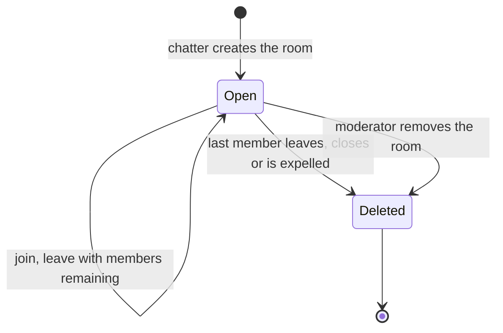

# State diagram — rooms — user room lifecycle

> **Feature**: rooms
> **Use cases**: UC5, UC3, UC11
> **Business rules**: BR-030 to BR-032

## Context

Lifecycle of a room created by a chatter. Official rooms never leave the Open state (BR-033). Does not
cover room membership of individual chatters (see `rooms/02`).

## Diagram

## Notes

- An away member still counts as a member, so a room survives a 5-minute phone pause.
- Moderator removal of a room follows a report on its name (UC9, see `moderation`).
