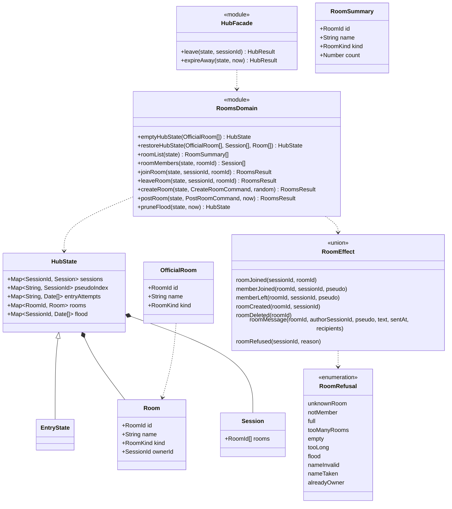

# Class diagram — rooms — domain functions, commands and effects

> **Feature**: rooms (roadmap brick 4)
> **Use cases**: UC2, UC3, UC4, UC5, UC10
> **Business rules**: BR-020 to BR-034, BR-012, BR-015
> **Related ADRs**: ADR-0007, ADR-0011

## Context

The pure functions in `src/domain` that the hub calls to list, join, leave, create and post in rooms,
and how closing a session leaves its rooms. Extends the types of `entry/07`. Does not cover ignore
filtering (brick 6), moderator room removal (brick 8) or smiley rendering (`web-ui`, brick 7a).

## Diagram

## Rules the code applies

- **Membership lives on the session** (owner choice D1, 450/500): `Session.rooms` holds the ids of the
  rooms joined, in both variants, so the away session stays exactly the ADR-0011 away record. A room holds
  only its metadata; its members are the sessions listing it. Closing a session drops its memberships.
- **State**: `HubState` extends `EntryState` with `rooms` and `flood`. The entry functions are generic
  over the state (`<S extends EntryState>`) and keep the other fields untouched.
- **Official rooms** (D5, 450/500, BR-033): the list is passed to `emptyHubState(officialRooms)` by the
  hub; it lives in `src/server/official-rooms.ts` with stable slug ids (`lyon`, `poesie`). Official rooms
  have no owner and are never deleted.
- **Rebuild after hibernation** (D2, 465/500): each member's socket attachment and away record carry
  `{ id, name, ownerId? }` for the user rooms it is in. The hub passes the sessions and these rooms to
  `restoreHubState`, which rebuilds the pseudo index and checks the rules again, since refs come from many
  sockets: the first ref per id and per name key wins (BR-030), one owned room per session (BR-031), an
  owner who is no longer a member is dropped, as are duplicate and unknown memberships and empty user rooms. Flood counters
  and entry attempts restart empty (ADR-0011). No new data is persisted.
- **UC2**: `roomList` returns official rooms in configuration order, then user rooms in creation order,
  each with its member count (connected and away).
- **UC3, BR-023**: `joinRoom` needs a connected session. Unknown room → `roomRefused unknownRoom`. Already a
  member → `roomJoined` again, no broadcast. A session already in 10 rooms → `tooManyRooms` (BR-024, owner
  choice R1, 435/500: bounds `session.rooms`, the attachment and the list scans). A room with 50 members,
  away ones included, → `full`.
  Otherwise the room id is appended to `session.rooms`, effects `roomJoined` (to the joiner, the hub sends
  `roomMembers`) and `memberJoined` (to the other members).
- **Leaving a room**: `leaveRoom` (any session, connected or away) removes the membership and emits `memberLeft`. If the owner leaves, the
  room has no owner from then on (BR-031). If a user room has no member left, it is removed and
  `roomDeleted` is emitted (BR-032). Not a member → no effect.
- **UC5, BR-030, BR-031** (D7, 435/500): the name is NFC-normalised and trimmed, has 3 to 30 characters
  among the pseudo characters (BR-001), `'`, `&`, `!`, `?` and single spaces between words, and contains no
  reserved word (BR-003), and at least one letter or digit → else `nameInvalid`. The uniqueness key is the
  folded name with only letters and digits kept (owner choice R2, 420/500), so `Paris.` or `PARIS !` is
  `nameTaken` by the official `Paris`. A session that owns a room → `alreadyOwner`; one already in 10 rooms
  → `tooManyRooms`. Otherwise a user
  room with `random.id()` and `ownerId` is created and joined: effects `roomCreated` (the hub writes the
  contribution line, BR-060), `roomJoined`, `memberJoined`.
- **UC4, BR-020, BR-021** (D3, 440/500): `postRoom` needs a connected member, else `notMember`. The text is
  trimmed; empty → `empty`, more than 500 characters (code points) → `tooLong`. If the session already has 5
  accepted messages in the last 10 s → `flood`. Only accepted messages are counted, so a chatter who retries
  after a warning is not punished; a script still delivers 5 messages per 10 s at most. The counter is per
  session and will be shared with private messages (brick 6). An accepted post records `now` and emits
  `roomMessage` with the trimmed text and the connected members as recipients, author included (echo).
  Away members receive nothing (BR-013 buffers private messages only). Ignore filtering is added in brick 6.
- **BR-022** (D4, 485/500): the domain keeps the raw text. The smiley whitelist and the text-only renderer
  belong to `web-ui` (brick 7a), the single place that turns text into DOM.
- **BR-034**: no message is kept in the state.
- **Closing a session** (D6, 455/500): `hub.ts` exports `leave` and `expireAway`, which call the entry
  functions and then leave every room of each closed session (internal `vacateRooms`, not exported by `index.ts`): `memberLeft` per room, ownership ended,
  empty user rooms deleted, flood counter dropped. When two closed sessions shared a user room, only the
  first emits `memberLeft` before `roomDeleted`; the second emits nothing for that room. `src/domain/index.ts` exports these in place of the
  entry ones, so the transport cannot skip the room cleanup.
- **Away and back**: `socketLost` and `resume` keep `session.rooms`. The hub maps `wentAway` and `resumed`
  to `memberAway` and `memberBack` in each room of the session, and builds `resumed.rooms` from
  `roomMembers`.
- `pruneFlood`, called from the hub alarm, forgets sessions with no message in the last 10 s.
- Refusals map to the protocol `warning { code: reason }`. The domain declares its own types and never
  imports `src/shared/protocol`.
- An away session has no profile (ADR-0011): the hub lists it without gender, age and city. The protocol
  `member` schema needs these fields optional for away members (follow-up, brick 7a).
