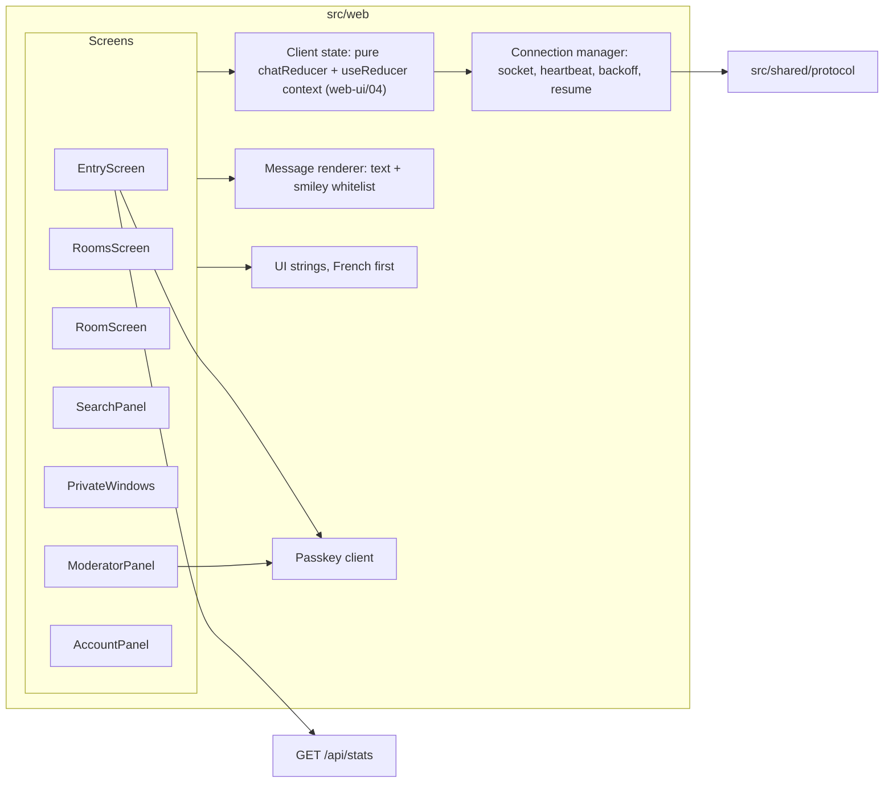

# Component diagram — web-ui — front-end structure

> **Feature**: web-ui (roadmap bricks 7a, 5, 6, 8: one overlay per slice)
> **Requirements**: ASV-NF-004, NF-005, NF-006, NF-011, NF-012
> **Design**: `docs/architecture/design-pack.md`

## Context

Modules of the React single-page app and their dependencies. Does not cover visual styling (see the
design pack) or the server side (see `platform`).

## Diagram

## Notes

- Brick 7a builds EntryScreen, RoomsScreen, RoomScreen, the store, the connection manager, the renderer
  and the strings (`web-ui/04`); the other screens arrive with their slices.
- Only the connection manager talks to the WebSocket; the entry screen also reads the connected count over
  HTTP (`platform/04`). Screens read and update the store.
- The connection manager owns BR-010 (heartbeat), automatic reconnection with backoff, and resume (UC13).
- The renderer is the single place that turns text into DOM, enforcing BR-022.
- `src/shared/protocol` is the typed message contract shared with the server (see `platform/04`).
- The entry screen keeps "enter" disabled until the 18+ box and the terms box are ticked, and caps the city field at 40 characters. The server still refuses such input with `error invalid` (`entry/07`).
