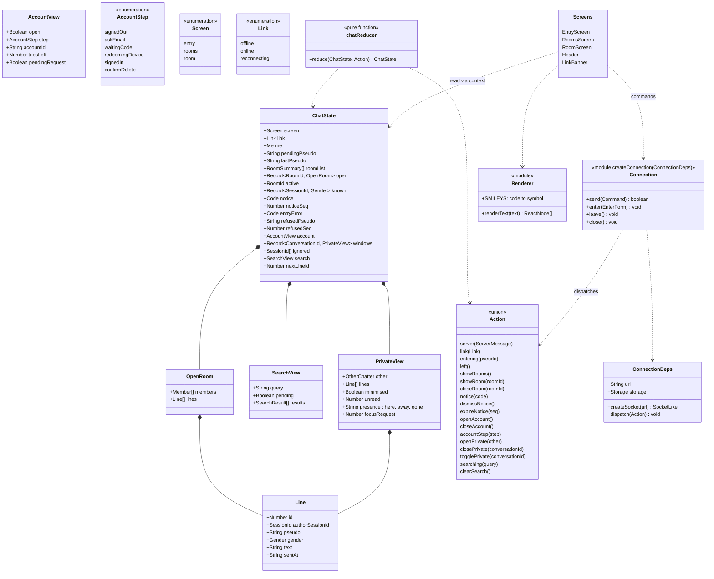

# Class diagram — web-ui — client state, connection manager and renderer

> **Feature**: web-ui (roadmap brick 7a)
> **Use cases**: UC1, UC2, UC3, UC4, UC5, UC10, UC13
> **Business rules**: BR-004, BR-006, BR-010, BR-014, BR-022, BR-090
> **Requirements**: ASV-NF-004, NF-006, NF-011, NF-012
> **Related ADRs**: ADR-0011; brick 7a owner choices D4, D6 (465/500), D7, D8

## Context

The modules of `src/web` that brick 7a builds: the pure client reducer, the connection manager, the text
renderer and the screens for entry, rooms and room. Brick 5 adds the account overlay (`web-ui/06`), brick 6
the private windows, ignore and search (`web-ui/07`). Does not cover the moderation overlay (brick 8).

## Diagram

## Rules the code applies

- **Account** (brick 5, `web-ui/06`): `codeSent` → `waitingCode`; `accountLinked` → `redeemingDevice` when
  it carries a `deviceClaim`, else `signedIn`, and clears an account notice (#136); `entered`/`resumed` with `accountId` → `signedIn`;
  `accountUnlinked` → `signedOut`; a `warning` replying to `verifyCode` keeps `waitingCode` with the tries
  left. The connection manager gains `requestCode`, `verifyCode`, `signOutEverywhere`, `deleteAccount`,
  and two `fetch` calls to `/account/device` and `/account/sign-out` (`credentials: "same-origin"`).

- **Private windows, ignore and search** (brick 6, `web-ui/07`): `privateWindow` → window created or its
  `other` refreshed (presence `here` or `away`); `privateMessage` → line appended to its window (last 200),
  `unread` + 1 when minimised; `memberAway` / `memberLeft` without `roomId` → presence `away` / `gone` of
  the windows with that session; `ignoreUpdated` → `ignored`; `searchResults` → `search.results`, `pending`
  off; `resumed` → `windows` rebuilt minimised from `resumed.windows`, `buffered` appended with unread counts;
  `accountUnlinked` → `windows` emptied. A pending window (`openPrivate`, before the first message) is keyed
  by the other session id until `privateWindow` gives its conversation id. `focusRequest` (#67): `openPrivate`
  (new or existing window) and a restore add 1, a new incoming `privateWindow` and `resumed` start at 0, a
  minimise and a `privateWindow` for an existing or pending window keep it; the composer takes the focus on
  each increase, never on an incoming window. The connection manager gains
  `sendPrivate`, `closePrivate`, `ignore`, `unignore` and `search`. Nothing of this is stored in the browser.

- **D6**: one pure `chatReducer`, held by `useReducer` in `App` and shared through a React context. The
  connection manager lives outside React; it dispatches actions and screens call its commands. Screens
  never touch the socket (`web-ui/03`). Screens call `Commands`; their only local actions are the `LocalAction`
  set of `chat-context.tsx` (navigation, account dialog, private windows, search, `dismissNotice`, `expireNotice`),
  never `server` or `link`.
- **Reducer**: `entered` → screen `rooms`, `me` set; `entryRefused` → `entryError` (the reason code) and `refusedPseudo` (from `pendingPseudo`), `entering` and `entered` clear both;
  `roomList` → list; `roomJoined` → room opened with its members and active, screen `room`; `memberJoined`,
  `memberLeft`, `memberAway`, `memberBack` → member list of that room updated; `roomMessage` → line
  appended, at most the last 200 lines per room in memory (BR-034: never stored); `warning`, `error` →
  `notice` (the code) and `refusedSeq` = `replyTo` (a message without `replyTo` keeps the previous value); `resumed` → `me` restored from `sessionId` and `pseudo`, rooms rebuilt from `rooms`, previous screen kept;
  `resumeRefused` → screen `entry` with the previous pseudo prefilled; `leave` → back to `entry`, state
  cleared, last pseudo kept for the form. `memberLeft` and `memberAway` without `roomId` change nothing.
  Notices and entry errors stay codes in the state; screens translate them through `strings.ts`.
- **Notice lifetime** (#68, batch option A 420/500): every action that sets `notice` also stamps a fresh
  `noticeSeq` (monotonic, never reused), so the same code raised twice counts as a new notice (the notice remounts, so
  it is announced again). While shown, `Notice` runs an 8 s timer for its `noticeSeq` (moving between page and
  dialog restarts it) and then dispatches `expireNotice(seq)`, which clears the notice only when
  `noticeSeq` still equals `seq` (a newer notice is never cut short). `entered` and `roomJoined` clear a notice
  that is not an account notice (the next success ends a stale refusal); `accountLinked` keeps clearing an
  account notice (#136). "fermer" (`dismissNotice`) still clears it at once. The timer stops while the pointer or
  the focus is on the notice, so it never vanishes under a reader or takes the focus away (WCAG 2.2.1, 2.4.3). Unit tests check the stamp, the
  expiry, the stale `expireNotice`, the clear on `entered` and `roomJoined`, and the 8 s timer in `Notice`.
- **Known profiles** (D4): every connected member seen fills `known[sessionId] = gender` in memory. An
  away member is shown with its known gender's `-away` colour, else the unspecified one, in italics, followed
  by "(absent)". Never written to storage.
- **Connection manager**: `createConnection({ url, createSocket, storage, dispatch })`, the socket factory
  and storage injected so tests use fakes. `send(Command)` numbers the command; when the socket is not open
  it sends nothing, dispatches `notice notConnected` and returns `undefined`, so the composer keeps its draft; otherwise it returns the command's `seq`. Refused drafts (#151, option B 460/500): the room-name field and each private window clear on send and keep the sent text with its `seq` (the last one per field). When the store's `refusedSeq` (`replyTo` of a `warning` or `error`) equals that `seq`, the field gets its text back when it is still empty (text typed since is never overwritten). Successes carry no `replyTo`, so nothing else is matched. Closing a tab dispatches `closeRoom` only once `leaveRoom` was written; the room name and the entry are kept the same way (`entering` only after `enter` was written). `leave()` while a resume is pending, or offline, sends nothing, keeps the token and shows `notConnected`. ENTRER stays disabled while an entry is pending (`pendingPseudo`), and a lost link drops that pending entry. One WebSocket to `/ws` on the page's origin (`wss:` under HTTPS). It numbers
  messages with `seq`. It validates every incoming message with the protocol `serverMessage` schema and
  drops invalid ones. Heartbeat (BR-010, ADR-0011): `ping` every 25 s; no `pong` within 10 s → the socket is
  closed and treated as lost. On loss: link `reconnecting`, retry after 1, 2, 4, 8, 16 then 30 s
  (NF-011). On reopen with a resume token → `resume { resumeToken, profile }`; an `error` replying to that resume either closes the socket to retry (`logUnavailable`) or forgets the session and shows entry (any other code); without one → link `online`
  on the entry screen.
- **sessionStorage** (ADR-0011): `{ resumeToken, profile }` only, checked against the protocol `resumePayload` schema on load (an invalid record is removed, the link goes `online`), written on `entered` and `resumed`
  (token rotated, BR-014), removed on `leave`, `resumeRefused` and `expelled`. Nothing else is stored in
  the browser.
- **Renderer** (BR-022): splits the text on the whitelisted smiley codes and returns text nodes and smiley
  ``; never `innerHTML`, never `dangerouslySetInnerHTML`, never a link.
  Whitelist V1: `:)`, `:(`, `;)`, `:D`, `:P`, `:o`, `<3`, `:caramel:`. The smiley palette button inserts
  codes. Pixel-art smiley images replace the symbols later without changing the rule.
- **Entry form** (`entry/07`, `web-ui/03`): pseudo (max 20), gender F / H / not said, age (18 to 99), city
  (max 40, no BR-090 character: notice under the field), boxes "j'ai 18 ans ou plus" and "j'accepte les règles du chat"; ENTRER stays disabled until
  both boxes are ticked and pseudo and age are filled. The server still checks everything.
  Missing fields hint (#60, option A 420/500): while ENTRER is disabled because fields are missing, a `small`
  line `#entry-missing` under it names them in form order ("Il manque : pseudo, âge, case 18 ans, case
  règles.", only the missing ones), and ENTRER points to it with `aria-describedby`. The "Membres" panel hint
  shown on "recevoir mon code" uses the same list. The header tagline "âge ? sexe ? ville ?" is the brand
  slogan of the validated mockup, not the chatter's profile, so it stays after entry (#60, option A 410/500).
  Field names (#148): every form field has an `id` or a `name` (the composers keep their `id`) (entry `pseudo`, `gender`, `age`, `city`, `adult`,
  `terms`, `email`, `remember`; rooms `roomName`; search `query`; account `email`, `remember`, `code`), so
  Chrome reports no "form field should have an id or name"; age and city get `autoComplete="off"` like the
  pseudo, so the browser keeps no form history of them (never persisted), other `autoComplete` values stay.
- **Members panel** (D7, 430/500): shown as in the validated mockup, fields disabled, with "Bientôt : les
  comptes membres" until brick 5. Footer links without a target yet (moderator sign-in, rules, legal
  notice, privacy) are shown as inert text, not links.
- **Connected count** (D8, 450/500): the entry header shows `GET /api/stats` `connected`, fetched on display
  and every 30 s while the entry screen is shown; hidden if the request fails. Leaving the screen aborts the
  request in flight.
- **Rooms screen**: official rooms then user rooms with counts (UC2); click joins (UC3); a create field with
  the room name (UC5); "quitter" sends `leave` (UC10).
- **Room screen**: tabs for the joined rooms, lines, members list with age and city (connected) or
  "(absent)" (away), message field with 500 code-point counter, send on Enter; over 500 the counter is flagged, sending is disabled and the text stays in the field (BR-020); a trimmed text holding a BR-090 character shows the `invisibleChars` notice, sending is disabled and the text stays in the field. Each room keeps its own draft, so a draft never follows a tab switch. Desktop (≥ 768 px wide and
  ≥ 720 px high): the room screen fits the viewport; the lines and the members list scroll inside their
  panels, and the lines follow new messages, and stay at the bottom when their panel shrinks (a private window opens, the window is resized), while the reader is at the bottom, never while they read
  older ones; sending a message always brings the reader back to the bottom (#65, #85). Below either
  size the page scrolls as a whole (#83). Phone width (< 768 px, down to 320 px): the members list is a toggled panel (NF-006). The stylesheet is mobile first (#171): its base rules are the phone layout, and wider layouts are added only by `min-width` (and `min-height`) media queries, never a `max-width` one. Leaving a tab sends `leaveRoom`.
- **Strings**: every UI text lives in `src/web/strings.ts`, French (NF-012).
- **Accessibility** (NF-004): native form controls with labels, the message list is an `aria-live="polite"`
  log, focus visible, colours from the design pack tokens only, both themes via `prefers-color-scheme`.
  Headings (#64, A11Y-02, option A 470/500): every screen renders `Header` (today entry, rooms, room), whose
  "asv" logo is the screen's only `h1`. It takes its name from its text (no `aria-label`) and `.logo` gets
  `margin: 0`, so the header looks as before. Below it, titles start at `h2`: the screen and section titles,
  the search panel (a `section`, inline on rooms, inside a modal `dialog` in a room, #111, keeping its `h2`), and the account and legal page `dialog`s,
  the legal page keeping its `h2` when opened from the account panel. Private windows stay `dialog`s named by
  `aria-label`, with no heading (`web-ui/07`). Unit tests check, per screen and with the account and legal
  dialogs open, one `level: 1` heading named "asv" and the titles at `level: 2`.
  Refused fields (#121, A11Y-03, option A 450/500): while a refusal holds, the field says so itself. The room field
  `#message` and the private window field get `aria-invalid="true"` while their text is over 500 code points
  (BR-020) or holds a BR-090 character, and `aria-describedby` with the ids of what explains it: the counter
  (`<id>-count`) when too long, the `invisibleChars` notice (`<id>-invisible`) when it shows, both when both hold.
  The entry city field gets `aria-invalid="true"` while its trimmed text holds a BR-090 character; its link to
  the notice is #120. Once the text fits, the attributes are removed (not set to `false`). Unit tests check
  both attributes on the two composers and `aria-invalid` on the city field, set then removed.
  Refused pseudo (#154, A11Y-03, option A 480/500): when the server refuses the pseudo (`entryRefused` with
  `pseudoTaken` or `pseudoInvalid`), the entry pseudo field gets `aria-invalid="true"` and
  `aria-describedby="entry-error"`, the id of the entry alert, while its trimmed NFC text equals the refused
  pseudo. The store keeps it as `refusedPseudo`, taken from `pendingPseudo` when `entryRefused` arrives and
  cleared by the next `entering`, so a pseudo whose sending failed is never marked. Editing it to another text removes both attributes; typing the refused pseudo back sets them again.
  Other refusals (`rate`, `banned`, `age`) leave the field unmarked. The `pseudoTaken` text says how to fix it:
  pick another pseudo, accents and case do not count (BR-002); `pseudoInvalid` already lists the rule (BR-001,
  BR-003). Unit tests check both codes, both entry panels, removal on edit, setting again on the same text, a failed
  sending, and no mark on `age`.
  Legal page scroll (#126, UI-01, option A 480/500; the issue's `height: auto` dropped after review
  round 1, owner 2026-11-06, since it stretched short pages): a legal page `dialog` (rules, notice, privacy; from the
  entry footer or the account panel) never grows past the viewport. `.legal-page` keeps the user-agent `dialog`
  height `fit-content` (a short page stays as tall as its text; it beats `inset`, which is why the page used to
  overflow) and caps it with `max-height: calc(100dvh - 2 * var(--gap))`, so a long text scrolls inside it and
  "fermer", at the end, stays
  reachable at 320, 390 and 768 px wide and at 1440 × 600. Since #59 it is modal (below). jsdom computes no layout: unit tests check the rule in `styles.css` and that each page still
  renders with its "fermer"; the QA pass measures the scroll on the production build.
  Legal page dialog (#59, A11Y-01, WCAG 2.4.3, option A 460/500): each legal page is a modal `dialog`, opened
  with `showModal()` when it mounts and closed with `close()` when it unmounts (a layout effect, as the account
  dialog), so the focus is trapped in it and the page behind is inert. On open the focus goes to the `dialog`
  itself (`tabIndex={-1}`), so its `h2` is read first; Tab reaches "fermer" (the text has no control), the
  arrow keys scroll the text. Its backdrop dims the page like the account panel's (the layering part of #111). Escape (a key
  handler on the dialog) and `cancel` close it and stop there: from the account panel, Escape with the privacy
  page open closes only the page, a second Escape closes the panel. On unmount the focus returns to the element
  that had it when the page opened (the footer link or the panel's "confidentialité" link); each link focuses
  itself on click, since Safari and Firefox on macOS do not (#130). Unit tests check the focus on open, Escape, `cancel` and "fermer" from the entry footer (each topic)
  and from the account panel, that Escape and `cancel` are prevented, the nested Escape, and the focus return
  after a click that does not focus the link.
  Dialog layering (#104, option B 480/500): the account, search and legal page dialogs share one rule:
  a 4 px shadow, a 2 px edge drawn as a spread shadow (never an `outline`, which would hide the
  `:focus-visible` ring of the focused legal page) and a dimmed `::backdrop`, from the `--backdrop`, `--dialog-shadow` and
  `--dialog-edge` tokens of the design pack. Light keeps the #63 look (25 % dimming, bevel shadow, no edge);
  dark dims the page at 60 % and draws the edge in `--brand` (7.73:1 against the dimmed page), since no shadow
  shows on a near-black page. Unit tests check the tokens per theme and that both selectors use the rule.
  Account dialog (#63, A11Y-01, option A 435/500): the account panel is a modal `dialog` opened with
  `showModal()` when it mounts and closed with `close()` when it unmounts, so the browser gives the focus
  trap, the inert background and the top layer (above the private dock, #84). Escape (a key handler on the
  dialog) and `cancel` (Android back) dispatch
  `closeAccount`; "fermer" does the same. Its height fits the viewport and it scrolls, so "fermer" stays
  reachable on a phone in landscape. Its right edge lines up with the page column's (`right: max(var(--gap), calc((100% - 1100px) / 2 + var(--gap)))`, where `100%` is the viewport without its scrollbar, #136), so on a wide screen it sits under "quitter", not against the window edge; the search dialog shares the rule. Only account notices show inside it (#136, option A 445/500): the codes of `ACCOUNT_NOTICES` in `store.ts` (the `ACCOUNT_WARNINGS` codes plus `codeSent`, `accountUnlinked`, `accountRequired`, `deviceNotSaved`, `notSignedIn`, and `unavailable` and `notConnected`, the feedback on its own actions); any other notice stays in the page, so it does not move the header on open or close. `accountLinked` clears an account notice ("code envoyé" no longer outlives the sign-in). On unmount the focus returns to the element
  that had it when the panel opened ("Mon compte", the pseudo whose "message privé" opened it, or the room
  field when the server opened it); "Mon compte" focuses itself on click, since Safari and Firefox on
  macOS do not (#130); nothing gets it if that element left the page. The background being inert, no screen change can come from the user
  while the panel is open; leaving the chat (back to entry) unmounts it. The privacy page opened from the
  panel is a modal `dialog` stacked above it (Legal page dialog, #59); Escape closes it alone. Unit tests stub `showModal` and `close`
  (jsdom has neither) and check the modal opening, Escape (with the privacy page open: the page only, then the panel),
  "fermer", an account notice inside the dialog, another notice left in the page, the notice cleared on sign-in, the alignment rule and the focus return. On a screen at most 500 px high it starts at
  the top of the viewport (`@media (max-height: 500px)`, #111), so "fermer" stays in view.
  Search dialog (#111, option A 460/500): in a room the search panel is a modal `dialog` built like the
  account dialog (`.overlay`, `showModal()` on mount, `close()` and focus return on unmount, Escape and
  `cancel` close it, "fermer"); "rechercher" focuses itself on click (#130). Escape on an open pseudo menu
  inside it closes the menu only. Every notice raised while it is open shows inside it (unlike the account dialog, which keeps only account notices, #136). Rules in `web-ui/07`.
  Small controls (#105, A11Y-05, option A 480/500; smileys added after review round 1, option A 450/500): the
  glyph-only buttons that close a room tab ("×"), minimise or close a private window ("_", "×") and insert a
  smiley in the room composer carry the class `icon-button` next to `link`. It gives them `min-width` and
  `min-height` of 24 CSS px (WCAG 2.2 SC 2.5.8 AA) and centres the glyph, and 44 px under
  `@media (pointer: coarse)` (house touch floor), where the room name button of a tab gets the same 44 px
  height so leaving a room is never the bigger target, and so does every bevelled button (`.bevel`, #176, option A
  460/500: the header buttons "Mon compte" and "quitter" of #170, the "salons" button, the minimised private window
  tabs (`.private-tab`), "créer", "rechercher", "envoyer", "Membres (n)", the entry, account, privacy and private
  window buttons); one class rule covers future buttons and replaces the #170 `.header-end button` rule. With a
  mouse they keep their box of at least 33 px (`.bevel.big`: 45 px), already above the 24 px floor; text inputs
  keep theirs. Every button that is not `.bevel` is a `.link`; the glyph, pseudo and menu links get the floors
  above and below, plain text links do not. Other text links (`.link` alone) do not grow, except the text targets below, which get a height floor, and the
  links of the account and search dialogs (`.overlay .link`: "fermer", "annuler", "nouveau code", the inline
  "confidentialité", #111), 44 px high under `@media (pointer: coarse)` in the same block as `.menu .link`. jsdom
  computes no layout: unit tests check the rules in `styles.css`, the class on the header and room-screen
  bevelled buttons, and that every button rendered on the room screen is `.link` or `.bevel`; the QA pass measures the boxes on the production build.
  Text targets (#142, option C 470/500): the "smileys" toggle (`details.smileys > summary`) and each pseudo
  button (`.pseudo-button`: members list, private window title, search results) are text controls with a 21 px line box. They get the same floors without a
  new class: `min-height: 24px` on `.pseudo-button` (a button centres its text) and `line-height: 24px` on
  `.smileys summary`, which stays `display: list-item` so its disclosure marker is kept (`inline-flex` would
  drop it); both 44 px under `@media (pointer: coarse)`, in a block placed after the base rules.
  The pseudo menu items ("message privé", "ignorer": `.menu .link`, #168, option A 480/500) join that touch
  block with `min-height: 44px`; with a mouse their 25 px box already meets the 24 px floor, so no base rule is
  added. The QA pass measures both items with the menu open and runs axe `target-size`.
  Header reflow (#143, UI-01, WCAG 2.2 SC 1.4.10, option A 480/500): `.header` already wraps; its end group
  `.header-end` (pseudo, "Mon compte", "quitter") gets `flex-wrap: wrap` and `min-width: 0`, and the pseudo
  (`.header-end strong`) gets `min-width: 0` and `overflow-wrap: anywhere` (`min-width: 0` is a safeguard,
  `anywhere` already lowers the min-content size), so a pseudo of up to 20 characters (BR-001) breaks only when it
  is wider than the band and the buttons wrap to the next line as needed, instead of widening the page.
  The pseudo is never truncated (no ellipsis): the chatter reads it in full. jsdom computes no layout: unit
  tests check the rules; the QA pass reads `scrollWidth` and the button boxes on the production build.
