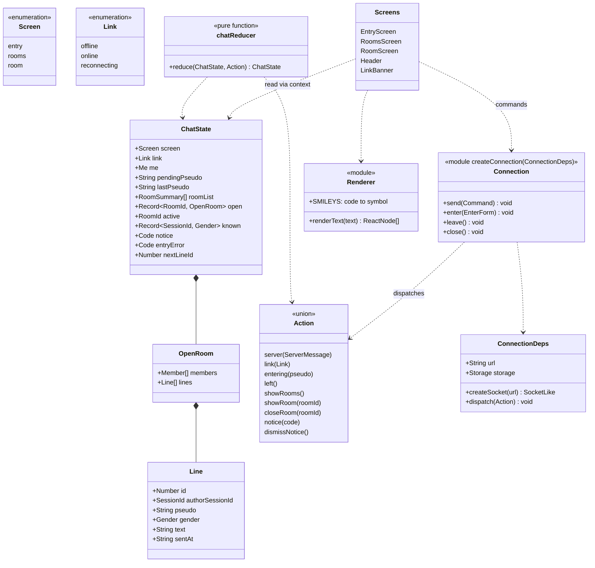

# Class diagram — web-ui — client state, connection manager and renderer

> **Feature**: web-ui (roadmap brick 7a)
> **Use cases**: UC1, UC2, UC3, UC4, UC5, UC10, UC13
> **Business rules**: BR-004, BR-006, BR-010, BR-014, BR-022
> **Requirements**: ASV-NF-004, NF-006, NF-011, NF-012
> **Related ADRs**: ADR-0011; brick 7a owner choices D4, D6 (465/500), D7, D8

## Context

The modules of `src/web` that brick 7a builds: the pure client reducer, the connection manager, the text
renderer and the screens for entry, rooms and room. Does not cover the overlays of bricks 5, 6 and 8
(account, private windows, search, moderation).

## Diagram

## Rules the code applies

- **D6**: one pure `chatReducer`, held by `useReducer` in `App` and shared through a React context. The
  connection manager lives outside React; it dispatches actions and screens call its commands. Screens
  never touch the socket (`web-ui/03`). Screens call `Commands`; their only local actions are `showRooms`,
  `showRoom` and `dismissNotice` (`LocalAction`), never `server` or `link`.
- **Reducer**: `entered` → screen `rooms`, `me` set; `entryRefused` → `entryError` (the reason code);
  `roomList` → list; `roomJoined` → room opened with its members and active, screen `room`; `memberJoined`,
  `memberLeft`, `memberAway`, `memberBack` → member list of that room updated; `roomMessage` → line
  appended, at most the last 200 lines per room in memory (BR-034: never stored); `warning`, `error` →
  `notice` (the code); `resumed` → rooms rebuilt from `rooms`, previous screen kept;
  `resumeRefused` → screen `entry` with the previous pseudo prefilled; `leave` → back to `entry`, state
  cleared, last pseudo kept for the form. `memberLeft` and `memberAway` without `roomId` change nothing.
  Notices and entry errors stay codes in the state; screens translate them through `strings.ts`.
- **Known profiles** (D4): every connected member seen fills `known[sessionId] = gender` in memory. An
  away member is shown with its known gender's `-away` colour, else the unspecified one, in italics, followed
  by "(absent)". Never written to storage.
- **Connection manager**: `createConnection({ url, createSocket, storage, dispatch })`, the socket factory
  and storage injected so tests use fakes. `send(Command)` numbers the command; when the socket is not open
  it sends nothing and dispatches `notice notConnected`. One WebSocket to `/ws` on the page's origin (`wss:` under HTTPS). It numbers
  messages with `seq`. It validates every incoming message with the protocol `serverMessage` schema and
  drops invalid ones. Heartbeat (BR-010, ADR-0011): `ping` every 25 s; no `pong` within 10 s → the socket is
  closed and treated as lost. On loss: link `reconnecting`, retry after 1, 2, 4, 8, 16 then 30 s
  (NF-011). On reopen with a resume token → `resume { resumeToken, profile }`; without one → link `online`
  on the entry screen.
- **sessionStorage** (ADR-0011): `{ resumeToken, profile }` only, written on `entered` and `resumed`
  (token rotated, BR-014), removed on `leave`, `resumeRefused` and `expelled`. Nothing else is stored in
  the browser.
- **Renderer** (BR-022): splits the text on the whitelisted smiley codes and returns text nodes and smiley
  ``; never `innerHTML`, never `dangerouslySetInnerHTML`, never a link.
  Whitelist V1: `:)`, `:(`, `;)`, `:D`, `:P`, `:o`, `<3`, `:caramel:`. The smiley palette button inserts
  codes. Pixel-art smiley images replace the symbols later without changing the rule.
- **Entry form** (`entry/07`, `web-ui/03`): pseudo (max 20), gender F / H / not said, age (18 to 99), city
  (max 40), boxes "j'ai 18 ans ou plus" and "j'accepte les règles du chat"; ENTRER stays disabled until
  both boxes are ticked and pseudo and age are filled. The server still checks everything.
- **Members panel** (D7, 430/500): shown as in the validated mockup, fields disabled, with "Bientôt : les
  comptes membres" until brick 5. Footer links without a target yet (moderator sign-in, rules, legal
  notice, privacy) are shown as inert text, not links.
- **Connected count** (D8, 450/500): the entry header shows `GET /api/stats` `connected`, fetched on display
  and every 30 s while the entry screen is shown; hidden if the request fails. Leaving the screen aborts the
  request in flight.
- **Rooms screen**: official rooms then user rooms with counts (UC2); click joins (UC3); a create field with
  the room name (UC5); "quitter" sends `leave` (UC10).
- **Room screen**: tabs for the joined rooms, lines, members list with age and city (connected) or
  "(absent)" (away), message field with 500 code-point counter, send on Enter. Phone width (< 768 px): the
  members list is a toggled panel (NF-006). Leaving a tab sends `leaveRoom`.
- **Strings**: every UI text lives in `src/web/strings.ts`, French (NF-012).
- **Accessibility** (NF-004): native form controls with labels, the message list is an `aria-live="polite"`
  log, focus visible, colours from the design pack tokens only, both themes via `prefers-color-scheme`.
