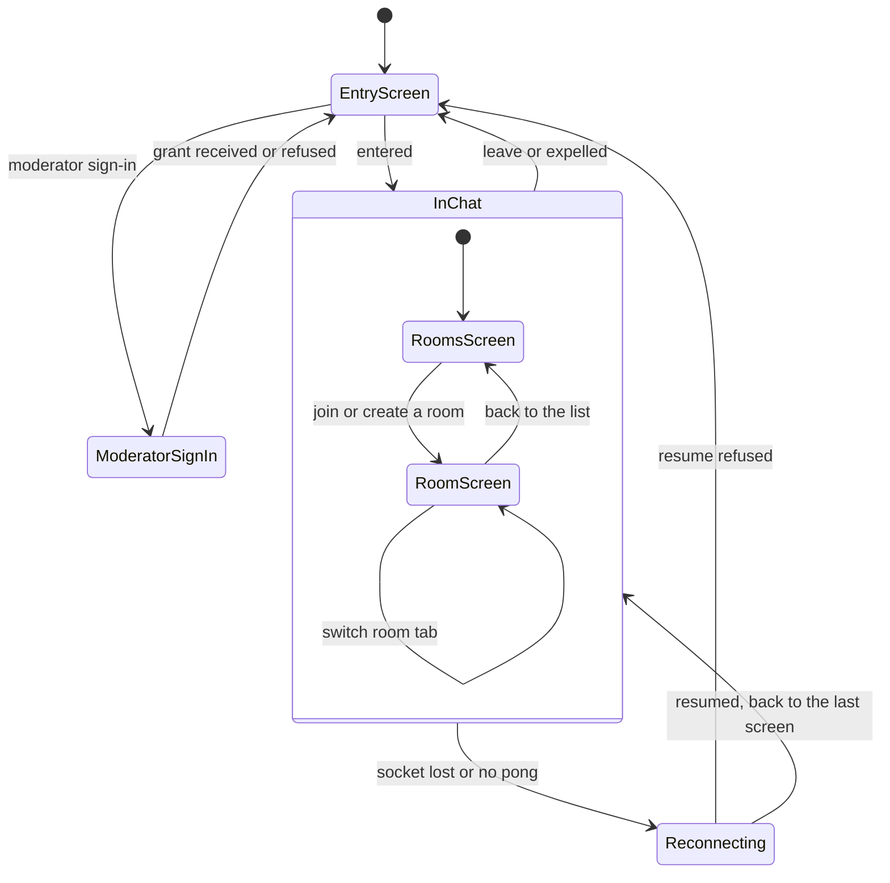

# State diagram — web-ui — screen navigation

> **Feature**: web-ui
> **Use cases**: UC1, UC2, UC3, UC6, UC7, UC10, UC12, UC13, UC16

## Context

Which screen the client shows and what moves between them. Private windows, the search panel and the
moderator panel are overlays, available in Rooms and Room. Does not cover screen layout (see the
design pack).

## Diagram

## Notes

- `Reconnecting` shows a discreet banner and keeps the last screen visible. On resume the client returns
  to the screen it was on (UML history state, drawn here as a note since Mermaid lacks it).
- `expelled` and `leave` apply from any screen of `InChat`.
- The account panel (UC17 to UC19) is an overlay in `InChat`: it opens from the "Mon compte" button in
  the header, after "recevoir mon code" on the entry screen, and (brick 6) when a chatter without an
  account tries a private message. Its own states are in `web-ui/06`.
