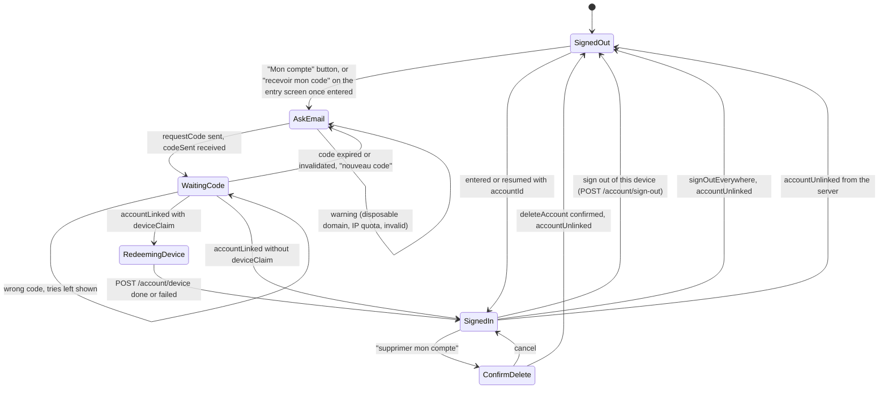

# State diagram — web-ui — account panel

> **Feature**: web-ui (brick 5)
> **Use cases**: UC17, UC18, UC19
> **Business rules**: BR-070 to BR-073, BR-081
> **Related ADRs**: ADR-0013, ADR-0014

## Context

The account panel in the chat and the "Membres" panel of the entry screen (owner choice 2026-10-23,
425/500: the entry panel reuses the pseudo form, enters the chat, then asks for the code). Does not
cover private windows (brick 6).

## Diagram

## Notes

- The panel is an overlay in `InChat` (`web-ui/05`), closable at any time; closing keeps the state.
- **Entry screen "Membres" panel**: e-mail field, "se souvenir de cet appareil" box (ticked by default),
  "recevoir mon code" button. The button needs the pseudo form valid (pseudo, 18+, rules), shows a hint
  otherwise, then enters the chat and sends `requestCode` as soon as `entered` arrives. The code field
  then appears in the account overlay. A failed `POST /account/device` keeps the session signed in for
  this visit only and shows a notice.
- `codeSent` always reads "Si l'adresse peut recevoir un code, il vient d'être envoyé. Valable
  10 minutes." (ADR-0013 amendment, same answer).
- Sign-up legal notice, shown under the e-mail field and before deletion: "Ton e-mail est gardé 5 ans
  après la fermeture du compte, uniquement pour la loi." (ADR-0014, GDPR art. 13).
- `SignedIn` shows "connecté·e comme membre" (never the e-mail, since the client does not receive it) and
  the three actions. `entered.staleDevice` triggers `POST /account/sign-out` silently.
- `WaitingCode` accepts digits only, six characters, and sends `verifyCode` on the sixth digit or on
  "valider".
