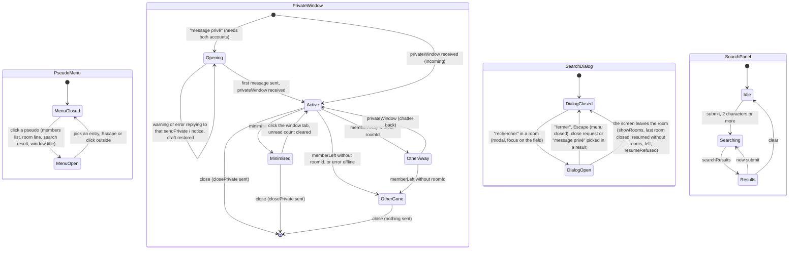

# State diagram — web-ui — pseudo menu, private windows and search panel

> **Feature**: web-ui (roadmap brick 6)
> **Use cases**: UC6, UC7, UC8
> **Business rules**: BR-013, BR-020, BR-040 to BR-044, BR-090
> **Design**: `docs/architecture/design-pack.md` (pseudo menu, floating private windows, search box)

## Context

The three brick 6 overlays of `InChat` (`web-ui/05`): the pseudo menu, the private windows and the search
panel. The server side is in `private-conversations/07` and `directory/07`. Does not cover reporting
(brick 8 adds "signaler" to the pseudo menu).

## Diagram

## Rules the code applies

- **Pseudo menu**: "message privé", "ignorer" or "ne plus ignorer". Not shown on the chatter's own pseudo.
  "message privé" is greyed when either side has no account (`hasAccount`, BR-040); picking it while the
  chatter has none opens the account panel (`web-ui/06`). "ignorer" sends `ignore`, "ne plus ignorer"
  `unignore`; the list comes back in `ignoreUpdated`.
- **Ignore on screen** (BR-042): messages of ignored session ids are already filtered by the server; the
  client also hides any line it still holds from them, and shows "(ignoré)" after their pseudo in member
  lists. `ignoreUpdated` replaces the list.
- **Opening**: "message privé" opens a window in `Opening` with the composer focused; nothing is sent until
  the first message. A refusal (`warning` or `error` replying to that `sendPrivate`) shows the notice and
  keeps the draft: the field clears on send and gets the sent text back when the refusal arrives (`web-ui/04`, #151). The window stays in `Opening` (option A 470/500), so after `tooManyWindows` the chatter can close another window and send again. `accountRequired` also opens the account panel.
- **Incoming window** (#67, WCAG 3.2.2 / 2.4.3, owner choice A 480/500): a window opened by the other
  chatter's first message shows as usual but never takes the focus; the chatter keeps typing where they were
  and the window's `aria-live` log announces the line. Only the chatter's own actions focus the composer:
  "message privé" (a new, open or minimised window) and restoring a minimised tab (owner choice A 445/500
  after review: also on an already open window). The store keeps a `focusRequest` count per window
  (`web-ui/04`) and the composer takes the focus each time it grows.
- **Windows**: at most 3 open (BR-043; the server enforces it). Each window holds its last 200 lines in
  memory only (BR-034), its own draft, the 500 code point counter and the BR-090 check of the room composer (BR-020, BR-090), with its refused-field marking (`web-ui/04`, #121), and an
  unread count while minimised. Lines render through the same `Renderer` (smileys, never HTML).
- **Desktop** (≥ 768 px): floating panels docked bottom right, side by side, the last opened in front.
  **Phone**: a stacked tab bar in the page flow after the room, one tab per window, full width
  (design pack, ASV-NF-006).
- **Never cover the composer** (#65, owner choices C 480/500 then B 430/500): on a desktop at least 720 px high (#83) the room screen
  fits the viewport and its lines scroll inside their panel (`web-ui/04` Room screen); while a private
  window is open, a window is at most `--dock-height` tall and the room screen is shortened by that
  height, so the dock never overlaps the composer at any scroll position. On phones the dock is not
  fixed and follows the room in the page flow, so nothing overlays the composer (with 2+ open windows it
  sits above the fold, reached by scrolling up). Overlays (account, search) stack above the dock (#84).
- **Resume**: `resumed.windows` rebuilds the windows (minimised), `resumed.buffered` appends the buffered
  messages to them and sets their unread counts (BR-013).
- **Account unlinked** (`accountUnlinked`, ASV-F-024): every window closes locally; the server already
  closed them.
- **Search panel**: a "rechercher" field on the rooms screen and a header button in rooms; submit only from 2
  characters (UC7 2a); results list pseudo (colour from gender), age, city, "(absent)", and the rooms they
  are in; click a result → pseudo menu. Results are not refreshed live; a new submit refreshes them.
  At most 50 results (server cap); "aucun chatteur trouvé" when empty.
- **Search dialog in a room** (#111, owner choice A 460/500): in a room the panel is a modal `dialog` (`showModal`,
  backdrop, top layer, the #59/#63 pattern), never a box drawn over the tab bar. It closes with its own "fermer"
  button, Escape or a close request (Android back), and the focus goes back to "rechercher". Picking
  "message privé" in a result while signed in closes it, so the new private window is not left inert behind
  the backdrop; picking it without an account opens the account dialog on top. The query and results stay in
  the state, so reopening shows them. Escape on an open pseudo menu in a result closes the menu only and gives
  the focus back to the pseudo. A notice raised while it is open shows inside it only (the page behind is inert and hides it, #185); with the account dialog on top, an account notice shows there only. On a screen at most 500 px high it starts at the top, so "fermer"
  stays in view; its links are 44 px high on a touch screen. On the rooms screen the panel stays in the page flow.
- **Strings** in `strings.ts`, French; notices for the new codes: `self`, `tooManyWindows`, `targetBusy`, `offline`,
  `accountRequired`, and `invalidText` (BR-090, room and private).
- **Accessibility** (NF-004): the pseudo menu is a `menu` with `menuitem`s, keyboard reachable from the
  pseudo button; the pseudo button's accessible name starts with its visible text, "<pseudo>[ (absent)][ (ignoré)], actions"
  (WCAG 2.5.3 Label in Name, #153; the space before each suffix is a text node outside its ``, as axe 4.12 in
  Lighthouse 13 drops a space that opens an element's text), while the open `menu` stays labelled "actions pour <pseudo>"; each window is a `dialog` (non-modal) labelled by the other pseudo with an
  `aria-live="polite"` log; its composer is named "message privé à <pseudo>", so no two fields on the page share the room composer's name "message" (#106, WCAG 4.1.2 / 2.4.6); the search results are a list of buttons.
- **Focus after close or minimise** (#131, WCAG 2.4.3, owner choice A 420/500): closing a window moves the
  focus to the window after it in Tab order (opened after it; shown to its left on desktop, above it on
  phones), else the one before it, on its first control (the title pseudo, or
  the tab of a minimised window); with no window left, to the room message field; with no room screen
  either, the focus stays on the document. A close the server cannot be told about keeps the window and the
  focus where they are. Minimising a window moves the focus to its new tab.
