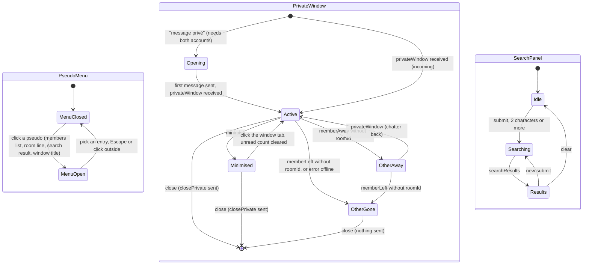

# State diagram — web-ui — pseudo menu, private windows and search panel

> **Feature**: web-ui (roadmap brick 6)
> **Use cases**: UC6, UC7, UC8
> **Business rules**: BR-013, BR-020, BR-040 to BR-044
> **Design**: `docs/architecture/design-pack.md` (pseudo menu, floating private windows, search box)

## Context

The three brick 6 overlays of `InChat` (`web-ui/05`): the pseudo menu, the private windows and the search
panel. The server side is in `private-conversations/07` and `directory/07`. Does not cover reporting
(brick 8 adds "signaler" to the pseudo menu).

## Diagram

## Rules the code applies

- **Pseudo menu**: "message privé", "ignorer" or "ne plus ignorer". Not shown on the chatter's own pseudo.
  "message privé" is greyed when either side has no account (`hasAccount`, BR-040); picking it while the
  chatter has none opens the account panel (`web-ui/06`). "ignorer" sends `ignore`, "ne plus ignorer"
  `unignore`; the list comes back in `ignoreUpdated`.
- **Ignore on screen** (BR-042): messages of ignored session ids are already filtered by the server; the
  client also hides any line it still holds from them, and shows "(ignoré)" after their pseudo in member
  lists. `ignoreUpdated` replaces the list.
- **Opening**: "message privé" opens a window in `Opening` with the composer focused; nothing is sent until
  the first message. A refusal (`warning` or `error` replying to that `sendPrivate`) shows the notice and
  keeps the draft. `accountRequired` also opens the account panel.
- **Windows**: at most 3 open (BR-043; the server enforces it). Each window holds its last 200 lines in
  memory only (BR-034), its own draft, the 500 code point counter of the room composer (BR-020) and an
  unread count while minimised. Lines render through the same `Renderer` (smileys, never HTML).
- **Desktop** (≥ 768 px): floating panels docked bottom right, side by side, the last opened in front.
  **Phone**: a stacked tab bar above the composer, one tab per window, the active window full width
  (design pack, ASV-NF-006).
- **Resume**: `resumed.windows` rebuilds the windows (minimised), `resumed.buffered` appends the buffered
  messages to them and sets their unread counts (BR-013).
- **Account unlinked** (`accountUnlinked`, ASV-F-024): every window closes locally; the server already
  closed them.
- **Search panel**: a "rechercher" field on the rooms screen and a header button in rooms; submit only from 2
  characters (UC7 2a); results list pseudo (colour from gender), age, city, "(absent)", and the rooms they
  are in; click a result → pseudo menu. Results are not refreshed live; a new submit refreshes them.
  At most 50 results (server cap); "aucun chatteur trouvé" when empty.
- **Strings** in `strings.ts`, French; notices for the new codes: `self`, `tooManyWindows`, `targetBusy`, `offline`,
  `accountRequired`.
- **Accessibility** (NF-004): the pseudo menu is a `menu` with `menuitem`s, keyboard reachable from the
  pseudo button; each window is a `dialog` (non-modal) labelled by the other pseudo with an
  `aria-live="polite"` log; the search results are a list of buttons.
