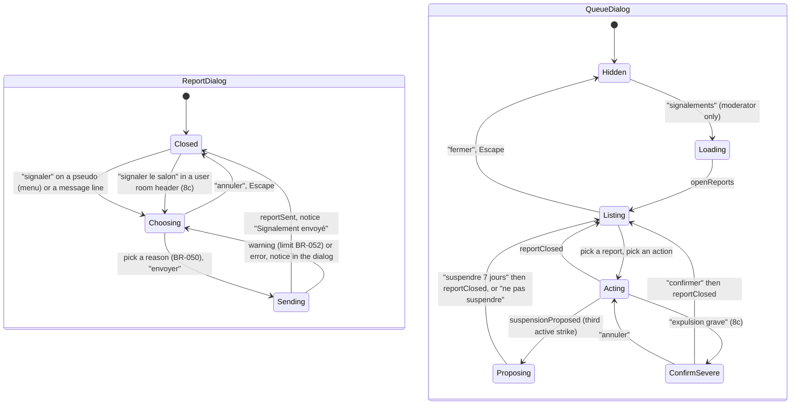

# State diagram — web-ui — report dialog and report queue (brick 8a)

> **Feature**: web-ui (brick 8a, issue #209)
> **Use cases**: UC9, UC11, UC12, UC16i, UC17
> **Business rules**: BR-050 to BR-055, BR-074, BR-075, BR-092, BR-102 to BR-107
> **Design**: `docs/architecture/design-pack.md` (retro modal dialog, same frame as the search dialog)

## Context

The two overlays brick 8a adds to `InChat` (`web-ui/05`): the report dialog every chatter opens from the
pseudo menu or a message line, and the queue dialog only a moderator session sees. Both reuse the
modal dialog of the search panel (`web-ui/07`). Does not cover the moderator panel of brick 8b.

## Diagram

## Notes

- The client builds the context from what it shows: the excerpt (the reported line, or empty for a
  pseudo) and up to the last 20 lines of that room or private window (BR-051), sent with `report`.
- Queue actions: "aucune suite" (`noAction`), "avertir" (`warned`, members only), "expulser" with
  1 h / 24 h / 7 j (`expel`, which closes the report as `expelled` on the server). Each row shows reason, date, excerpt, context,
  pseudos, whether the target has an account and is connected, and its active strikes.
- From brick 8b the queue title reads "Signalements — ‹nom›" (`web-ui/09`).
- The queue is sorted oldest first while there is no triage (BR-092); urgency columns arrive in 8c.
- An `expelled` target sees the expel screen with the end time, then the entry screen (BR-008).
- A `warned` target sees a notice naming the rule and its active strikes.

## Brick 8c (#211)

- Each row shows an urgency badge (haute, moyenne, basse, inconnue) and, when triaged, the category and
  summary under "tri automatique, à vérifier", as text only; the list follows BR-102.
- "signaler le salon" in the header of a user room opens the report dialog with target kind `room`
  (reason, last 20 lines as context); official rooms do not show it.
- On a room report the actions are "aucune suite" and "fermer le salon" (`removeRoom`, BR-106).
- "expulsion grave" (chatter and message reports) asks a confirmation naming the effects: account
  deleted, e-mail blocked 6 months, 7-day ban (BR-103).
- A checkbox "à signaler aux autorités" sits beside every closing action (BR-104); a row with an alert
  shows "alerte : en attente" or "alerte : déposée (canal, référence)".
- No reporter-facing screen: the decision reaches a member reporter by e-mail only (BR-107).
