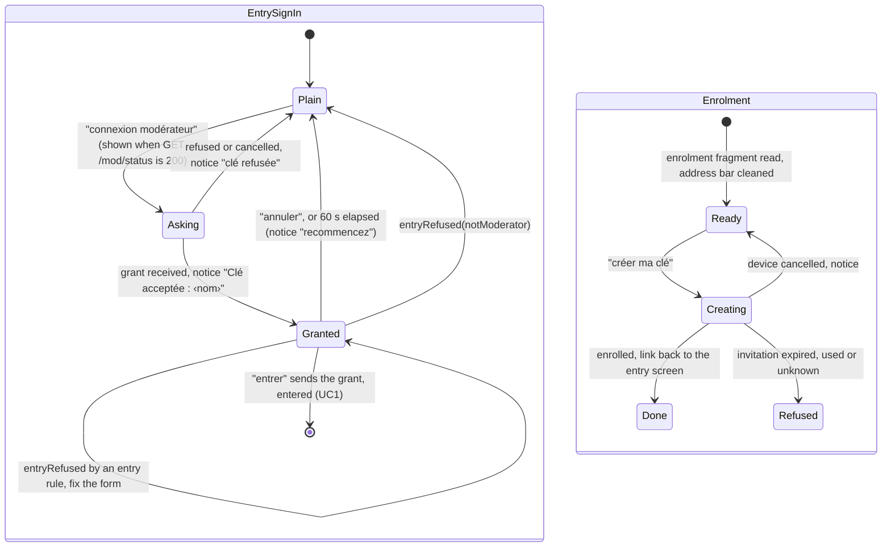

# State diagram — web-ui — moderator sign-in and enrolment (brick 8b)

> **Feature**: web-ui (brick 8b, issue #210)
> **Use cases**: UC15, UC16
> **Business rules**: BR-054, BR-094, BR-095, BR-097, BR-098
> **Design**: `docs/architecture/design-pack.md` (retro modal dialog, entry form)

## Context

The "panneau modérateur" chosen by the owner (choice A, 425/500, 2026-11-13): a "connexion modérateur"
link on the entry form, an enrolment page reached by the invitation link, and the 8a queue dialog
(`web-ui/08`) with the moderator name in its title. Replaces the "modération" token field of 8a. Does
not cover the queue itself.

## Diagram

## Notes

- WebAuthn runs only from the user's click (browser rule); no passkey prompt opens on page load.
- Without `PublicKeyCredential` the link shows "navigateur sans clé d'accès" and stays disabled.
- After `entered(isModerator)` the room screen shows the "signalements" button; the queue title reads
  "Signalements — ‹nom›", from `entered.moderatorName` or `resumed.moderatorName` (BR-095), so it
  survives a reload; this changes the queue title of `web-ui/08`.
- The enrolment page is chosen at load when the fragment starts with `mod/enroll/` (`web-ui/05`); no
  router is added.
- The grant lives in component state only, never in storage.
