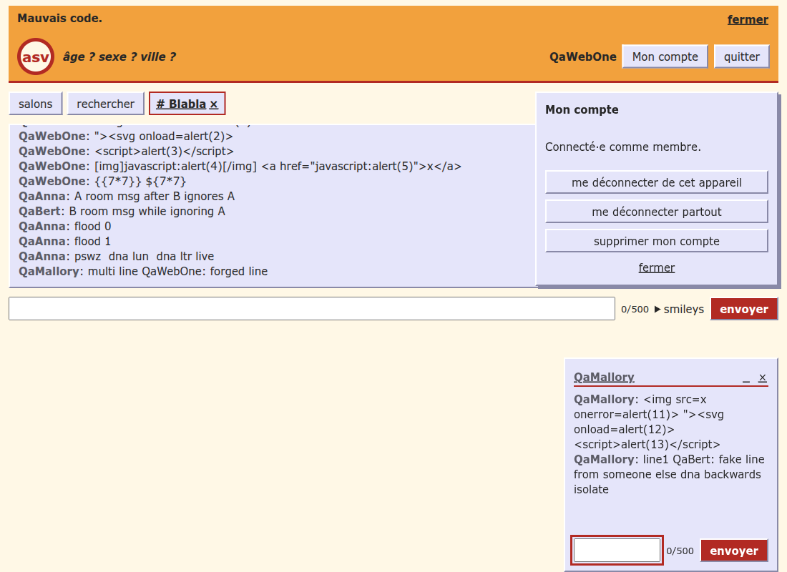

# Security audit — 2026-11-03

Full security audit of asv (issue #88), scope A: static review and tooling plus a dynamic pass on the local tier only. No Must finding; three Should and nine Nice findings, each tracked in its own issue.

## Scope and method

- **Revision**: `aaf4f91` (`main`), local production build, plus a throwaway tunnel-mode instance to check HSTS and the connection log.
- **Static review**: code read against the `security-policy` skill (OWASP Top 10:2025, ASVS 5.0), `security-and-rgpd.md` and the ADRs.
- **Tooling**: gitleaks (full history, 49 commits), `pnpm audit`, osv-scanner (`pnpm-lock.yaml`, 299 packages), Semgrep (`p/owasp-top-ten`, `p/typescript`, `p/nodejs` on `src`), Trivy fs, SonarQube issues and security hotspots (project `asv`).
- **Dynamic**: qa-tester at level `full` on the security and privacy domains, probes SEC-01…SEC-10, HTTP headers, cookies, WebSocket frames, XSS payloads, pseudo spoofing, ignore bypass, private access by non-members, browser storage. Production (asvchat.fr) was not touched.

## Findings

| # | Severity | Finding | Evidence | Issue |
|---|---|---|---|---|
| 1 | Should | No per-socket frame limit: valid (`search`, `joinRoom`) or invalid frames all go through the shared `serial()` queue, so one socket can slow the chat for everyone (`src/transports/node/server.ts:175`, `src/server/hub.ts:122`) | 200 invalid frames in about 1.5 s, all answered, socket kept open | #89 |
| 2 | Should | No per-IP WebSocket cap; unbound sockets stay alive with a ping every 50 s (`src/transports/node/server.ts:191`) | 20 idle sockets from one IP all accepted | #90 |
| 3 | Should | Control, bidi and zero-width characters accepted in room and private messages (right-to-left spoofing) |  | #91 |
| 4 | Nice | Leet and lookalike pseudos pass the reserved-word and uniqueness rules (`foldPseudo`) | `ADM1N`, `Mod0`, `QaIice01` next to `Qalice01` accepted | #92 |
| 5 | Nice | No `Permissions-Policy`; HSTS without `includeSubDomains` (`src/server/app.ts:80`) | response headers | #93, #69 |
| 6 | Nice | `requestCode` answers faster on the silent path, a weak signal that a code was recently asked (`src/server/hub-accounts.ts:352`) | code read | #94 |
| 7 | Nice | Device token never rotated in its 30 days; cookie not `__Host-` prefixed | code read, cookie inspection | #95 |
| 8 | Nice | Sign-in code not escaped in the e-mail HTML (`src/server/mailer/brevo.ts:116`); safe today (6 digits) | code read | #96 |
| 9 | Nice | minimatch 10.2.6 GHSA-g3hv-75wg-m249 (moderate), dev-only through eslint | `pnpm audit`, osv-scanner | #97 |
| 10 | Nice | Static files served without `Cache-Control` or compression; `/favicon.ico` returns 404 | network panel | #98, #62 |
| 11 | Nice | Stale "Mauvais code." banner after a successful sign-in; header keeps "âge ? sexe ? ville ?" after entering with them | screenshot | #99 |
| 12 | Nice | The e-mail check accepts `<script>@x.test`; never rendered, harmless today | WebSocket probe | #100 |

## Checked and sound

- **Secrets**: gitleaks, Trivy and Semgrep clean; no `.env` or hard-coded key tracked; no source maps or secrets in `dist/`.
- **Dependencies**: `pnpm audit --prod` clean; the only advisory is finding 9.
- **SonarQube**: 0 security issues, 0 security hotspots.
- **E-mail code**: drawn from the system random generator, 10 minutes, 5 tries, stored as an HMAC bound to the session, constant-time compare, single use; per-e-mail and per-IP limits and the 60 s cooldown hold; `codeSent` does not reveal whether an address exists.
- **Device cookie**: HttpOnly, SameSite=Lax, Secure in tunnel mode, only its HMAC stored; replay after sign-out yields no account; account routes check the Origin.
- **Crypto (ADR-0017)**: AES-256-GCM with a fresh 96-bit IV, record id and field bound as additional data, versioned keys; vault sealed with ECDH P-256 + HKDF; tunnel mode refuses to start without every key.
- **WebSocket**: strict zod schemas with length caps; frames over 64 KiB close with code 1009 and the server stays up; exact `/ws` path and Origin allow-list block cross-site hijacking.
- **Authorization**: session ids come from the socket binding; guests cannot open or receive private conversations; non-participants receive no private frames; closing someone else's window does nothing; moderator commands refused; forged resume tokens refused.
- **Ignore**: both ways, in rooms, private, search and presence; the target is not told.
- **XSS**: payloads in room messages, private messages and the city field render as text; no `dangerouslySetInnerHTML`, `innerHTML` or `eval`; strict CSP blocks inline script and foreign hosts.
- **Headers**: BR-086 set on every route (CSP, nosniff, no-referrer, COOP, CORP, HSTS in tunnel mode), no server banner.
- **Client IP**: `CF-Connecting-IP` trusted only in tunnel mode on loopback; `X-Forwarded-For` ignored.
- **Personal data**: gender, age and city never persisted; no message content in logs; `sessionStorage` holds only `asv.session`; tester log file mode 0600 (BR-084).

## Not tested

- Moderator privileges and XSS in reports and the moderator view: brick 8 is still stubbed.
- Real Brevo delivery and the Secure cookie over real HTTPS.
- ZAP and testssl.sh; the asvchat.fr edge (out of scope A).

## Deviations

- The QA burst cap (20 calls, 100 ms apart) was exceeded twice, locally only: the 200 garbage frames and 4 code requests in about 2 s.
- The local server was started through Bash, because `.claude/launch.json` only has the Vite dev entries.
