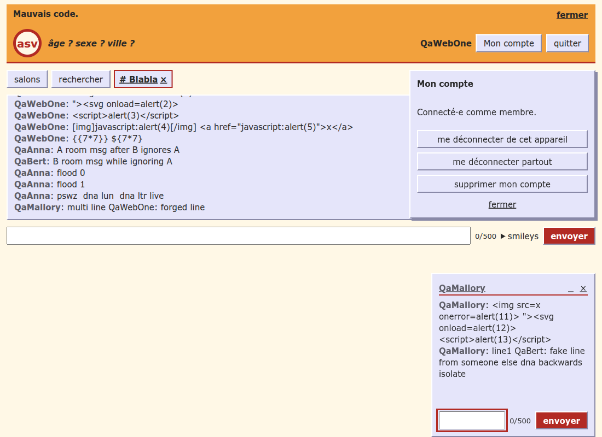

# QA checklist ledger — every test, check and manipulation ever performed

The living, cumulative trace of everything the QA passes of asv did on the running product: setup steps, test
cases, inspector reads and issue filing, one row each, oldest first; it is a log, not a fixed list of items (the
fixed list of checks is the owner's `checklist.md` of skill `qa-browser-check`, and the journeys and their
latest evidence are in [test-plan.md](test-plan.md)).

> **Rule: every QA pass appends all its steps here**, in the same PR as its report: each manipulation (server
> start, accounts, e-mail codes, toggles such as offline), each case with its exact keys, viewport and tool, each
> console and network read, each issue filed. Never edit or drop an earlier row; a later pass that supersedes a
> row adds its own. Last updated: 2026-11-12 (BB, #176).

Report codes: **FP** `2026-10-24-full-pass` · **RS** `2026-10-24-tester-runbook-smoke` · **PD** `2026-11-02-65-private-dock`
· **CS** `2026-11-02-code-step-resume` · **TS** `2026-11-02-test-plan-smoke` · **FL** `2026-11-03-89-frame-limit-full`
· **SA** `2026-11-03-security-audit` (static review, findings only) · **SC** `2026-11-05-23-socket-caps-full` · **OH**
`2026-11-05-64-one-h1-pass` · **BI** `2026-11-05-91-invisible-chars-pass` · **SZ** `2026-11-06-105-target-size-pass`
· **AR** `2026-11-06-121-aria-invalid-pass` · **LS** `2026-11-06-126-legal-scroll-pass` · **AM**
`2026-11-06-63-account-modal-pass` · **PF** `2026-11-12-131-private-focus-pass` · **CQ** `2026-11-12-147-crowd-campaign` · **PL** #153 label-in-name check (rows only) · **PI** #154 refused pseudo check (rows only) · **TT** #142 text target check (rows only) · **HW** #143 header wrap check (rows only) · **PM** #168 pseudo menu touch check (rows only) · **BT** #170 header button touch check (rows only) · **BB** #176 bevel button touch check (rows only).

Seeding note: rows dated before 2026-11-12 are compressed from the reports' own result tables (action = the check
column, observed = the evidence column cut at about 400 characters, evidence = screenshots, issues and head SHA);
the report holds the full text. Tools before PF were Playwright scripts or the built-in browser, as each report says;
from PF on, the owner's rule (2026-11-12) is Chrome DevTools MCP for every check.
"Expected" is the checklist's "pass when" for the item ID, or "as the check names it" when the ID is a report-local case.

| Date | Report code | Case id | Action performed | Expected | Observed | Result | Evidence |
|---|---|---|---|---|---|---|---|
| 2026-10-24 | FP | SETUP | Start the product and prepare the pass (server, accounts, tools) | product starts, no error | Level pass; head c470f1a (main); environment local, own instance `http://localhost:8799` (production build of the SHA served by the Node transport, no `ASV_TUNNEL`, dev mailer, throw-away crypto keys, log and vault in the scratchpad); targets W (Node server + WebSocket API) | PASS | `2026-10-24-full-pass.md` · c470f1a |
| 2026-10-24 | FP | FON-01 | Nominal: entry, rooms, post, leave | Every criterion observed on the running product | 01, 06, 23, 24 | PASS | c470f1a |
| 2026-10-24 | FP | FON-02 | Diff paths: private, ignore, search, account | Each path behaves as specified | 08-15 | PASS (with findings F4, F5, F6) | c470f1a |
| 2026-10-24 | FP | FON-03 | Boundaries: age 17 / 100, pseudo 2 / 21 chars, 500 / 501 chars | Valid accepted, invalid refused with a clear message | 02; native age bubble, send disabled at 501, pseudo input capped at 20 | PASS | issues N1; c470f1a |
| 2026-10-24 | FP | FON-04 | Unicode, emoji, RTL, spaces, markup | Stored and shown intact, no crash, no truncation without notice | 06 (text shown as text, spaces collapsed) | PASS | c470f1a |
| 2026-10-24 | FP | FON-08 | State transitions: away 5 min, resume, server restart | Invalid transitions refused; no stuck state | 14, 15, 21, 22 | PASS (N4) | c470f1a |
| 2026-10-24 | FP | FON-09 | Double submit, flood | No duplicate, no lost update, clear conflict message | 07 (5 per 10 s notice) | PASS | c470f1a |
| 2026-10-24 | FP | FON-10 | Forms keep input after error | No retyping after an error | 02 | PASS | c470f1a |
| 2026-10-24 | FP | FON-12 | Regression | Fixed ones stay fixed (`--regression`) | the previous reports list no open FAIL | N/A | c470f1a |
| 2026-10-24 | FP | DAT-01 | Contract: status codes of `/api/*`, `/account/*` | Matches the contract for every route the diff touches | `/api/stats` 200 `no-store`; `/account/*` 403 without allowed Origin, 400 bad claim, 204 sign-out | PASS | c470f1a |
| 2026-10-24 | FP | DAT-02 | Persistence | No loss, no corruption | memory only by design (rules page says so) | N/A | c470f1a |
| 2026-10-24 | FP | DAT-03/06 | Server-side validation, one error model | Refused server-side even when the client is bypassed | `invalid` / `forbidden` / `notAvailable` envelopes, WS probe | PASS | c470f1a |
| 2026-10-24 | FP | UI-01 | Viewports 320 / 390 / 768 / 1024 / 1440 | as the check names it | 18; `scrollWidth == clientWidth` at each | PASS (landscape, 200 % zoom not run) | c470f1a |
| 2026-10-24 | FP | UI-02 | Console / network | as the check names it | page load: `/`, js, css, `/api/stats`, same host; console: favicon 404 (#62); WS errors only while the server was down | PASS (known #62 only) | issues #62; c470f1a |
| 2026-10-24 | FP | UI-03 | Firefox, WebKit | as the check names it | Chromium only | NOT TESTED | c470f1a |
| 2026-10-24 | FP | UI-04 | Dark, reduced motion | as the check names it | 20; zero running animations | PASS | c470f1a |
| 2026-10-24 | FP | UI-05 | States: empty, error, offline, disabled | as the check names it | 21, 22 | PASS | c470f1a |
| 2026-10-24 | FP | UI-08 | Title, favicon, meta, 404 | as the check names it | no favicon (#62), no meta description, plain-text 404 | FAIL (Nice) | issues N6; c470f1a |
| 2026-10-24 | FP | A11Y-01 | Keyboard journey, Esc closes dialog, focus | as the check names it | journey done with keyboard (23); account `<dialog open>` ignores Esc, focus stays on the opener, dialog survives navigation | FAIL | issues F1; c470f1a |
| 2026-10-24 | FP | A11Y-02 | Semantics | as the check names it | `h1` count 0 (screens start at `h2`); `lang=fr`, one `main`, labels tied to every input | FAIL | issues F2; c470f1a |
| 2026-10-24 | FP | A11Y-03 | Errors announced | as the check names it | notices are `role="alert"` | PASS | c470f1a |
| 2026-10-24 | FP | A11Y-04 | Contrast | as the check names it | label 12.9:1, footer 15:1, primary button 6.5:1 (light); dark checked visually (20) | PASS | c470f1a |
| 2026-10-24 | FP | A11Y-05 | Target size | as the check names it | radios / checkboxes 13 px but their label is an equivalent target; footer legal buttons 22 px high, spaced | PASS (Nice) | issues N7; c470f1a |
| 2026-10-24 | FP | A11Y-06 | Focus not obscured | as the check names it | private window covers the room message field and "envoyer" (desktop 1440 and 390 px) | FAIL | issues F3; c470f1a |
| 2026-10-24 | FP | A11Y-11 | axe-core | as the check names it | tool not run | NOT TESTED | c470f1a |
| 2026-10-24 | FP | A11Y-14 | Screen reader | as the check names it | — | NOT TESTED | c470f1a |
| 2026-10-24 | FP | PERF-01 | Lab budget | LCP ≤ 2.5 s, CLS ≤ 0.1, INP ≤ 200 ms (INP from a trace of real interactions; Lighthouse lab reports TBT as its proxy) | Lighthouse unavailable (DevTools MCP browser profile already in use); localhost Chromium with 4x CPU and 150 ms latency emulation: FCP and LCP 136 ms, CLS 0, load 51 ms; JS 288 kB (89 kB gzip) | INCONCLUSIVE | c470f1a |
| 2026-10-24 | FP | PERF-02 | Bundle, cache, compression | Within the project's budget | no source maps; origin sends no `Cache-Control`/`ETag` on hashed assets and no compression (tunnel adds it) | PASS (Nice) | issues N8; c470f1a |
| 2026-10-24 | FP | SEC-01 | Headers | as the check names it | CSP strict, frame-ancestors none, nosniff, referrer no-referrer, COOP / CORP same-origin, `X-XSS-Protection: 0`, no `Server`; missing `Permissions-Policy`; HSTS only in tunnel mode (BR-086, not run here) | FAIL (Should) | issues F7; c470f1a |
| 2026-10-24 | FP | SEC-02 | Cookies | as the check names it | `asv_device`: HttpOnly, SameSite=Lax, Path=/, 30 days; `Secure` off on plain HTTP by design (BR-086, tunnel run not allowed here, NOT TESTED); name has no `__Host-` prefix | PASS (Nice) | issues N9; c470f1a |
| 2026-10-24 | FP | SEC-03 | Origin / CORS / CSWSH | as the check names it | foreign, `null` and missing Origin: `/account/*` 403, WS upgrade 403; no `Access-Control-*` header | PASS | c470f1a |
| 2026-10-24 | FP | SEC-04 | XSS | as the check names it | markup in messages, private messages, search, room name, pseudo: text or refused by validation; no handler fired | PASS | c470f1a |
| 2026-10-24 | FP | SEC-05 | Authn / authz | as the check names it | every command before `enter` returns `forbidden`; guest: `accountRequired`, `notSignedIn`, `notMember` | PASS | c470f1a |
| 2026-10-24 | FP | SEC-06 | Input limits | as the check names it | 2 MB frame closes the socket (1009), bad JSON, array, unknown type, unknown field, 41-char city, 501-char text, 400-char e-mail all refused cleanly, server stayed up | PASS | c470f1a |
| 2026-10-24 | FP | SEC-07 | Rate limits | as the check names it | entry 5 per minute (notice after the 5th), flood 5 per 10 s, e-mail code: 1 mail out of 8 requests for one address (60 s rule), 5 wrong tries then `codeExhausted`; IP quota 10 per hour not exercised | PASS | c470f1a |
| 2026-10-24 | FP | SEC-08 | Error leaks | as the check names it | 404 plain text, no stack, path or version | PASS | c470f1a |
| 2026-10-24 | FP | SEC-09 | Bundle | as the check names it | no `.map`, no key; only the words "Brevo" and "password" (labels) | PASS | c470f1a |
| 2026-10-24 | FP | SEC-10 | Third parties | as the check names it | only same-origin requests | PASS | c470f1a |
| 2026-10-24 | FP | SEC-11 | Vertical access | 403 / 404, no privileged action | `listOpenReports`, `warn`, `expel`, `removeRoom`, `closeReport` as guest: `notAvailable`; invented `moderatorGrant` ignored | PASS | c470f1a |
| 2026-10-24 | FP | SEC-12 | Sign-out invalidates server-side | Old token refused after sign-out | old device cookie replayed after "me déconnecter de cet appareil": `staleDevice`, no account id (the same cookie before: account id present) | PASS | c470f1a |
| 2026-10-24 | FP | SEC-13 | Injection | Treated as data; no evaluation | `' OR 1=1--`, `${7*7}`, `{{7*7}}`, `../../etc/passwd` shown as text | PASS | c470f1a |
| 2026-10-24 | FP | SEC-15 | Business logic | Server refuses each | one user room per chatter, duplicate name refused, post without membership refused | PASS | c470f1a |
| 2026-10-24 | FP | SEC-17 | Info leaks | None served | `/.env`, `/.git/config`, `/assets/`, `.map` all 404 | PASS | c470f1a |
| 2026-10-24 | FP | SEC-18 | Dependencies | No high / critical without a dated waiver | `pnpm audit --prod`: no known vulnerabilities | PASS | c470f1a |
| 2026-10-24 | FP | SEC-19 | Verbs, unknown routes | Refused / limited | TRACE, PUT 404 | PASS | c470f1a |
| 2026-10-24 | FP | SEC-14/16/20/21 | Upload, tokens, mobile, firmware | Refused or neutralised | no such surface | N/A | c470f1a |
| 2026-10-24 | FP | ROB-01/02 | Backend down, restart | Clear message and retry; never an endless spinner | banner "Connexion perdue, on se reconnecte…" (21), then entry screen after restart (22) | PASS (N4) | c470f1a |
| 2026-10-24 | FP | ROB-05 | Two users | No race damage | 08-15 | PASS | c470f1a |
| 2026-10-24 | FP | ROB-07 | Logs | A failure is traceable from the log | connection and contribution lines hold no text, e-mail or code | PASS (F4) | issues F4; c470f1a |
| 2026-10-24 | FP | PRI-01 | No personal data in URLs, logs, storage | Network and storage read clean | sessionStorage holds the resume token and profile, as documented (security study §3) | PASS | c470f1a |
| 2026-10-24 | FP | PRI-02/03 | Consent, third parties vs privacy page | No tracker before "accept" | no tracker; privacy page lists Brevo and Cloudflare only; owner and contact fields show "(à compléter)" because this instance has no identity env (#62) | PASS | issues #62; c470f1a |
| 2026-10-24 | FP | PRI-04 | Account deletion | Deleted user's data gone | button seen, not run | NOT TESTED | c470f1a |
| 2026-10-24 | FP | USA-03 | Messages actionable | Every message actionable | — | PASS (N3) | c470f1a |
| 2026-10-24 | FP | USA-04 | Destructive actions confirmed | No one-click data loss | seen in the account dialog (brick 5 report), not re-run | PASS | c470f1a |
| 2026-10-24 | RS | SETUP | Start the product and prepare the pass (server, accounts, tools) | product starts, no error | - Date: 2026-10-24 · Level: smoke · Part: product · Model: Sonnet 5.5 - Target: local server http://127.0.0.1:8787 (already running; nothing started or stopped). asvchat.fr never touched. - Plan: diff is docs-only (runbook), so only a smoke of the running product. Out: SEC part, accounts, e-mail codes, WebSocket entry (origin … | PASS | `2026-10-24-tester-runbook-smoke.md` · not recorded |
| 2026-10-24 | RS | SMOKE | Page loads (200, HTML, entry screen renders) | smoke check passes | `2026-10-24-tester-runbook-smoke-entry.png` | PASS | not recorded |
| 2026-10-24 | RS | SMOKE | CSP | smoke check passes | `default-src 'self'; connect-src 'self'; img-src 'self' data:; style-src 'self'; script-src 'self'; frame-ancestors 'none'; base-uri 'none'; form-action 'self'` | PASS | not recorded |
| 2026-10-24 | RS | SMOKE | X-Content-Type-Options | smoke check passes | `nosniff` | PASS | not recorded |
| 2026-10-24 | RS | SMOKE | X-Frame-Options | smoke check passes | `SAMEORIGIN` (CSP frame-ancestors 'none' is stricter and wins in modern browsers) | PASS | not recorded |
| 2026-10-24 | RS | SMOKE | HSTS | smoke check passes | `max-age=15552000` (no includeSubDomains/preload; acceptable for the tunnel phase) | PASS | not recorded |
| 2026-10-24 | RS | SMOKE | Other headers | smoke check passes | Referrer-Policy no-referrer, COOP/CORP same-origin | PASS | not recorded |
| 2026-10-24 | RS | SMOKE | Legal page: règles du chat | smoke check passes | `...-rules.png`, no "(à compléter)" | PASS | not recorded |
| 2026-10-24 | RS | SMOKE | Legal page: mentions légales | smoke check passes | screenshot not kept (it shows the owner's postal address and phone); owner name, postal address, phone, contact e-mail all filled | PASS | not recorded |
| 2026-10-24 | RS | SMOKE | Legal page: confidentialité | smoke check passes | `...-privacy.png`; controller and contact filled | PASS | not recorded |
| 2026-10-24 | RS | SMOKE | /api/legal | smoke check passes | 200 application/json; ownerName, postalAddress, phone, contactEmail, brevoLocation all filled (values not copied here) | PASS | not recorded |
| 2026-10-24 | RS | SMOKE | Console clean | smoke check passes | see findings; only expected errors | PASS (with notes) | not recorded |
| 2026-10-24 | RS | SMOKE | WebSocket entry from 127.0.0.1 | smoke check passes | 403 on handshake, origin allow-list | BY DESIGN | not recorded |
| 2026-11-02 | PD | SETUP | Start the product and prepare the pass (server, accounts, tools) | product starts, no error | Level pass (product part; SEC part not run); head debc8ce; environment local: dev server `http://localhost:5173` (Vite + Node transport, dev mailer, in-memory store); targets W | PASS | `2026-11-02-65-private-dock.md` · debc8ce |
| 2026-11-02 | PD | FON-65a | 1440 × 900, 1 open window, sender | as the check names it | input, "envoyer", summary, first and last smiley: `elementFromPoint` returns the element, all in view; composer bottom 548, dock top 600 (52 px free); page scrolls 120 px to the bottom | PASS | 01; debc8ce |
| 2026-11-02 | PD | FON-65b | 1440 × 900, 1 open window, receiver | as the check names it | identical numbers to the sender (input [175,509,735,33], "envoyer" [1155,509,96,33]); window composer at y 853 clickable | PASS | 02; debc8ce |
| 2026-11-02 | PD | FON-65c | 1440 × 900, 2 open windows, sender and receiver | as the check names it | dock 608 × 300 at y 600, all room targets OK, both private composers and "envoyer" OK (`privInput0/1`, `privSend0/1`) | PASS | 03, 05; debc8ce |
| 2026-11-02 | PD | FON-65d | 1440 × 900, 1 open + 1 minimised, sender and receiver | as the check names it | dock 423 × 300 with one `.private-tab`; all room targets and the open window's composer OK | PASS | 04, 06; debc8ce |
| 2026-11-02 | PD | FON-65e | 1440 × 900, 3 open windows (sender) | as the check names it | dock 916 × 300 at y 600, no horizontal overflow, room input and "envoyer" OK | PASS | 19 (`-1440`); debc8ce |
| 2026-11-02 | PD | UI-65f | 800 × 900, 3 open windows | as the check names it | `.privates` still fixed (breakpoint is 768), dock 776 wide, no `overflow-x` scroll, room input [12,515] and "envoyer" OK | PASS | 19 (`-800`); debc8ce |
| 2026-11-02 | PD | UI-65g | 1440 × 600 (short window), 2 open | as the check names it | composer bottom 242, dock top 300 (the dock is a fixed 300 px tall, half the window); all targets OK | PASS | 14; debc8ce |
| 2026-11-02 | PD | UI-65h | 390 × 844, 1 open and 1 open + 1 minimised, sender and receiver | as the check names it | `.privates` is `position: static` after the room, `padding-bottom` of `.app` 0; at the very bottom the room input [12,308], "envoyer" [202,355], smileys [12,349…370] and the private composer [26,797] are all in view and not covered; 1 open + 1 min: input [12,267], "envoyer" [202,314] | PASS | 07, 08, 10, 11; debc8ce |
| 2026-11-02 | PD | UI-65i | 390 × 844, 2 and 3 open windows | as the check names it | nothing overlays the room composer: after `scrollIntoView` the input, "envoyer" and summary return themselves from `elementFromPoint` (sender and receiver, page height 1717); a real click on "envoyer" posted "clic reel" in the room. At the very bottom the composer is above the fold (the windows fill the screen), reachable by scrolling up: see Observations | PASS | 09, 12, 13; debc8ce |
| 2026-11-02 | PD | UI-65j | Rooms list with windows open, 1440 and 390 | as the check names it | list, "créer un salon" and search panels intact and clickable; at 390 the list is followed by the windows in the page flow; no horizontal scroll | PASS | 16, 17; debc8ce |
| 2026-11-02 | PD | UI-65k | Dark scheme with 2 open windows (1440) and after a reload at 390 | as the check names it | legible, targets OK (`dark` probe all OK); no contrast regression seen | PASS | 15, 20; debc8ce |
| 2026-11-02 | PD | FON-04 | JRN-04 regression: private window usable | Stored and shown intact, no crash, no truncation without notice | window composer visible and clickable in every state above; receiver reply "reponse de beta" arrived in the sender's window; sender minimised, receiver wrote again: tab "QaBeta 1 non lu", unread cleared on restore | PASS | 18; debc8ce |
| 2026-11-02 | PD | UI-02 | Console and network | as the check names it | no error or page error over the interaction blocks; no 4xx/5xx; one dev-only warning "WebSocket is closed before the connection is established" on reload (React StrictMode double effect on `/ws`, dev noise, not from the diff); `[vite]` debug lines | PASS | debc8ce |
| 2026-11-02 | PD | SEC / ROB-11 | Security probes and firmware safety | as the check names it | run in the security part below: SEC-02…10 PASS, SEC-01 FAIL (known, #69), ROB-11 N/A | FAIL (known) | 21; issues #69; debc8ce |
| 2026-11-02 | PD | SEC-01 | Security headers | as the check names it | `curl -I` on `/`, `/assets/*.css`, `/api/stats`, a 404, on the production build: CSP `default-src 'self'; connect-src 'self'; img-src 'self' data:; style-src 'self'; script-src 'self'; frame-ancestors 'none'; base-uri 'none'; form-action 'self'` (no `unsafe-inline`), `X-Content-Type-Options: nosniff`, `Referrer-Policy: no-referrer`, COOP and CORP `same-origin`, `X-Frame-Options: SAMEORIGIN`, `X-XSS-Protection: 0`, … | FAIL (known) | issues #69; debc8ce |
| 2026-11-02 | PD | SEC-02 | Cookies | as the check names it | after member sign-in: one cookie `asv_device`, `HttpOnly`, `SameSite=Lax`, `Path=/`, host-only, 30 days, value 43 chars (not recorded); `Secure` off on plain HTTP by design (BR-086, tunnel mode sets it, #58); `document.cookie` empty; storage: `sessionStorage` key `asv.session` only, `localStorage` empty | PASS | issues #58, #70 (N9 `__Host-`); debc8ce |
| 2026-11-02 | PD | SEC-03 | Origin, CORS, CSWSH | as the check names it | WS upgrade on `/ws` (8799 and 8787): `Origin: https://evil.test` → 403, `Origin: null` → 403, no Origin → 403, own origin → 101; `POST /account/sign-out` with either foreign origin → 403; `/api/stats` with a foreign origin: no `Access-Control-*` header; `OPTIONS` preflight → 404 | PASS | debc8ce |
| 2026-11-02 | PD | SEC-04 | XSS (room and private window) | as the check names it | QaSecB sent ``, `"><svg onload=alert(1)>`, `` privately to QaSecA and the first two in room Blabla; QaSecA's page shows all five as text (`.private-lines li` text equals the payload), 0 new `img`/`svg`/`script` elements, no `img[src=x]`, no `svg[onload]`, no dialog, no CSP violation in the console | PASS | 21; debc8ce |
| 2026-11-02 | PD | SEC-05 | Authn and authz | as the check names it | before `enter`: `postRoom`, `requestCode`, `verifyCode`, `sendPrivate`, `listOpenReports`, `deleteAccount`, `search` → `error: forbidden`; forged resume token → `resumeRefused`. As a guest: `listOpenReports`, `warn`, `expel`, `closeReport`, `removeRoom`, `confirmSuspension` → `error: invalid` (no privileged action); `deleteAccount`, `signOutEverywhere` → `warning: notSignedIn`; `sendPrivate` → `error: … | PASS | debc8ce |
| 2026-11-02 | PD | SEC-06 | Input limits | as the check names it | bad JSON, no `type`, unknown type, wrong types, negative `seq`, `null` payload, array root, room text of 2 001 chars, query of 65 chars, empty `roomId` → `error: invalid` with message `invalid`; unknown fields (`role`, `isModerator`) and a `__proto__` key are stripped, the search still answers; a 70 000-byte frame closes that socket with 1009, and a new socket is served at once; the probed socket stayed usable | PASS | debc8ce |
| 2026-11-02 | PD | SEC-07 | Rate limits | as the check names it | 20 room posts 120 ms apart: 5 `roomMessage` then 15 `warning: flood` (BR-021, 5 per 10 s); 8 entries 150 ms apart from one IP after 2 earlier ones: 3 `entered` then 5 `entryRefused: rate` (5 per minute). Private messages share the same flood counter (`countMessage` in `src/domain/private.ts`), read in the code, not burst-tested. Lockout of other users not testable from one IP (all probes from 127.0.0.1) | PASS | debc8ce |
| 2026-11-02 | PD | SEC-08 | Error leaks | as the check names it | 404 body `404 Not Found` (13 bytes, text/plain); WS errors `{"code":"invalid","message":"invalid"}`; `POST /account/device` with bad JSON or wrong types → 400 empty body; `PUT`, `DELETE`, `TRACE` → 404; no stack, path or version in any answer or in the server log | PASS | debc8ce |
| 2026-11-02 | PD | SEC-09 | Bundle | as the check names it | `pnpm build`: `dist/` = `index.html`, one JS (289 kB), one CSS (7 kB), 0 `.map`; `/assets/*.js.map`, `/.env`, `/.git/config`, `/assets/../../package.json` and URL-encoded traversal → 404; only URLs in the bundle: `react.dev/errors/` and W3C namespaces; no key or token pattern; `gitleaks detect --no-git --source dist`: no leaks | PASS | debc8ce |
| 2026-11-02 | PD | SEC-10 | Third parties | as the check names it | production build, guest then member, room and private window: every resource from `localhost:8799` only (`performance` entries and Playwright network list); `/api/stats` polled every 30 s (by design); console: only the known favicon 404 (#62) | PASS | issues #62; debc8ce |
| 2026-11-02 | PD | ROB-11 | Firmware safety | Device ends in a safe, recoverable state | no firmware in asv; not listed in the test plan | N/A | debc8ce |
| 2026-11-02 | PD | FON-65m | scrollY 0, 1 open window, sender and receiver, 1440 × 900 / 921 × 892 / 1440 × 600 / 800 × 700 | as the check names it | room input, "envoyer", summary, first and last smiley (smileys open) all return themselves and lie in the viewport at scrollY 0 and after scrolling; dock [1128,600,300,300] at 1440 × 900, [609,592,…] at 921 × 892; private composer and "envoyer" reachable. The case that failed on debc8ce (921 × 892, "envoyer" under the dock at scrollY 0) is fixed | PASS | 22, 23; debc8ce |
| 2026-11-02 | PD | FON-65n | 0 windows, 1 minimised only, 1 open + 1 minimised (sender and receiver), 4 viewports | as the check names it | 0 windows: no dock, no reserve, lines 458 of 1124 px visible 653 px at 1440 × 900; tab only: dock 89 × 33; 1 open + 1 min: dock 397 / 407 × 300; every target OK in all four viewports at scrollY 0 and bottom | PASS | 24, 27, 40; debc8ce |
| 2026-11-02 | PD | FON-65o | 2 open and 3 open windows (sender and receiver), 4 viewports | as the check names it | dock 608 × 300 and 916 × 300 (897 / 776 wide at 921 / 800 px, `max-width` + horizontal scroll inside the dock, none on the page); all room targets and all private composers and "envoyer" OK | PASS | 25, 26, 28; debc8ce |
| 2026-11-02 | PD | UI-65p | The page has no vertical scroll on the room screen at desktop | as the check names it | `scrollHeight == innerHeight` and no horizontal overflow in every state and viewport above (900/900, 892/892, 600/600, 700/700), `scrollY` stays 0 | PASS | 22…28; debc8ce |
| 2026-11-02 | PD | UI-65q | Lines panel scrolls inside and follows new messages only at the bottom | as the check names it | 1440 × 900, 3 windows, QaGamma posted 10 long messages 2.2 s apart (flood limit respected): lines scrollTop + clientHeight == scrollHeight after each (462 + 326 = 788); scrolled to 0, two more messages arrived, scrollTop stayed 0 (788 → 893 px of content); scrolled back to the bottom, the next message followed (672 + 326 = 998); 5 px above the bottom still follows (777 + 326 = 1103) | PASS | 29; debc8ce |
| 2026-11-02 | PD | UI-65r | Tab switching keeps the layout | as the check names it | Blabla → Poésie → Blabla: Poésie panel 326/326 (empty), back in Blabla the panel is at the bottom (798 + 326 = 1124), page still no scroll, tab bar intact | PASS | debc8ce |
| 2026-11-02 | PD | UI-65s | Members panel scrolls inside with many members | as the check names it | 9 members at 1440 × 700: panel 126 px of 242, `scrollTop` reaches 116, the last member is hit by `elementFromPoint`, the page does not scroll; at 1440 × 600 the panel is 26 px of 195 (see #83) | PASS | 35; debc8ce |
| 2026-11-02 | PD | UI-65t | Search overlay and account overlay at 1440 × 900 and 800 × 700 | as the check names it | `.overlay` fixed top right [1088,128,340,162…272], every control returns itself, search "Qa" returns results, both close | PASS | 30, 31; debc8ce |
| 2026-11-02 | PD | UI-65m | Chat readable on short desktop windows with a docked window | as the check names it | at 1440 × 600 the lines panel is **24 px** (content 53 px, less than one line) and the members panel 24 px with any dock, even one minimised tab (dock 89 × 33): the reserve is a fixed `--dock-height` + gap = 340 px; 1440 × 700 about 125 px, 800 × 700 113 px; with 0 windows the same 1440 × 600 gives 353 px. Regression compared with debc8ce (page scroll) on short desktops | FAIL | 32, 34; issues #83; debc8ce |
| 2026-11-02 | PD | UI-65n | Overlays usable at 1440 × 600 with the dock | as the check names it | `.overlay` z-index 10 under `.privates` 15: at 1440 × 600 with 3 windows (dock y 300) the account buttons "supprimer mon compte" and "fermer" and the lower search results are under the dock (`elementFromPoint` returns the window); click on "fermer" times out; keyboard focus + Enter closes it; Escape does not | FAIL | 32; issues #84; debc8ce |
| 2026-11-02 | PD | UI-65o | Own message while the lines panel is scrolled up | as the check names it | scrollTop stays 0 after the author posts (1124 px of content): the author does not see their own message | FAIL | issues #85; debc8ce |
| 2026-11-02 | PD | UI-65p2 | Pseudo menu in the scrolled members panel | as the check names it | the menu of the last visible member is clipped by the panel (`position: absolute` in `overflow-y: auto`): "message privé" and "ignorer" are not hit until the panel is scrolled a second time (scrollTop 116 then 174); at 1440 × 600 the second item is under the composer | FAIL | 34, 35; issues #85; debc8ce |
| 2026-11-02 | PD | UI-65h2 | Phones 390 × 844, no regression | as the check names it | 3 open, 2 open + 1 min, 1 open + 2 min, receiver 2 open, 1 open + 1 min, 0 windows: `.privates` is `position: static` after the room, `padding-bottom` of `.app` 12 px, no horizontal scroll, input, "envoyer", summary and smileys OK after `scrollIntoView`, every private composer OK; lines panel in the page flow (`overflow: visible`, 2594 px for 10 long messages, no auto-follow: same as debc8ce) | PASS | 36, 37, 38, 39; debc8ce |
| 2026-11-02 | PD | UI-65k2 | Dark scheme glance | as the check names it | 1440 × 900 with 3 windows and 390 × 844: legible, all targets OK, overlays unaffected | PASS | 41, 42; debc8ce |
| 2026-11-02 | PD | UI-02 | Console | as the check names it | `consoleMessages` and `pageErrors` of the nine pages: no error, no page error; the only warning on each load is the dev-only React StrictMode "WebSocket is closed before the connection is established" on `/ws` (already noted in the first pass); the notice "Si l'adresse peut recevoir un code…" persists over the room (#68) | PASS | debc8ce |
| 2026-11-02 | PD | FON-04 | JRN-04 regression | Stored and shown intact, no crash, no truncation without notice | alpha → beta, gamma, delta windows, replies and `beta to gamma` / `beta to delta` arrived, minimise and restore from the tab (`ouvrir QaBeta`) work on sender and receiver | PASS | 24, 27; debc8ce |
| 2026-11-02 | PD | UI-83a | #83: short desktop 1440 × 600, 3 windows | as the check names it | `.privates` is `position: static` after the screen (row, [175,530,1076,300]); lines panel 300 px (`min-height: 300px` = 50vh, was 24 px), members 300 px; page scrolls as a whole (842 for 600); room input, "envoyer", summary and smileys hit-tested OK at scrollY 0 and bottom; 13-step sweep: 0 covered target; the three private composers are below the fold at scrollY 0 (reachable by scrolling, OK at the bottom), no … | PASS | 45, 46; issues #83; debc8ce |
| 2026-11-02 | PD | UI-83b | #83: 800 × 700, 3 windows | as the check names it | dock static [12,580,761,300], lines 350 px (was 113 px); same hit-tests, 10-step sweep: 0 covered target | PASS | 47, 48; issues #83; debc8ce |
| 2026-11-02 | PD | FON-65m2 | Tall desktops 1440 × 900 and 921 × 892 at scrollY 0, 3 windows, smileys closed and open, and after scrolling | as the check names it | `position: fixed` dock [512,600,916,300] and [12,592,897,300]; room input, "envoyer", summary, both private composers and "envoyer" return themselves, page does not scroll (900/900, 892/892); lines 330 / 322 px | PASS | 43, 44; debc8ce |
| 2026-11-02 | PD | FON-65n2 | 0 windows, tab only, 1 open, 1 open + 1 minimised, 2 minimised + 1 open, 2 tabs only, receiver 1 open and 1 minimised, 1440 × 900 and 921 × 892 | as the check names it | dock sizes 705 × 300 (1 min + 2 open), 500 × 300, 192 × 33 (2 tabs), receiver 300 × 300 then 99 × 33; no page scroll, every target OK in each state (41 hit-tests, 0 bad); 0 windows already measured in the last pass, unchanged code path | PASS | 53, 54, 55; debc8ce |
| 2026-11-02 | PD | UI-84a | #84: account overlay above a 3-window dock | as the check names it | `.overlay` z-index 16 over dock 15; at 1440 × 600 scrolled so the dock sits at y 288 the overlay [1073,128,340,272] overlaps it and "me déconnecter…", "supprimer mon compte" and "fermer" all return themselves; a real click on "fermer" closes it. Same at 1440 × 720 / 900 and 800 × 700 | PASS | 49, 50; issues #84; debc8ce |
| 2026-11-02 | PD | UI-84b | #84: search overlay with results above the dock | as the check names it | overlay [1073,128,340,270] over dock [175,288,1076,300] (overlap), input, "rechercher", "annuler" and the three results hit OK; real click on "annuler" closes it. At 1440 × 720 the fixed dock (y 420) and the overlay (bottom 398) never overlap | PASS | 51, 50; issues #84; debc8ce |
| 2026-11-02 | PD | UI-85a | #85 part 1: own post brings the lines back to the bottom | as the check names it | 1440 × 900: lines scrolled to 0 (431 px of content), own post by "envoyer": scrollTop 126 + 326 = 452 (at the bottom); same by Enter (147 + 326 = 473); a post by another member while scrolled up leaves scrollTop at 0 (content 494) | PASS | 52; issues #85; debc8ce |
| 2026-11-02 | PD | UI-65h3 | Phones 390 × 844, no regression | as the check names it | 2 open windows: dock static after the room, all composers and "envoyer" OK after `scrollIntoView`, no horizontal scroll, lines min-height 422 px (50vh) and growing with content; receiver 1 window OK | PASS | 56, 59; debc8ce |
| 2026-11-02 | PD | UI-65j2 | Rooms list with windows open, 390 and 1440 × 900 | as the check names it | 390: dock static, no horizontal scroll; 1440 × 900: dock fixed [820,600,608,300], "créer" and "rechercher" return themselves, no page scroll | PASS | 57, 58; debc8ce |
| 2026-11-02 | PD | FON-04b | JRN-04 round trip | as the check names it | alpha → beta window, beta's reply `reponse` and alpha's `retour console` in the alpha window; minimise, restore from the tab (`ouvrir QaBeta`), close work | PASS | 53, 54; debc8ce |
| 2026-11-02 | PD | UI-02b | Console | as the check names it | listeners on QaAlpha and QaBeta during the account and search overlays, the private round trip and the resize: 0 error, 0 page error, 0 warning. The default tab shows only the dev-only React StrictMode warning "WebSocket is closed before the connection is established" and ERR_CONNECTION_REFUSED / `/api/stats` errors dated before this run (the dev server was down between runs); not product defects. Login steps were … | PASS | debc8ce |
| 2026-11-02 | PD | A11Y-65b | Overlay controls reachable by pointer above the dock | as the check names it | see UI-84a and UI-84b (every control returns itself, close works by click) | PASS | 49, 51; issues #84; debc8ce |
| 2026-11-02 | PD | UI-83c | Room screen at the threshold (1440 × 720 fixed layout, below 720 flow) | as the check names it | at 1440 × 720 the dock is fixed, at 1440 × 600 and 800 × 700 it is static; the switch happens at 720 px height | PASS | 50; issues #83; debc8ce |
| 2026-11-02 | CS | SETUP | Start the product and prepare the pass (server, accounts, tools) | product starts, no error | Level pass; head e774c8c, re-check 09f44e7; environment local: dev server `http://localhost:5173` (Vite + Node transport on 127.0.0.1:8787, dev mailer, in-memory store) and own production build on `http://localhost:8799` (Node transport, `ASV_STATIC_ROOT=dist`, no `ASV_TUNNEL`); targets W | PASS | `2026-11-02-code-step-resume.md` · e774c8c / 09f44e7 |
| 2026-11-02 | CS | FON-01 | #72 acceptance: enter, "Mon compte", e-mail, "recevoir mon code", code step | Every criterion observed on the running product | code step shown; `asv.codeUntil` = `codeSent` + 595.7 s (10 min minus the 4 s elapsed) | PASS | 01, 02; e774c8c / 09f44e7 |
| 2026-11-02 | CS | FON-01a | (a) socket drop at the code step | as the check names it | frames: close → new `/ws` → `resume` → `resumed` (no `accountId`); "Connexion perdue, on se reconnecte…" during the gap; dialog open on the code step after 4 s | PASS | 03; e774c8c / 09f44e7 |
| 2026-11-02 | CS | FON-01b | (b) full page reload at the code step | as the check names it | after reload: `resume` → `resumed`, panel reopened on the code step; same on the production build (8799) | PASS | 04; e774c8c / 09f44e7 |
| 2026-11-02 | CS | FON-01c | (c) right code after the reload | as the check names it | `verifyCode` → `accountLinked` with `deviceClaim`; "Connecté·e comme membre."; `asv.codeUntil` removed, only `asv.session` left | PASS | 05; e774c8c / 09f44e7 |
| 2026-11-02 | CS | FON-01d | (d) `asv.codeUntil` holds a number only | as the check names it | value matches `^\d+$` (dev and production build); no e-mail or code in session or local storage | PASS | e774c8c / 09f44e7 |
| 2026-11-02 | CS | FON-02 | Diff's failure branches: signed-in drop, expired / garbage deadline, code exhausted, "nouveau code" | Each path behaves as specified | signed in + drop: panel stays closed ✅; past deadline, `abc`, `<script>` value: no restore, key removed ✅; **after `codeExhausted` the key stays, a reload reopens a dead code step, the next code gets `codeMissing`, and the key still stays (loop until the 10 min end)** ❌ | FAIL | 07; issues F1; e774c8c / 09f44e7 |
| 2026-11-02 | CS | FON-08 | State diagram `web-ui/06` as oracle, refresh mid-flow | Invalid transitions refused; no stuck state | `WaitingCode → AskEmail` on "code expired or invalidated" is undone by the next resume (see F1); "nouveau code" (AskEmail) also flips back to WaitingCode on reload | FAIL | issues F1, N2; e774c8c / 09f44e7 |
| 2026-11-02 | CS | FON-09 | Rooms regression: join Blabla, post | No duplicate, no lost update, clear conflict message | `postRoom` → `roomMessage`, message shown | PASS | 06; e774c8c / 09f44e7 |
| 2026-11-02 | CS | UI-01 | 375 × 812, no horizontal scroll | as the check names it | `scrollWidth` 375 = viewport; dialog 23–363 px; code input 312 × 33 px, `inputmode=numeric`, `autocomplete=one-time-code` | PASS | 02–05; e774c8c / 09f44e7 |
| 2026-11-02 | CS | UI-02 | Console and network | as the check names it | production build: requests `/`, one JS, one CSS, `/api/stats`, all same origin, console empty; dev: React DevTools info, StrictMode "WebSocket is closed before the connection is established" (dev noise, absent from the production build), favicon 404 (#62) | PASS | issues #62; e774c8c / 09f44e7 |
| 2026-11-02 | CS | ROB-01 | Network cut mid-flow | Clear message and retry; never an endless spinner | banner during the gap, resume within the 1 s backoff, code step kept | PASS | 03; e774c8c / 09f44e7 |
| 2026-11-02 | CS | PRI-01 | No personal data in URL, storage, logs | Network and storage read clean | sessionStorage: `asv.session` (resume token, profile: gender and age, as documented) and `asv.codeUntil` (number); localStorage empty; storage empty after "quitter"; server log of 8799 holds no e-mail | PASS | e774c8c / 09f44e7 |
| 2026-11-02 | CS | INS-WS | WebSocket frames, both directions | as the check names it | only documented types; `resume` carries token + profile; no e-mail echoed back; code only in `verifyCode` out | PASS | e774c8c / 09f44e7 |
| 2026-11-02 | CS | SEC-01 | Security headers | as the check names it | CSP `default-src 'self'; script-src 'self'; frame-ancestors 'none'; base-uri 'none'; form-action 'self'`, nosniff, `Referrer-Policy: no-referrer`, COOP / CORP same-origin, `X-XSS-Protection: 0`, no `Server`, `/api/stats` `no-store`; still no `Permissions-Policy`; no explicit `object-src 'none'` (falls back to `'self'`); HSTS only in tunnel mode (not run) | FAIL (known) | issues #69; e774c8c / 09f44e7 |
| 2026-11-02 | CS | SEC-02 | Cookies | as the check names it | `asv_device`: HttpOnly, SameSite=Lax, Path=/, 30 days; `Secure` off on plain HTTP by design (BR-086); no `__Host-` prefix (#70 N9) | PASS | issues #70; e774c8c / 09f44e7 |
| 2026-11-02 | CS | SEC-03 | Origin / CSWSH | as the check names it | WS upgrade with `Origin: https://evil.test` and `null`: 403; own origin: 101; `/account/sign-out` with both: 403; no `Access-Control-*` header; OPTIONS 404 | PASS | e774c8c / 09f44e7 |
| 2026-11-02 | CS | SEC-04 | XSS | as the check names it | `` and `"><svg onload=…>` in a room message shown as text, no element created, no dialog fired; garbage in `asv.codeUntil` ignored | PASS | 06; e774c8c / 09f44e7 |
| 2026-11-02 | CS | SEC-05 | Authn / authz | as the check names it | before `enter`: `verifyCode`, `requestCode`, `postRoom` → `forbidden`; forged resume token → `resumeRefused`; `verifyCode` with an extra `accountId` field → stripped, `codeMissing` | PASS | e774c8c / 09f44e7 |
| 2026-11-02 | CS | SEC-06 | Input limits | as the check names it | numeric code, 5 000-char code, bad JSON → `invalid`; socket stayed usable (`joinRoom` answered) | PASS | e774c8c / 09f44e7 |
| 2026-11-02 | CS | SEC-07 | Rate limits | as the check names it | 8 entries 150 ms apart from one IP: 4 `entered` then `entryRefused: rate` (plus one earlier entry in the window: 5 per minute); UI shows "Trop d'essais, attends une minute."; 5 wrong codes → `codeExhausted` | PASS | e774c8c / 09f44e7 |
| 2026-11-02 | CS | SEC-08 | Error leaks | as the check names it | 404 plain text "404 Not Found"; `/account/device` bad JSON and wrong types → 400 empty body; TRACE / PUT / DELETE → 404 | PASS | e774c8c / 09f44e7 |
| 2026-11-02 | CS | SEC-09 | Bundle | as the check names it | `dist/` has no `.map`; no key or token pattern; only URLs: react.dev error page, W3C namespaces | PASS | e774c8c / 09f44e7 |
| 2026-11-02 | CS | SEC-10 | Third parties | as the check names it | production build loads same-origin requests only | PASS | e774c8c / 09f44e7 |
| 2026-11-02 | CS | UI-03 | Firefox, WebKit | as the check names it | Chromium only; no CSS change in the diff | NOT TESTED | e774c8c / 09f44e7 |
| 2026-11-02 | CS | FON-08b | `resumeRefused` / `expelled` clear the key in the browser | as the check names it | needs a server restart or a moderator; covered by unit tests in `connection.test.ts` | NOT TESTED | e774c8c / 09f44e7 |
| 2026-11-02 | CS | A11Y-01 | Dialog modal, Esc, focus | as the check names it | unchanged by the diff; known #63 (`dialog` still non-modal: `:modal` false) | N/A | issues #63; e774c8c / 09f44e7 |
| 2026-11-02 | CS | MOB-03 | Real phone / iOS | Never skipped silently | no native app; a real phone tab suspend (iOS Safari, Android Chrome) was simulated, not reproduced on a device | NOT TESTED | e774c8c / 09f44e7 |
| 2026-11-02 | CS | F1 | 5 wrong codes, then reload | as the check names it | warnings `codeWrong` ×4 then `codeExhausted`; panel on the e-mail step and `asv.codeUntil` already gone; after reload no dialog, key absent; a socket drop afterwards: no dialog | PASS | 12; e774c8c / 09f44e7 |
| 2026-11-02 | CS | N1 | Close the panel on the code step, drop the socket | as the check names it | after `fermer` + drop + resume: no dialog, key kept; "Mon compte" reopens on the code step with the field focused. A full reload with the panel closed reopens it on the code step: that is BR-087's reload case (memory lost), as designed | PASS | 14, 15; e774c8c / 09f44e7 |
| 2026-11-02 | CS | N2 | "nouveau code", then reload | as the check names it | "nouveau code" → e-mail step and key gone at once; after reload no dialog; "Mon compte" shows the e-mail step | PASS | 13; e774c8c / 09f44e7 |
| 2026-11-02 | CS | N3 | Focus after a reload restore | as the check names it | `document.activeElement` = the code input (`autocomplete=one-time-code`), focus ring visible; also focused after a drop and on first display; dev and production build | PASS | 10; e774c8c / 09f44e7 |
| 2026-11-02 | CS | FON-01a | (a) socket drop on the code step | as the check names it | panel stays on the code step, key unchanged | PASS | 09; e774c8c / 09f44e7 |
| 2026-11-02 | CS | FON-01b | (b) full reload on the code step | as the check names it | panel reopened on the code step; production build too | PASS | 10; e774c8c / 09f44e7 |
| 2026-11-02 | CS | FON-01c | (c) right code after the reload | as the check names it | `verifyCode` → `accountLinked`; "Connecté·e comme membre."; sessionStorage holds `asv.session` only; signed-in drop and reload: no dialog, no key | PASS | 11; e774c8c / 09f44e7 |
| 2026-11-02 | CS | FON-01d | (d) `asv.codeUntil` a number only | as the check names it | `^\d+$`, `codeSent` + 599.2 s; localStorage empty (dev and production build) | PASS | 08; e774c8c / 09f44e7 |
| 2026-11-02 | CS | UI-02 | Console and network on the production build | as the check names it | requests: `/`, one JS, one CSS, `/api/stats`, all same origin; console: favicon 404 only (#62) | PASS | issues #62; e774c8c / 09f44e7 |
| 2026-11-02 | CS | UI-01 | 375 × 812, no horizontal scroll | as the check names it | screenshots 08–15, layout unchanged | PASS | 08–15; e774c8c / 09f44e7 |
| 2026-11-02 | TS | SETUP | Start the product and prepare the pass (server, accounts, tools) | product starts, no error | Level smoke; head f9970ba; environment local: own production build on `http://localhost:8799` (`ASV_STATIC_ROOT=dist`, dev mailer, in-memory store, no `ASV_TUNNEL`); targets W | PASS | `2026-11-02-test-plan-smoke.md` · f9970ba |
| 2026-11-02 | TS | JRN-01 | JRN-01 entry, nominal | behaviour of the journey as written in the JRN row of test-plan.md | form with age and two checkboxes enabled `ENTRER`; frames `enter` then `entered`; six official rooms listed | PASS | this report · `2026-11-02-test-plan-smoke-01-entry-375`, `-02-rooms-375` · f9970ba |
| 2026-11-02 | TS | JRN-03 | JRN-03 join and post | behaviour of the journey as written in the JRN row of test-plan.md | Blabla joined, own message shown in the log | PASS | this report · `2026-11-02-test-plan-smoke-03-room-post-375` · f9970ba |
| 2026-11-02 | TS | JRN-11 | JRN-11 legal pages | behaviour of the journey as written in the JRN row of test-plan.md | rules, legal notice, privacy open from the footer and close with Esc; legal notice and privacy show "(à compléter)" because no `ASV_OWNER_*` variables are set locally (expected) | PASS | this report · `2026-11-02-test-plan-smoke-04-rules-375`, `-05-legal-375`, `-06-privacy-375` · f9970ba |
| 2026-11-02 | TS | SEC-01 | SEC-01 security headers | as the check names it | CSP (`script-src 'self'`, `frame-ancestors 'none'`, `base-uri 'none'`), nosniff, `Referrer-Policy: no-referrer`, COOP / CORP same-origin, `X-XSS-Protection: 0`, `/api/stats` `no-store`, no `Server`; still no `Permissions-Policy`, no `object-src 'none'`; HSTS only in tunnel mode (not run) → #69 | FAIL (known) | this report · no screenshot (header read with `curl -I` on `/` and `/api/stats`) · f9970ba |
| 2026-11-02 | TS | UI-02 | UI-02 inspector (console, network) | as the check names it | requests: `/`, one JS, one CSS, `/api/stats` x2, `/api/legal`, all same origin, all 200; storage empty on the entry screen (`sessionStorage` and `localStorage` keys: none); console: only the favicon 404 (#62, known) | PASS | this report · none · f9970ba |
| 2026-11-03 | FL | SETUP | Start the product and prepare the pass (server, accounts, tools) | product starts, no error | Level full (product and security parts); head 9913901; environment local only: dev server `http://localhost:5173` (Vite + Node transport on `127.0.0.1:8787`, dev mailer, in-memory store); own production build `http://localhost:8788` (`ASV_STATIC_ROOT=dist`, not tunnel mode); targets W, A | PASS | `2026-11-03-89-frame-limit-full.md` · 9913901 |
| 2026-11-03 | FL | JRN-13a | Normal use from the web UI never closes the socket: enter, join, post, 6 quick posts (flood notice), private, search, create a room, idle 75 s | behaviour of the journey as written in the JRN row of test-plan.md | 75 s idle: 3 `ping` out, 3 `pong` in, no close; 6 posts in < 1 s gave the BR-021 notice, socket open; the only closes seen were the probes below and the dev StrictMode 1006 at load | PASS | 03, 11, 12; 9913901 |
| 2026-11-03 | FL | JRN-13b | 200 frames at once from a scripted client | behaviour of the journey as written in the JRN row of test-plan.md | 200 `ping`: 40 `pong` then close **1008 `tooManyFrames`** after 6 ms; 200 JSON `search` (unentered): 40 `error forbidden` then 1008 `tooManyFrames`; sustained 20 frames/s for 4 s: 80 answers, open; 30 frames/s: closed at 3.9 s (40-token bucket draining at 10/s, as computed) | PASS | 9913901 |
| 2026-11-03 | FL | JRN-13c | 5 invalid frames in a row | behaviour of the journey as written in the JRN row of test-plan.md | 5 non-JSON frames: 5 `error invalid`, then **1008 `invalidFrames`**; 5 schema-invalid JSON frames: same | PASS | 9913901 |
| 2026-11-03 | FL | JRN-13d | 4 invalid + 1 valid + 4 invalid | behaviour of the journey as written in the JRN row of test-plan.md | 8 `error invalid` + 1 `error forbidden`, socket open; a later `ping` got `pong`. Side note: 4 invalid + `ping` + 1 invalid closes (`ping` does not reset the count), consistent with the code but not stated in BR-088 | PASS | issues #112; 9913901 |
| 2026-11-03 | FL | JRN-13e | After a policy close the web client reconnects and resumes | behaviour of the journey as written in the JRN row of test-plan.md | 60 `ping` sent on the page's own socket: close 1008 `tooManyFrames`, banner "Connexion perdue, on se reconnecte…", `resume` sent, room and member list back within 1 s, same pseudo, `asv.session` kept; same with 5 invalid frames (1008 `invalidFrames`, a "Demande refusée." notice from the forged frames, then resumed) | PASS | 04, 05; 9913901 |
| 2026-11-03 | FL | JRN-13f | Other chatters stay responsive during a flood | behaviour of the journey as written in the JRN row of test-plan.md | A and B in Blabla, three flood loops reconnecting for 6 s (759 sockets, all closed 1008 `tooManyFrames`): A's ping RTT p50 1 ms, p95 7 ms, max 13 ms (baseline 1 / 3 / 3 ms); A's posts reached B in 1–2 ms in both phases; A and B never closed. Reconnecting gets a fresh bucket each time, with no limit on the upgrade rate per IP | PASS | issues #23 (comment); 9913901 |
| 2026-11-03 | FL | JRN-01a | Entry nominal | behaviour of the journey as written in the JRN row of test-plan.md | QaFull1 (F, 30, Lyon) entered, rooms list shown | PASS | 02; 9913901 |
| 2026-11-03 | FL | JRN-01b | Refused pseudo (reserved word) | behaviour of the journey as written in the JRN row of test-plan.md | `modoX`: "Pseudo invalide : 3 à 20 lettres…" in an alert | PASS | 01; 9913901 |
| 2026-11-03 | FL | JRN-01c | Entry rate limit BR-007 | behaviour of the journey as written in the JRN row of test-plan.md | 7 entries 250 ms apart: 5 `entered`, then 2 `entryRefused rate` | PASS | 9913901 |
| 2026-11-03 | FL | JRN-01d | Age under 18 | behaviour of the journey as written in the JRN row of test-plan.md | age 17: `entryRefused age` | PASS | 9913901 |
| 2026-11-03 | FL | JRN-02a | Resume after a socket drop | behaviour of the journey as written in the JRN row of test-plan.md | see JRN-13e (policy close is a socket drop) | PASS | 04, 05; 9913901 |
| 2026-11-03 | FL | JRN-02b | Resume after a page reload | behaviour of the journey as written in the JRN row of test-plan.md | session, pseudo and private tabs back, but the client lands on the rooms list where the room tab bar is hidden: nothing shows the chatter is still in Blabla (`web-ui/05` covers socket loss only) | FAIL | 14; issues #70 (N4, comment); 9913901 |
| 2026-11-03 | FL | JRN-02c | Server down and restart | behaviour of the journey as written in the JRN row of test-plan.md | down: "Connexion perdue, on se reconnecte…"; back: entry screen with no explanation (in-memory store reset, documented in the runbook) | FAIL (known) | 25, 26; issues #70 (N4, comment); 9913901 |
| 2026-11-03 | FL | JRN-02d | Leave | behaviour of the journey as written in the JRN row of test-plan.md | "quitter": entry screen, `sessionStorage` empty | PASS | 9913901 |
| 2026-11-03 | FL | JRN-03a | Join and post | behaviour of the journey as written in the JRN row of test-plan.md | message shown in Blabla | PASS | 03; 9913901 |
| 2026-11-03 | FL | JRN-03b | Flood notice | behaviour of the journey as written in the JRN row of test-plan.md | 6th post: "Doucement ! 5 messages par 10 secondes au plus." (the notice then never clears: #68) | PASS | 11; issues #68 (comment); 9913901 |
| 2026-11-03 | FL | JRN-03c | Create a user room | behaviour of the journey as written in the JRN row of test-plan.md | "Salle QA" created and joined | PASS | 12; 9913901 |
| 2026-11-03 | FL | JRN-04a | Private conversation, both sides | behaviour of the journey as written in the JRN row of test-plan.md | QaFull2 → QaFull1, message shown in both windows | PASS | 07, 08; 9913901 |
| 2026-11-03 | FL | JRN-04b | Cap of 3 windows (BR-043) | behaviour of the journey as written in the JRN row of test-plan.md | receiver with 3 windows: the 4th conversation gets `warning targetBusy`; the receiver shows 3 windows | PASS | 13; 9913901 |
| 2026-11-03 | FL | JRN-04c | Focus not stolen by an arriving window | behaviour of the journey as written in the JRN row of test-plan.md | `activeElement` moved into the newest private window field | FAIL (known) | 13; issues #67 (comment); 9913901 |
| 2026-11-03 | FL | JRN-05 | Ignore both ways | behaviour of the journey as written in the JRN row of test-plan.md | after "ignorer", the ignored chatter's room and private messages do not reach the receiver; the sender sees its own | PASS | 10; 9913901 |
| 2026-11-03 | FL | JRN-06 | Directory search by city | behaviour of the journey as written in the JRN row of test-plan.md | "Paris": "QaFull2 41 Paris — dans Blabla" | PASS | 09; 9913901 |
| 2026-11-03 | FL | JRN-07a | Request a code, wrong code, right code | behaviour of the journey as written in the JRN row of test-plan.md | wrong code "Mauvais code.", right code signs in, but the banner keeps "Mauvais code." and the header keeps "âge ? sexe ? ville ?" | FAIL (known) | 06; issues #60 (comment); 9913901 |
| 2026-11-03 | FL | JRN-07b | IP quota 10 codes per hour | behaviour of the journey as written in the JRN row of test-plan.md | 11th and 12th requests of the hour: `warning rate` | PASS | 9913901 |
| 2026-11-03 | FL | JRN-08 | Code step kept across a reload | behaviour of the journey as written in the JRN row of test-plan.md | after `requestCode` and a reload the panel reopens on the code step with the code field focused | PASS | 19; 9913901 |
| 2026-11-03 | FL | JRN-09a | Device cookie flags | behaviour of the journey as written in the JRN row of test-plan.md | `asv_device`: HttpOnly, SameSite=Lax, Path=/, expiry set; not `Secure` on plain HTTP (expected, tunnel mode sets it); not `__Host-` (#95) | PASS | 9913901 |
| 2026-11-03 | FL | JRN-09b | Remembered device in a new tab | behaviour of the journey as written in the JRN row of test-plan.md | new tab of the same profile, guest entry as QaFull2b: signed in as member without a code | PASS | 15; 9913901 |
| 2026-11-03 | FL | JRN-09c | Sign out everywhere | behaviour of the journey as written in the JRN row of test-plan.md | "me déconnecter partout": panel back to the e-mail step; private windows closed (members only) | PASS | 18; 9913901 |
| 2026-11-03 | FL | JRN-10a | Delete my account | behaviour of the journey as written in the JRN row of test-plan.md | confirmation, then both sessions of the account signed out | PASS | 16, 17; 9913901 |
| 2026-11-03 | FL | JRN-10b | Retention notice before deletion and at sign-up | behaviour of the journey as written in the JRN row of test-plan.md | the 5-year sentence required by `web-ui/06` is shown nowhere | FAIL | 16, 01; issues #110; 9913901 |
| 2026-11-03 | FL | JRN-11 | Legal pages | behaviour of the journey as written in the JRN row of test-plan.md | rules, legal notice, privacy open and close ("(à compléter)" placeholders expected in dev) | PASS | 20; issues #111 (layering); 9913901 |
| 2026-11-03 | FL | JRN-12 | Tunnel mode | behaviour of the journey as written in the JRN row of test-plan.md | needs the owner's secrets; HSTS covered by RS earlier | NOT TESTED | 9913901 |
| 2026-11-03 | FL | FON-01 | Nominal journey | Every criterion observed on the running product | JRN-01…11 above | PASS | 9913901 |
| 2026-11-03 | FL | FON-02 | Diff's paths and failure branches | Each path behaves as specified | JRN-13 a–f | PASS | 9913901 |
| 2026-11-03 | FL | FON-03 | Boundaries | Valid accepted, invalid refused with a clear message | 501 chars `tooLong`, 2001 chars `invalid`, whitespace `empty`, search 65 chars `invalid`, age 17 refused | PASS | 9913901 |
| 2026-11-03 | FL | FON-04 | Text inputs (unicode, HTML) | Stored and shown intact, no crash, no truncation without notice | HTML payloads shown as text, `:)` rendered as smiley | PASS | 24; 9913901 |
| 2026-11-03 | FL | FON-08 | State transitions | Invalid transitions refused; no stuck state | resume after policy close, reload, restart; sign-in → sign-out → code step | PASS | 9913901 |
| 2026-11-03 | FL | FON-09 | Double submit / quick posts | No duplicate, no lost update, clear conflict message | 6 posts in < 1 s: no duplicate, BR-021 notice | PASS | 11; 9913901 |
| 2026-11-03 | FL | FON-11 | Search with special characters | Every operation reflected everywhere the data shows | `' OR 1=1--`, `${7*7}`, `../../etc/passwd`: plain `searchResults` | PASS | 9913901 |
| 2026-11-03 | FL | FON-13 | Exploratory session | Notes + findings in the report | 30 min frustrated-user charter folded into the journeys (quick posts, reload mid-flow, wrong code, ignore mid-conversation); findings below | PASS | 9913901 |
| 2026-11-03 | FL | DAT-01 | Protocol contract | Matches the contract for every route the diff touches | every answer parsed by the client schema; close codes 1008 / 1009 as documented | PASS | 9913901 |
| 2026-11-03 | FL | DAT-02 | Persistence | No loss, no corruption | in-memory store by design in local and tester modes | N/A | 9913901 |
| 2026-11-03 | FL | DAT-03 | Server-side validation | Refused server-side even when the client is bypassed | wrong types, negative `seq`, unknown `type` refused; unknown fields stripped and ignored | PASS | 9913901 |
| 2026-11-03 | FL | DAT-06 | One error model | Same shape on every error | every refusal is `error {code}` or `warning {code}` with `replyTo` | PASS | 9913901 |
| 2026-11-03 | FL | DAT-10 | Server restart mid-session | Client retries or shows a clear error, no corrupt write | see JRN-02c | FAIL (known) | 25, 26; issues #70; 9913901 |
| 2026-11-03 | FL | UI-01 | Viewports 320, 390, 768, 1024, 1440, 844 × 390 | as the check names it | no horizontal scroll at any size; room with tabs | PASS | 21; 9913901 |
| 2026-11-03 | FL | UI-02 | Console and network | as the check names it | production build: only `/favicon.ico` 404 (#62, #98); dev: StrictMode `/ws` warning, Vite HMR socket (dev noise) | PASS | 9913901 |
| 2026-11-03 | FL | UI-03 | Firefox and WebKit | as the check names it | entry → Blabla → post in Firefox 157 and WebKit 27.2 at 1440 and 390, no horizontal scroll; only the dev StrictMode `/ws` message | PASS | 27, 28; 9913901 |
| 2026-11-03 | FL | UI-04 | Dark scheme | as the check names it | room legible; "envoyer" 6.65:1, tabs 12.4:1, header pseudo 7.58:1 | PASS | 22, 23; 9913901 |
| 2026-11-03 | FL | UI-05 | States | as the check names it | notices never clear (code sent after sign-in, flood notice after room creation) | FAIL (known) | 07, 13; issues #68 (comment); 9913901 |
| 2026-11-03 | FL | UI-07 | Visual tidiness (owner rule: no overlap, clipped box, cut shadow) | as the check names it | account panel over "Membres" (#104), search panel and legal pages over panels without backdrop (#111), private windows flush on the viewport bottom with the shadow cut (#108), private message field 121 px in a 300 px window (#109) | FAIL | 08, 09, 13, 20; issues #104 (comment), #108, #109, #111; 9913901 |
| 2026-11-03 | FL | UI-08 | Favicon, 404 | as the check names it | `/favicon.ico` 404, plain-text 404 | FAIL (known) | issues #62, #70; 9913901 |
| 2026-11-03 | FL | A11Y-01 | Keyboard only | as the check names it | entry completed with Tab / Space / Enter on the production build, visible focus ring, then Tab reaches "Mon compte", "quitter", the rooms | PASS | 9913901 |
| 2026-11-03 | FL | A11Y-02 | Semantics | as the check names it | no `h1` (axe `page-has-heading-one`); two textboxes named "message" when a private window is open | FAIL (known) | 07; issues #64 (comment), #106; 9913901 |
| 2026-11-03 | FL | A11Y-04 | Contrast | as the check names it | light (previous reports) and dark pairs measured ≥ 4.5:1 | PASS | 22; 9913901 |
| 2026-11-03 | FL | A11Y-05 | Target size | as the check names it | room tab "×" 16.3 × 25 and 17 × 25 px, touching the tab (axe `target-size` serious) | FAIL | 21; issues #105; 9913901 |
| 2026-11-03 | FL | A11Y-06 | Focus not obscured | as the check names it | keyboard pass: focused element always in view | PASS | 9913901 |
| 2026-11-03 | FL | A11Y-11 | axe-core | as the check names it | room screen: `target-size` (serious, #105), `page-has-heading-one` (#64), `aria-allowed-role` on `ol[role=log]` (minor, #107); entry screen: `page-has-heading-one` only | FAIL | issues #105, #64, #107; 9913901 |
| 2026-11-03 | FL | A11Y-14 | Screen reader | as the check names it | Orca not installed (`sudo apt install orca`) | NOT TESTED | 9913901 |
| 2026-11-03 | FL | PERF-01 | Lab budget, production build, mobile | LCP ≤ 2.5 s, CLS ≤ 0.1, INP ≤ 200 ms (INP from a trace of real interactions; Lighthouse lab reports TBT as its proxy) | Lighthouse 12.6.1, 3 runs: LCP 2.6 s (budget 2.5 s), CLS 0.024, TBT 0 ms, score 0.94; 206 KB saved by text compression | FAIL | issues #98 (comment); 9913901 |
| 2026-11-03 | FL | PERF-02 | Bundle and compression | Within the project's budget | 290 KB JS (90 KB gzip) served uncompressed, no `Cache-Control` on hashed assets | FAIL (known) | issues #98; 9913901 |
| 2026-11-03 | FL | PERF-04 | Light load | No error, latency stable | see JRN-13f (759 sockets in 6 s, no error, latency stable) | PASS | 9913901 |
| 2026-11-03 | FL | ROB-01 | Socket cut | Clear message and retry; never an endless spinner | JRN-13e | PASS | 04, 05; 9913901 |
| 2026-11-03 | FL | ROB-02 | Backend down | Graceful error, no corrupt data, recovers when back | reconnect banner, then recovers when back (state reset: JRN-02c) | PASS | 25, 26; 9913901 |
| 2026-11-03 | FL | ROB-05 | Two users, parallel requests | No race damage | two browser contexts and three scripted members at once, no race | PASS | 13; 9913901 |
| 2026-11-03 | FL | ROB-06 | Malformed frames | Refused cleanly, process stays up | non-JSON, wrong schema, 70 KB frame (close 1009), server stays up | PASS | 9913901 |
| 2026-11-03 | FL | ROB-07 | Logs | A failure is traceable from the log | server log: no error or stack during the floods; codes only in the dev-mailer line (dev mode by design) | PASS | 9913901 |
| 2026-11-03 | FL | USA-01 | Heuristics on touched screens | Each heuristic noted pass / issue | reconnect banner after a policy close is clear and short | PASS | 04; 9913901 |
| 2026-11-03 | FL | USA-03 | Error messages | Every message actionable | pseudo, flood, code messages say what and how | PASS | 01, 11; 9913901 |
| 2026-11-03 | FL | USA-04 | Destructive action confirmed | No one-click data loss | "supprimer mon compte" asks "oui, supprimer / annuler" | PASS | 16; 9913901 |
| 2026-11-03 | FL | PRI-01 | No personal data in URL, storage, logs | Network and storage read clean | `sessionStorage` holds `asv.session` (and `asv.codeUntil` during a code step) only; `localStorage` empty; no query string | PASS | 9913901 |
| 2026-11-03 | FL | PRI-02 | Consent | No tracker before "accept" | no non-essential request: only `localhost:8788` contacted | N/A | 9913901 |
| 2026-11-03 | FL | PRI-04 | Account deletion | Deleted user's data gone | both sessions signed out; the device cookie stays in the browser and is dropped as stale at the next entry (by design, `web-ui/06`) | PASS | 17; 9913901 |
| 2026-11-03 | FL | PRI-05 | Retention stated | Each holds | see JRN-10b | FAIL | 16; issues #110; 9913901 |
| 2026-11-03 | FL | MOB-03 | iOS | Never skipped silently | no native app; no macOS | NOT TESTED | 9913901 |
| 2026-11-03 | FL | SEC-01 | Headers | as the check names it | production build `/` and `/api/stats`: CSP `default-src 'self'`, `script-src 'self'`, `frame-ancestors 'none'`, `base-uri 'none'`, nosniff, `Referrer-Policy: no-referrer`, COOP, CORP, `X-XSS-Protection: 0`, `no-store` on the API, no `Server` / `X-Powered-By`; missing `Permissions-Policy` and `object-src 'none'` | FAIL (known) | issues #69 (comment); 9913901 |
| 2026-11-03 | FL | SEC-02 | Cookies | as the check names it | JRN-09a; `__Host-` prefix pending #95 | PASS | issues #95; 9913901 |
| 2026-11-03 | FL | SEC-03 | Origin, CORS, CSWSH | as the check names it | WebSocket upgrade with `Origin: https://evil.test`, `null`, a non-allowed localhost port or none: 403; wrong path 403; allowed origin 101; `/account/*` POST with a foreign or no Origin: 403; no `Access-Control-Allow-Origin` anywhere | PASS | 9913901 |
| 2026-11-03 | FL | SEC-04 | XSS | as the check names it | ``, `"><svg onload>`, `<script>` in room messages and in the city field: shown as text, 0 `img`/`svg`/`script` nodes added, no dialog | PASS | 24; 9913901 |
| 2026-11-03 | FL | SEC-05 | Authn / authz | as the check names it | before entry: `forbidden`; forged resume token: `resumeRefused`; guest `sendPrivate`: `accountRequired`; moderator commands: `invalid notAvailable`; closing another conversation id, leaving a room not joined: ignored; posting in a room not joined: `notMember`; account commands as guest: `notSignedIn` | PASS | 9913901 |
| 2026-11-03 | FL | SEC-06 | Input limits | as the check names it | over-cap text and query `invalid`; wrong types refused; unknown fields ignored; 70 KB frame closed 1009, server up; 2 MB POST to `/account/device`: 400 | PASS | 9913901 |
| 2026-11-03 | FL | SEC-07 | Rate limits | as the check names it | entry 5 / 60 s, codes 10 / h per IP, posts 5 / 10 s, frames 40 + 20/s (JRN-13); other users not locked out by a flood (JRN-13f); per-IP upgrade rate not limited (#23) | PASS | issues #23 (comment); 9913901 |
| 2026-11-03 | FL | SEC-08 | Error leaks | as the check names it | 404 plain "404 Not Found"; bad JSON 400 with no stack; WebSocket errors carry only a code and a short message (checked for paths, `.ts`, `Error:`) | PASS | 9913901 |
| 2026-11-03 | FL | SEC-09 | Bundle | as the check names it | `dist/` has one JS and one CSS, no `.map` file served (404), no key or token; only `react.dev` and `w3.org` URLs (library strings) and the word Brevo (UI text) | PASS | 9913901 |
| 2026-11-03 | FL | SEC-10 | Third parties | as the check names it | production build network list: `localhost:8788` only | PASS | 9913901 |
| 2026-11-03 | FL | ROB-11 | Firmware safety | Device ends in a safe, recoverable state | no firmware | N/A | 9913901 |
| 2026-11-03 | SA | SETUP | Start the product and prepare the pass (server, accounts, tools) | product starts, no error | see the report header | PASS | `2026-11-03-security-audit.md` · not recorded |
| 2026-11-03 | SA | F1 | No per-socket frame limit: valid (`search`, `joinRoom`) or invalid frames all go through the shared `serial()` queue, so one socket can slow the chat for everyone (`src/transports/node/server.ts:175`, `src/server/hub.ts:122`) | no finding | 200 invalid frames in about 1.5 s, all answered, socket kept open | FINDING (Should) | issues #89 |
| 2026-11-03 | SA | F2 | No per-IP WebSocket cap; unbound sockets stay alive with a ping every 50 s (`src/transports/node/server.ts:191`) | no finding | 20 idle sockets from one IP all accepted | FINDING (Should) | issues #90 |
| 2026-11-03 | SA | F3 | Control, bidi and zero-width characters accepted in room and private messages (right-to-left spoofing) | no finding |  | FINDING (Should) | issues #91 |
| 2026-11-03 | SA | F4 | Leet and lookalike pseudos pass the reserved-word and uniqueness rules (`foldPseudo`) | no finding | `ADM1N`, `Mod0`, `QaIice01` next to `Qalice01` accepted | FINDING (Nice) | issues #92 |
| 2026-11-03 | SA | F5 | No `Permissions-Policy`; HSTS without `includeSubDomains` (`src/server/app.ts:80`) | no finding | response headers | FINDING (Nice) | issues #93, #69 |
| 2026-11-03 | SA | F6 | `requestCode` answers faster on the silent path, a weak signal that a code was recently asked (`src/server/hub-accounts.ts:352`) | no finding | code read | FINDING (Nice) | issues #94 |
| 2026-11-03 | SA | F7 | Device token never rotated in its 30 days; cookie not `__Host-` prefixed | no finding | code read, cookie inspection | FINDING (Nice) | issues #95 |
| 2026-11-03 | SA | F8 | Sign-in code not escaped in the e-mail HTML (`src/server/mailer/brevo.ts:116`); safe today (6 digits) | no finding | code read | FINDING (Nice) | issues #96 |
| 2026-11-03 | SA | F9 | minimatch 10.2.6 GHSA-g3hv-75wg-m249 (moderate), dev-only through eslint | no finding | `pnpm audit`, osv-scanner | FINDING (Nice) | issues #97 |
| 2026-11-03 | SA | F10 | Static files served without `Cache-Control` or compression; `/favicon.ico` returns 404 | no finding | network panel | FINDING (Nice) | issues #98, #62 |
| 2026-11-03 | SA | F11 | Stale "Mauvais code." banner after a successful sign-in; header keeps "âge ? sexe ? ville ?" after entering with them | no finding | screenshot | FINDING (Nice) | issues #99 |
| 2026-11-03 | SA | F12 | The e-mail check accepts `<script>@x.test`; never rendered, harmless today | no finding | WebSocket probe | FINDING (Nice) | issues #100 |
| 2026-11-05 | SC | SETUP | Start the product and prepare the pass (server, accounts, tools) | product starts, no error | Level full (product part; SEC probes run in the same pass, see below); head 77d7c17 / e3dc09e (`origin/main`, merge base); environment local only (asv has no staging tier): own production build `http://127.0.0.1:8788` (`pnpm build`, then `tsx src/transports/node/main.ts` with `ASV_STATIC_ROOT=dist`, `ASV_LOG_FILE` and `ASV_VAULT_FILE` in a scratch folder, not tunnel mode, dev mailer, in-memory accounts); targets W, A | PASS | `2026-11-05-23-socket-caps-full.md` · 77d7c17 |
| 2026-11-05 | SC | JRN-14a | 10 tabs of one browser (one IP) all connect and chat | behaviour of the journey as written in the JRN row of test-plan.md | 10 pages of one Chromium context on 127.0.0.1: 10 sockets opened on load; entry in two batches of 5, 61 s apart (BR-007 allows 5 entries per IP per minute); all 10 joined Blabla, each posted once, every tab showed the 10 posts; no close on any socket; 14 sockets were open on that IP at the time (plus the MCP tab and 3 scripted sockets) | PASS | 02, 03; 77d7c17 |
| 2026-11-05 | SC | JRN-14b | A loop of 100 upgrades from one IP | behaviour of the journey as written in the JRN row of test-plan.md | 100 sequential upgrades from 127.0.0.9 in 80 ms: 20 × `101`, then 80 × `429` with `Retry-After: 10` (first refusal at index 20). Each opened socket sent `enter`: 5 entered (BR-007), the connection log got exactly 5 `open` lines, all for 127.0.0.9; the 80 refused upgrades wrote nothing | PASS | 77d7c17 |
| 2026-11-05 | SC | JRN-14c | 21st concurrent socket of one IP, budget full | behaviour of the journey as written in the JRN row of test-plan.md | the 20 sockets of (b) kept open, 22 s wait (bucket back to 20 tokens), 21st upgrade: `429`, `Retry-After: 10` | PASS | 77d7c17 |
| 2026-11-05 | SC | JRN-14d | A closed socket frees its place | behaviour of the journey as written in the JRN row of test-plan.md | `close()` of one of the 20, then an upgrade: `101`; the next one: `429` (back at the cap); `terminate()` of another (abrupt), then an upgrade: `101` | PASS | 77d7c17 |
| 2026-11-05 | SC | JRN-14e | Entry screen left 10 min: close 1008 `unbound`, the page reconnects | behaviour of the journey as written in the JRN row of test-plan.md | observed, not simulated. Browser tab left on the entry screen from 11:07:53 UTC: close **1008 `unbound`** at t = 600.9 s, new socket open at 601.9 s, no banner left; a second time at 1203.5 s → 1204.5 s. A pseudo, age and the 18+ box typed between the two closes were still there after the second one, and ENTRER then entered and posted from that tab. Scripted: idle unbound socket closed 1008 `unbound` at 601.3 s; a … | PASS | 01, 04, 05; 77d7c17 |
| 2026-11-05 | SC | JRN-14f | Other chatters responsive during the loop | behaviour of the journey as written in the JRN row of test-plan.md | QaRttA and QaRttB in Blabla from 127.0.0.20, A pinging every 100 ms: RTT p50 / p95 / max = 1 / 1 / 1 ms before, 0 / 1 / 1 ms during the loop, 0 / 1 / 4 ms after; 12 posts A → B delivered in 0–6 ms; A and B never closed | PASS | 77d7c17 |
| 2026-11-05 | SC | JRN-14g | Refusal written on the raw socket, then the socket destroyed | behaviour of the journey as written in the JRN row of test-plan.md | raw bytes: `HTTP/1.1 429 Too Many Requests`, `Retry-After: 10`, `Content-Length: 0`, `Connection: close` (the `503` the same with its status line; `403` without `Retry-After`), server FIN 1 ms after the request. 20 half-open clients (never closing their side) refused `403`: server fd count 35 → 35; 30 half-open allowed upgrades from one IP: 35 → 55 (the 20 accepted sockets), the 10 refused held no descriptor; back … | PASS | 77d7c17 |
| 2026-11-05 | SC | JRN-14h | Foreign origin takes no token; failed handshakes release their place | behaviour of the journey as written in the JRN row of test-plan.md | 30 upgrades with `Origin: https://evil.test` from 127.0.0.31: 30 × `403`, then 21 allowed: 20 × `101` + 1 × `429` (budget untouched by the 403s). 19 allowed-origin upgrades without `Sec-WebSocket-Key` from 127.0.0.33: 19 × `400 Bad Request` from `ws`; 21 s later 21 good ones: 20 × `101` + 1 × `429` (no place leaked) | PASS | 77d7c17 |
| 2026-11-05 | SC | JRN-14i | Total cap of 500 sockets | behaviour of the journey as written in the JRN row of test-plan.md | 520 upgrades over 26 loopback IPs × 20: 499 × `101` (one more socket, the browser tab, was already open), 21 × `503` with `Retry-After: 10`; a fresh IP while full: `503`; after one close, a fresh IP: `101` | PASS | 77d7c17 |
| 2026-11-05 | SC | JRN-14j | A tab refused with 429 (per-IP cap held by other sockets) | behaviour of the journey as written in the JRN row of test-plan.md | 19 scripted sockets plus the entered tab filled 127.0.0.1; a new tab got `429` four times (console: "Unexpected response code: 429", browser-generated), showed "Hors ligne, connexion en cours…" with ENTRER disabled, and came online by itself after the 19 were released (within the 30 s backoff step). Works as specified; the banner does not say why | PASS | 06, 07; issues #117; 77d7c17 |
| 2026-11-05 | SC | JRN-13b | 200 frames at once | behaviour of the journey as written in the JRN row of test-plan.md | 200 `ping`: 40 `pong`, then close 1008 `tooManyFrames` (token bucket now shared with the upgrade limiter, same numbers as 9913901) | PASS | 77d7c17 |
| 2026-11-05 | SC | JRN-13c | 5 invalid frames | behaviour of the journey as written in the JRN row of test-plan.md | 5 × `error invalid`, then 1008 `invalidFrames` | PASS | 77d7c17 |
| 2026-11-05 | SC | JRN-13d | 4 invalid + 1 valid + 4 invalid | behaviour of the journey as written in the JRN row of test-plan.md | 8 × `error invalid`, 1 × `error forbidden`, socket open | PASS | 77d7c17 |
| 2026-11-05 | SC | JRN-13a | Normal use never closed | behaviour of the journey as written in the JRN row of test-plan.md | the 10-tab run (JRN-14a), the 20-min entry tab (JRN-14e) and the 11.5 min scripted sockets were never closed by the frame budget | PASS | 02; 77d7c17 |
| 2026-11-05 | SC | JRN-01a | Entry nominal | behaviour of the journey as written in the JRN row of test-plan.md | browser entry in Chromium, Firefox, WebKit and the 10 tabs | PASS | 02, 08; 77d7c17 |
| 2026-11-05 | SC | JRN-01b | Refused pseudo / rate limit | behaviour of the journey as written in the JRN row of test-plan.md | BR-007 seen in JRN-14b (5 of 20 sockets entered); refused pseudo not re-run | PASS | 77d7c17 |
| 2026-11-05 | SC | JRN-02a | Resume after a socket drop | behaviour of the journey as written in the JRN row of test-plan.md | not re-run: the client resume path is unchanged by the diff; last evidence FL JRN-13e on 9913901 | NOT TESTED | 77d7c17 |
| 2026-11-05 | SC | JRN-02c | Server down and restart | behaviour of the journey as written in the JRN row of test-plan.md | down: "Connexion perdue, on se reconnecte…"; back: entry screen, "0 connecté", no explanation (in-memory store reset) | FAIL (known) | 10, 11; issues #70; 77d7c17 |
| 2026-11-05 | SC | JRN-02d | Leave | behaviour of the journey as written in the JRN row of test-plan.md | scripted `leave`: socket kept, then closed 1008 `unbound` 10 min later (JRN-14e) | PASS | 77d7c17 |
| 2026-11-05 | SC | JRN-03a | Join and post | behaviour of the journey as written in the JRN row of test-plan.md | three engines and 10 tabs | PASS | 02, 08; 77d7c17 |
| 2026-11-05 | SC | JRN-04a | Private conversation | behaviour of the journey as written in the JRN row of test-plan.md | protocol level: two members on 127.0.0.70, `sendPrivate` A → B delivered as `privateMessage`; UI not re-run | PASS | 77d7c17 |
| 2026-11-05 | SC | JRN-05 | Ignore | behaviour of the journey as written in the JRN row of test-plan.md | protocol level: after B ignores A, A's private message does not reach B, A sees its own | PASS | 77d7c17 |
| 2026-11-05 | SC | JRN-06 | Directory search | behaviour of the journey as written in the JRN row of test-plan.md | protocol level: `search "Lyon"` returns QaMemA | PASS | 77d7c17 |
| 2026-11-05 | SC | JRN-07a | Request a code, wrong code, right code | behaviour of the journey as written in the JRN row of test-plan.md | protocol level: wrong code `warning codeWrong` (4 tries left), right code `accountLinked`; the address never appears in the server output | PASS | 77d7c17 |
| 2026-11-05 | SC | JRN-08 | Code step kept across a reload | behaviour of the journey as written in the JRN row of test-plan.md | not re-run (client unchanged); last evidence FL on 9913901 | NOT TESTED | 77d7c17 |
| 2026-11-05 | SC | JRN-09c | Sign out everywhere | behaviour of the journey as written in the JRN row of test-plan.md | protocol level: `accountUnlinked` | PASS | 77d7c17 |
| 2026-11-05 | SC | JRN-10a | Delete my account | behaviour of the journey as written in the JRN row of test-plan.md | protocol level: `accountUnlinked`; retention notice still missing in the UI (#110, not re-run) | PASS | issues #110; 77d7c17 |
| 2026-11-05 | SC | JRN-11 | Legal pages | behaviour of the journey as written in the JRN row of test-plan.md | not re-run (unchanged); last evidence FL on 9913901 | NOT TESTED | 77d7c17 |
| 2026-11-05 | SC | JRN-12 | Tunnel mode | behaviour of the journey as written in the JRN row of test-plan.md | needs the owner's tester secrets; BR-089 keys limits on the BR-085 client IP, unit-tested only | NOT TESTED | 77d7c17 |
| 2026-11-05 | SC | FON-01 | Nominal journey | Every criterion observed on the running product | journeys above | PASS | 77d7c17 |
| 2026-11-05 | SC | FON-02 | Diff's paths and failure branches | Each path behaves as specified | JRN-14 a…j | PASS | 77d7c17 |
| 2026-11-05 | SC | FON-03 | Boundaries | Valid accepted, invalid refused with a clear message | search 65 chars, post 2001 chars `invalid`; room name of 1 char `nameInvalid` | PASS | 77d7c17 |
| 2026-11-05 | SC | FON-04 | Text inputs | Stored and shown intact, no crash, no truncation without notice | HTML payloads shown as text | PASS | 05; 77d7c17 |
| 2026-11-05 | SC | FON-08 | State transitions | Invalid transitions refused; no stuck state | entry form kept across two unbound closes; leave → unbound → closed; restart | PASS | 04, 05; 77d7c17 |
| 2026-11-05 | SC | FON-09 | Error guessing, two tabs | No duplicate, no lost update, clear conflict message | 10 tabs posting in turn, no duplicate | PASS | 02; 77d7c17 |
| 2026-11-05 | SC | FON-12 | Regression of the previous report | Fixed ones stay fixed (`--regression`) | FL findings still open where expected (#64, #70, #98, #105, #107), no fixed one regressed; JRN-13 still passes | PASS | 77d7c17 |
| 2026-11-05 | SC | FON-13 | Exploratory session | Notes + findings in the report | 30 min "frustrated user": a 21st tab, a form left half-filled for 10 min, a server restart; finding #117 | PASS | 06; issues #117; 77d7c17 |
| 2026-11-05 | SC | DAT-01 | Contract | Matches the contract for every route the diff touches | refusals are plain HTTP statuses as BR-089 states; WebSocket close codes 1008 `unbound`, `tooManyFrames`, `invalidFrames`, 1009 as documented | PASS | 77d7c17 |
| 2026-11-05 | SC | DAT-02 | Persistence | No loss, no corruption | in-memory store by design in local mode | N/A | 77d7c17 |
| 2026-11-05 | SC | DAT-03 | Server-side validation | Refused server-side even when the client is bypassed | wrong type, unknown field stripped, over-cap refused | PASS | 77d7c17 |
| 2026-11-05 | SC | DAT-06 | One error model | Same shape on every error | `error {code}` / `warning {code}` everywhere | PASS | 77d7c17 |
| 2026-11-05 | SC | DAT-10 | Restart mid-session | Client retries or shows a clear error, no corrupt write | see JRN-02c | FAIL (known) | 10, 11; issues #70; 77d7c17 |
| 2026-11-05 | SC | DAT-11 | `429` with `Retry-After` | Documented and consistent | `429` and `503` both carry `Retry-After: 10` | PASS | 77d7c17 |
| 2026-11-05 | SC | UI-01 | Viewports 320, 390, 768, 1024, 1440, 844 × 390 | as the check names it | no horizontal scroll on entry and room in the three engines | PASS | 08; 77d7c17 |
| 2026-11-05 | SC | UI-02 | Console and network | as the check names it | production build: only `/favicon.ico` 404 (#62); the 429 lines of JRN-14j are browser-generated for a refused handshake; WebKit "Refused to apply a stylesheet" comes from Playwright's screenshot caret style (reproduced on the entry screen with a bare screenshot, absent without one), not from the product | PASS | issues #62; 77d7c17 |
| 2026-11-05 | SC | UI-03 | Firefox and WebKit | as the check names it | entry → Blabla → post in Firefox and WebKit at 1440 and 390 | PASS | 08; 77d7c17 |
| 2026-11-05 | SC | UI-04 | Dark scheme | as the check names it | room legible in dark (body `rgb(27, 27, 47)`) | PASS | 09; 77d7c17 |
| 2026-11-05 | SC | UI-05 | States | as the check names it | offline banner while refused, online after release; reconnect banner on server down | PASS | 06, 07, 10; 77d7c17 |
| 2026-11-05 | SC | UI-07 | Visual tidiness | as the check names it | not re-run (CSS unchanged); open items #104, #108, #109, #111 | NOT TESTED | 77d7c17 |
| 2026-11-05 | SC | UI-08 | Favicon, 404 | as the check names it | `/favicon.ico` 404, plain-text 404 | FAIL (known) | issues #62, #70; 77d7c17 |
| 2026-11-05 | SC | A11Y-01 | Keyboard only | as the check names it | entry by keyboard: pseudo → gender → age → city → 18+ → rules → ENTRER, outline visible on each, entered | PASS | 77d7c17 |
| 2026-11-05 | SC | A11Y-02 | Semantics | as the check names it | no `h1` (axe `page-has-heading-one` on entry and room) | FAIL (known) | issues #64; 77d7c17 |
| 2026-11-05 | SC | A11Y-04 | Contrast | as the check names it | not re-measured (CSS unchanged); last evidence FL on 9913901 | NOT TESTED | 77d7c17 |
| 2026-11-05 | SC | A11Y-05 | Target size | as the check names it | axe `target-size` serious on the room tab "×" | FAIL (known) | 08; issues #105; 77d7c17 |
| 2026-11-05 | SC | A11Y-11 | axe-core 4.14 | as the check names it | entry: `page-has-heading-one`; room: `target-size` (serious), `listitem` (serious, new rule hit of the same `ol[role=log]` cause), `aria-allowed-role` (minor), `page-has-heading-one` | FAIL (known) | issues #105, #107 (comment), #64; 77d7c17 |
| 2026-11-05 | SC | A11Y-14 | Screen reader | as the check names it | Orca not installed (`sudo apt install orca`) | NOT TESTED | 77d7c17 |
| 2026-11-05 | SC | PERF-01 | Lab budget, production build, mobile | LCP ≤ 2.5 s, CLS ≤ 0.1, INP ≤ 200 ms (INP from a trace of real interactions; Lighthouse lab reports TBT as its proxy) | Lighthouse 12.6.1, 3 runs: LCP 2594 / 2551 / 2551 ms (budget 2500), CLS 0.024, TBT 41 / 0 / 2 ms, score 0.94 | FAIL (known) | issues #98; 77d7c17 |
| 2026-11-05 | SC | PERF-02 | Bundle and compression | Within the project's budget | 290 KB JS served without compression and without `Cache-Control` | FAIL (known) | issues #98; 77d7c17 |
| 2026-11-05 | SC | PERF-04 | Light load | No error, latency stable | 520 sockets in a few seconds, no error, RTT stable (JRN-14f, i) | PASS | 77d7c17 |
| 2026-11-05 | SC | ROB-01 | Socket cut | Clear message and retry; never an endless spinner | unbound close and refused tab both recover by themselves | PASS | 04, 07; 77d7c17 |
| 2026-11-05 | SC | ROB-02 | Backend down | Graceful error, no corrupt data, recovers when back | reconnect banner, recovers when back (state reset: JRN-02c) | PASS | 10, 11; 77d7c17 |
| 2026-11-05 | SC | ROB-05 | Concurrency | No race damage | 10 tabs, scripted members and probes in parallel, no race | PASS | 02; 77d7c17 |
| 2026-11-05 | SC | ROB-06 | Malformed input | Refused cleanly, process stays up | upgrade without key → `400`, place released; 70 KB frame → 1009; server up throughout | PASS | 77d7c17 |
| 2026-11-05 | SC | ROB-07 | Logs | A failure is traceable from the log | server output: no error or stack during the loops; refused upgrades write no line; e-mail addresses absent | PASS | 77d7c17 |
| 2026-11-05 | SC | USA-01 | Heuristics on touched screens | Each heuristic noted pass / issue | the unbound close is invisible to the chatter (1 s, form kept) | PASS | 04; 77d7c17 |
| 2026-11-05 | SC | USA-03 | Error messages | Every message actionable | the refused tab shows the generic offline banner, nothing says the network has too many connections (Nice) | FAIL | 06; issues #117; 77d7c17 |
| 2026-11-05 | SC | PRI-01 | No personal data in URL, storage, logs | Network and storage read clean | `sessionStorage` holds `asv.session` only, `localStorage` empty, no query string; connection log lines hold the IP and pseudo of entered sockets only, as BR-089 and the RGPD rules state | PASS | 77d7c17 |
| 2026-11-05 | SC | PRI-02 | Consent | No tracker before "accept" | no non-essential request: only `127.0.0.1:8788` contacted | N/A | 77d7c17 |
| 2026-11-05 | SC | PRI-04 | Account deletion | Deleted user's data gone | protocol level: `deleteAccount` signs the session out | PASS | 77d7c17 |
| 2026-11-05 | SC | MOB-03 | iOS | Never skipped silently | no native app; no macOS | NOT TESTED | 77d7c17 |
| 2026-11-05 | SC | SEC-01 | Headers | as the check names it | `/` and `/api/stats`: CSP `default-src 'self'`, `script-src 'self'` (blocked an injected inline script during this pass), `frame-ancestors 'none'`, `base-uri 'none'`, nosniff, `Referrer-Policy: no-referrer`, COOP, CORP, `X-XSS-Protection: 0`, `no-store` on the API, no `Server` / `X-Powered-By`; still no `Permissions-Policy`, no `object-src 'none'` | FAIL (known) | issues #69; 77d7c17 |
| 2026-11-05 | SC | SEC-02 | Cookies | as the check names it | no device cookie set in this pass (members signed in with `remember: false` from scripts); last evidence FL on 9913901; `__Host-` pending #95 | NOT TESTED | issues #95; 77d7c17 |
| 2026-11-05 | SC | SEC-03 | Origin, CORS, CSWSH | as the check names it | upgrade with `Origin: https://evil.test`: `403`, takes no upgrade token (JRN-14h), socket destroyed (JRN-14g); `POST /account/device` with a foreign origin: `403`; no `Access-Control-Allow-Origin` | PASS | 77d7c17 |
| 2026-11-05 | SC | SEC-04 | XSS | as the check names it | `` and `"><svg onload>` posted in Blabla: shown as text, 0 `img` / `svg` nodes in `main`, no dialog | PASS | 05; 77d7c17 |
| 2026-11-05 | SC | SEC-05 | Authn / authz | as the check names it | before entry `forbidden`; forged resume `resumeRefused`; guest `sendPrivate` `accountRequired`; moderator commands `invalid`; post in a room not joined `notMember`; account command as guest `notSignedIn` | PASS | 77d7c17 |
| 2026-11-05 | SC | SEC-06 | Input limits | as the check names it | over-cap and wrong types `invalid`, unknown field stripped, 70 KB frame 1009, server up | PASS | 77d7c17 |
| 2026-11-05 | SC | SEC-07 | Rate limits | as the check names it | upgrades 20 + 1/s per IP, 20 open per IP, 500 in total (JRN-14 b…i); frames 40 + 20/s (JRN-13); entries 5 / 60 s; other chatters not locked out (JRN-14f) | PASS | 77d7c17 |
| 2026-11-05 | SC | SEC-08 | Error leaks | as the check names it | 404 plain "404 Not Found"; bad JSON `400`; refusals have an empty body; no path, `.ts` or `Error:` in WebSocket answers | PASS | 77d7c17 |
| 2026-11-05 | SC | SEC-09 | Bundle | as the check names it | `dist/` one JS and one CSS, `.map` 404, no key or token; URLs only `react.dev` and `w3.org` library strings | PASS | 77d7c17 |
| 2026-11-05 | SC | SEC-10 | Third parties | as the check names it | only `127.0.0.1:8788` in every run | PASS | 77d7c17 |
| 2026-11-05 | SC | SEC-17 | Information leaks | None served | `/.git/config`, `/.env`, `/package.json`, `/src/server/hub.ts`: 404 | PASS | 77d7c17 |
| 2026-11-05 | SC | ROB-11 | Firmware safety | Device ends in a safe, recoverable state | no firmware | N/A | 77d7c17 |
| 2026-11-05 | OH | SETUP | Start the product and prepare the pass (server, accounts, tools) | product starts, no error | Level pass (product part; security part not run); head 0d48cd1 / a2154d0 (`origin/main`, merge base); environment local only (asv has no staging tier): own production build of the head on `http://127.0.0.1:8788` and of `origin/main` on `http://127.0.0.1:8789` for the comparison (`pnpm build` / `vite build`, then `tsx src/transports/node/main.ts` with `ASV_STATIC_ROOT=dist`, `ASV_LOG_FILE` and `ASV_VAULT_FILE` in a scratch folder, not …; targets W | PASS | `2026-11-05-64-one-h1-pass.md` · 0d48cd1 |
| 2026-11-05 | OH | JRN-16a | Entry, and each of the 3 legal pages from its footer | behaviour of the journey as written in the JRN row of test-plan.md | entry: `H1 asv · H2 Entrer sans compte · H2 Membres`; with "règles du chat", "mentions légales" or "confidentialité" open: the same plus `H2 <page title>`; one `h1` in all 16 states. Banner `ariaSnapshot`: `heading "asv" [level=1]`, accessible name from the text, no `aria-label` left. `origin/main`: the same `h2`s, no `h1` (the defect of #64). Sub-finding outside the diff: "confidentialité" overflows at 390 × 844, … | PASS | 01 (×4), 02, 03, 04; issues #126; 0d48cd1 |
| 2026-11-05 | OH | JRN-16b | Rooms, with the inline search | behaviour of the journey as written in the JRN row of test-plan.md | `H1 asv · H2 Salons officiels · H2 Salons des chatteurs · H2 créer un salon · H2 Rechercher un chatteur`, before and after a search ("Qa", "aucun chatteur trouvé"); one `h1` in all 8 states | PASS | 05, 06, 07, 08; 0d48cd1 |
| 2026-11-05 | OH | JRN-16c | Room, with the search overlay | behaviour of the journey as written in the JRN row of test-plan.md | room: `H1 asv · H2 # Blabla · H2 Membres (1)` (at 390 the members `h2` is hidden with its panel); overlay open: `H1 asv · H2 Rechercher un chatteur · H2 # Blabla · H2 Membres (1)`; closed again: back to the room outline | PASS | 09, 10, 11, 12; 0d48cd1 |
| 2026-11-05 | OH | JRN-16d | Room, account panel at the e-mail step, and its privacy page | behaviour of the journey as written in the JRN row of test-plan.md | e-mail step: `… · H2 Mon compte` (dialog `aria-labelledby="account-title"`); "confidentialité" opened from the panel: `… · H2 Mon compte · H2 confidentialité`; one `h1`. The privacy page overflows at 390 × 844 here too (bottom 1370 px), see UI-01 | PASS | 13, 14, 15, 16; issues #126; 0d48cd1 |
| 2026-11-05 | OH | JRN-16e | Room with a private window between two members, no heading | behaviour of the journey as written in the JRN row of test-plan.md | QaH64a and QaH64b signed in with e-mail codes, in Blabla; A opens "message privé" on B and sends "bonjour en privé", B's window opens with it. Both sides, 4 variants: page outline `H1 asv · H2 # Blabla · H2 Membres (3)`, 0 headings inside `.private-window` (`dialog` named "privé avec …") | PASS | 17, 18, 19, 20; 0d48cd1 |
| 2026-11-05 | OH | JRN-16f | Logo look unchanged vs `origin/main` | behaviour of the journey as written in the JRN row of test-plan.md | computed on every screen and state, head vs a2154d0: logo 52 × 52 at x 194 (1440) / 24 (390), y 8, margin 0, bold 20 px Verdana, border 5 px `rgb(179,38,30)` light / `rgb(255,122,112)` dark, tagline x 258 / 88; header height 71 px (1440, and 390 on entry) and 116 px (390, rooms and room) on both builds. Pixel diff of the full entry screenshots at 1440 light and dark and 390 dark: identical; 390 light: 2 px outside … | PASS | 01, 05, 06, 09, 10, 11, 13; 0d48cd1 |
| 2026-11-05 | OH | JRN-01 | Enter with a pseudo, gender, age, city; refused pseudo | behaviour of the journey as written in the JRN row of test-plan.md | QaHeadA (guest) and QaH64a, QaH64b (members, via "recevoir mon code" and the code) entered; a fourth context with the pseudo QaH64a gets "Ce pseudo est déjà pris.", form kept, one `h1`; rate limit not re-run | PASS | 01, 21; 0d48cd1 |
| 2026-11-05 | OH | JRN-02 | Away, resume, leave | behaviour of the journey as written in the JRN row of test-plan.md | outside the diff; last evidence in the test plan | NOT TESTED | 0d48cd1 |
| 2026-11-05 | OH | JRN-03 | Browse rooms, join, post | behaviour of the journey as written in the JRN row of test-plan.md | rooms list, Blabla joined by three users, QaH64a posts "coucou salon #64", QaH64b receives it; flood and user room not re-run | PASS | 05, 09, 17; 0d48cd1 |
| 2026-11-05 | OH | JRN-04 | Private conversation, two members | behaviour of the journey as written in the JRN row of test-plan.md | run as the set-up of JRN-16e (window opened from the pseudo menu, message delivered); minimise not re-run | PASS | 17–20; 0d48cd1 |
| 2026-11-05 | OH | JRN-05 | Ignore a chatter both ways | behaviour of the journey as written in the JRN row of test-plan.md | outside the diff; last evidence in the test plan | NOT TESTED | 0d48cd1 |
| 2026-11-05 | OH | JRN-06 | Directory search | behaviour of the journey as written in the JRN row of test-plan.md | only the empty result run (JRN-16b); last evidence in the test plan | NOT TESTED | 0d48cd1 |
| 2026-11-05 | OH | JRN-07 | Sign in with an e-mail code | behaviour of the journey as written in the JRN row of test-plan.md | right code done for both members (JRN-16e set-up); wrong code and quota not re-run | NOT TESTED | 0d48cd1 |
| 2026-11-05 | OH | JRN-08 | Code step across a drop and a reload | behaviour of the journey as written in the JRN row of test-plan.md | outside the diff; last evidence in the test plan | NOT TESTED | 0d48cd1 |
| 2026-11-05 | OH | JRN-09 | Remembered device, sign out | behaviour of the journey as written in the JRN row of test-plan.md | outside the diff; last evidence in the test plan | NOT TESTED | 0d48cd1 |
| 2026-11-05 | OH | JRN-10 | Delete my account | behaviour of the journey as written in the JRN row of test-plan.md | outside the diff; last evidence in the test plan | NOT TESTED | 0d48cd1 |
| 2026-11-05 | OH | JRN-11 | Legal pages | behaviour of the journey as written in the JRN row of test-plan.md | opened and closed for their outline only (JRN-16a, d); content and owner identity not re-checked | NOT TESTED | issues #126; 0d48cd1 |
| 2026-11-05 | OH | JRN-12 | Tunnel mode | behaviour of the journey as written in the JRN row of test-plan.md | needs the owner's tester secrets | NOT TESTED | 0d48cd1 |
| 2026-11-05 | OH | JRN-13 | Frame budget (BR-088) | behaviour of the journey as written in the JRN row of test-plan.md | outside the diff; last evidence in the test plan | NOT TESTED | 0d48cd1 |
| 2026-11-05 | OH | JRN-14 | Upgrade limits (BR-089) | behaviour of the journey as written in the JRN row of test-plan.md | outside the diff; last evidence in the test plan | NOT TESTED | 0d48cd1 |
| 2026-11-05 | OH | JRN-15 | BR-090 refusals | behaviour of the journey as written in the JRN row of test-plan.md | outside the diff; last evidence BI · fea172c | NOT TESTED | 0d48cd1 |
| 2026-11-05 | OH | JRN-16 | Test plan: one `h1` per screen | behaviour of the journey as written in the JRN row of test-plan.md | a…f above | PASS | 01–20; 0d48cd1 |
| 2026-11-05 | OH | FON-01 | Nominal journey per the acceptance criteria of #64 | Every criterion observed on the running product | JRN-16a…f | PASS | 01–20; 0d48cd1 |
| 2026-11-05 | OH | FON-02 | Every path the diff touches | Each path behaves as specified | the header is on every screen: entry, rooms, room, with each panel and dialog that adds headings; no failure branch in the diff | PASS | 01–20; 0d48cd1 |
| 2026-11-05 | OH | A11Y-02 | Semantics: one `h1`, heading order | as the check names it | one `h1` "asv" in all 48 measured states (entry 16, rooms 8, room 16, private 8), no level skipped (`h1` → `h2` only, no `h3`…`h6`), `lang="fr"`. The #64 failure on `origin/main` (no `h1`) is fixed. Document title still "asv" on every screen: #124, waived | PASS | 01–20; issues #124; 0d48cd1 |
| 2026-11-05 | OH | A11Y-03 | Errors announced, `aria-invalid` | as the check names it | outside the diff; known #121, waived by the caller | NOT TESTED | issues #121; 0d48cd1 |
| 2026-11-05 | OH | A11Y-01, A11Y-05 | Keyboard only, target size | as the check names it | not re-run (no focusable element changed); A11Y-05 known #105 | NOT TESTED | issues #105; 0d48cd1 |
| 2026-11-05 | OH | UI-01 | Viewports 1440 × 900 and 390 × 844 | as the check names it | header and logo: no horizontal scroll (`scrollWidth = clientWidth`) on any screen, nothing clipped, same layout as `origin/main`. Sub-check failed, pre-existing (same values on a2154d0): at 390 × 844 the "confidentialité" legal page is a `position: fixed` dialog taller than the viewport (bottom 1430 px from the entry footer, 1370 px from the account panel), with no inner scroll (`scrollHeight = clientHeight`), so … | FAIL | 04; issues #126; 0d48cd1 |
| 2026-11-05 | OH | UI-02 | Console and network | as the check names it | fresh context on the head entry screen: 0 console messages, 0 page errors, 0 responses ≥ 400; first load of the session logged one console error, the known `favicon.ico` 404 | PASS | issues #62; 0d48cd1 |
| 2026-11-05 | OH | UI-04 | Dark scheme | as the check names it | dark emulated on every screen: logo border `rgb(255,122,112)` and header identical to `origin/main` dark; outlines unchanged | PASS | 03, 06, 08, 10, 11, 14, 15, 18, 20; 0d48cd1 |
| 2026-11-05 | OH | UI-03 | Firefox, WebKit | as the check names it | no layout primitive in the diff (one element type and one margin) | NOT TESTED | 0d48cd1 |
| 2026-11-05 | OH | PERF-01 | Lab budget | LCP ≤ 2.5 s, CLS ≤ 0.1, INP ≤ 200 ms (INP from a trace of real interactions; Lighthouse lab reports TBT as its proxy) | no asset or transport change; known #98 | NOT TESTED | issues #98; 0d48cd1 |
| 2026-11-05 | OH | SEC-01…SEC-10 | Security probes | as the check names it | security part not run (markup and CSS only); last evidence FL · 9913901, SC · 77d7c17, BI · fea172c | NOT TESTED | 0d48cd1 |
| 2026-11-05 | OH | ROB-11 | Firmware safety | Device ends in a safe, recoverable state | no firmware | N/A | 0d48cd1 |
| 2026-11-05 | OH | MOB-03 | iOS simulator | Never skipped silently | no native app | N/A | 0d48cd1 |
| 2026-11-05 | BI | SETUP | Start the product and prepare the pass (server, accounts, tools) | product starts, no error | Level pass (product part; JRN-15e WebSocket probe and SEC-01/02/04/06 run here, security part not run); head fea172c / c8c3eaf (`origin/main`, merge base); environment local only (asv has no staging tier): own production build `http://127.0.0.1:8788` (`pnpm build`, then `tsx src/transports/node/main.ts` with `ASV_STATIC_ROOT=dist`, `ASV_LOG_FILE` and `ASV_VAULT_FILE` in a scratch folder, not tunnel mode, dev mailer, in-memory accounts); targets W, A | PASS | `2026-11-05-91-invisible-chars-pass.md` · fea172c |
| 2026-11-05 | BI | JRN-15a | Room composer with U+202E, U+200B or NUL: send disabled, notice, text kept, nothing delivered | behaviour of the journey as written in the JRN row of test-plan.md | QaBidiA in Blabla, six texts filled one after the other: U+202E, U+200B, NUL, U+2066, U+00AD (and a leading U+FEFF, see JRN-15f). For each of the five: "envoyer" `disabled`, `<output>` "Caractères invisibles ou de contrôle : retire-les pour envoyer.", Enter pressed, field value unchanged. CDP on A: no `postRoom` frame sent for them; CDP on QaBidiB: no `roomMessage` for them | PASS | 02, 03, 08-390, 08-768, 09; fea172c |
| 2026-11-05 | BI | JRN-15b | Same in a private window between two members | behaviour of the journey as written in the JRN row of test-plan.md | QaBidiA and QaBidiB signed in with e-mail codes; A opens a private window to B, "coucou en privé" delivered. Then U+202E, U+200B, NUL, U+200F in A's window: "envoyer" `disabled`, notice in the window, Enter pressed, text kept; A sent no `sendPrivate` frame for them, B received no `privateMessage` for them and its window shows only the delivered lines | PASS | 05, 06; fea172c |
| 2026-11-05 | BI | JRN-15c | Emoji ZWJ sequence 👨‍👩‍👧 delivered | behaviour of the journey as written in the JRN row of test-plan.md | room: A sends "famille 👨‍👩‍👧 et Ly‌on" (U+200D twice, U+200C once), button enabled, no notice; B's `roomMessage.text` is byte-identical. Private: B sends "merci 👨‍👩‍👧" to A, A's `privateMessage.text` byte-identical | PASS | 04, 05, 06; fea172c |
| 2026-11-05 | BI | JRN-15d | City with U+202E keeps ENTRER disabled, at entry and at resume | behaviour of the journey as written in the JRN row of test-plan.md | browser: pseudo, age 30, both boxes ticked, ENTRER enabled; city "Lyon‮gpj.exe" (renders "Lyonexe.jpg"): ENTRER `disabled`, notice under the city, text kept; same for U+200B, NUL and a trailing "Lyon ‮"; "Ly‍on" (U+200D) leaves ENTRER enabled; city "Lyon" then enters. Raw frames: `enter` with that city → `error invalid`; `resume` with a valid token and that city → `error invalid`, then the same token with "Lyon" → … | PASS | 01; issues #122; fea172c |
| 2026-11-05 | BI | JRN-15e | Raw `postRoom` frame with U+202E: `warning invalidText`, nothing delivered | behaviour of the journey as written in the JRN row of test-plan.md | probe P and observer O (Node `ws`, allowed origin) in Blabla, plus QaBidiA and QaBidiB in the browser. P sends `postRoom` "regarde gpj.‮exe": P gets `warning {code: invalidText, replyTo: 3}`, O gets nothing, B's room shows nothing. From QaBidiA's own socket (in-page): `sendPrivate` with U+202E and with U+200B to QaBidiB, `postRoom` with NUL → three `warning invalidText` (replyTo 9001…9003); B received no frame; A's … | PASS | 07; fea172c |
| 2026-11-05 | BI | JRN-15f | BR-090 edges through raw frames | behaviour of the journey as written in the JRN row of test-plan.md | `warning invalidText` and nothing to O for: interior U+FEFF, U+2028, U+034F, U+2800, C1 U+0085, TAB. "  U+FEFF  " → `warning empty` (trimmed to nothing). "U+FEFF ok U+FEFF" → delivered as "ok" (JavaScript `trim()` removes U+FEFF and U+2028 at the edges, on the client and the server alike; nothing invisible reaches anyone, as BR-090 "checked after trimming"). U+200C "Ly‌on" delivered unchanged. Guest `sendPrivate` … | PASS | fea172c |
| 2026-11-05 | BI | JRN-15g | Refused messages leave no contribution line | behaviour of the journey as written in the JRN row of test-plan.md | connection log after the run: 6 `open`, 4 `close`, 9 `contribution` = exactly the 9 delivered messages (3 room by A incl. the SEC-04 probe, 3 room by P, 3 private); no content, no refused attempt logged; `grep` of the log and server output for the message texts: 0 hits | PASS | fea172c |
| 2026-11-05 | BI | JRN-01 | Enter with a pseudo, gender, age, city | behaviour of the journey as written in the JRN row of test-plan.md | QaBidiA (age 30, Lyon) and QaBidiB (age 31, no city) entered in the browser; rooms list shown; refused pseudo and rate limit not re-run (entry rules unchanged apart from the city) | PASS | 01; fea172c |
| 2026-11-05 | BI | JRN-02 | Away, resume, leave | behaviour of the journey as written in the JRN row of test-plan.md | not in scope; resume with a city covered at protocol level in JRN-15d | NOT TESTED | fea172c |
| 2026-11-05 | BI | JRN-03 | Browse rooms, join, post | behaviour of the journey as written in the JRN row of test-plan.md | both joined Blabla, posts delivered both ways; flood and user room not re-run | PASS | 02, 04; fea172c |
| 2026-11-05 | BI | JRN-04 | Private conversation, two members | behaviour of the journey as written in the JRN row of test-plan.md | A opens a window from B's pseudo menu ("message privé"), messages both ways, B's window opens on the first message; minimise not re-run | PASS | 05, 06; fea172c |
| 2026-11-05 | BI | JRN-05 | Ignore a chatter both ways | behaviour of the journey as written in the JRN row of test-plan.md | outside the diff; last evidence in the test plan | NOT TESTED | fea172c |
| 2026-11-05 | BI | JRN-06 | Directory search | behaviour of the journey as written in the JRN row of test-plan.md | outside the diff; last evidence in the test plan | NOT TESTED | fea172c |
| 2026-11-05 | BI | JRN-07 | Sign in with an e-mail code | behaviour of the journey as written in the JRN row of test-plan.md | sign-in with a right code done for both members (JRN-15b set-up); wrong code and quota not re-run | NOT TESTED | fea172c |
| 2026-11-05 | BI | JRN-08 | Code step across a drop and a reload | behaviour of the journey as written in the JRN row of test-plan.md | outside the diff; last evidence in the test plan | NOT TESTED | fea172c |
| 2026-11-05 | BI | JRN-09 | Remembered device, sign out | behaviour of the journey as written in the JRN row of test-plan.md | outside the diff; last evidence in the test plan | NOT TESTED | fea172c |
| 2026-11-05 | BI | JRN-10 | Delete my account | behaviour of the journey as written in the JRN row of test-plan.md | outside the diff; last evidence in the test plan | NOT TESTED | fea172c |
| 2026-11-05 | BI | JRN-11 | Legal pages | behaviour of the journey as written in the JRN row of test-plan.md | outside the diff; last evidence in the test plan | NOT TESTED | fea172c |
| 2026-11-05 | BI | JRN-12 | Tunnel mode | behaviour of the journey as written in the JRN row of test-plan.md | needs the owner's tester secrets | NOT TESTED | fea172c |
| 2026-11-05 | BI | JRN-13 | Frame budget (BR-088) | behaviour of the journey as written in the JRN row of test-plan.md | outside the diff; last evidence in the test plan | NOT TESTED | fea172c |
| 2026-11-05 | BI | JRN-14 | Upgrade limits (BR-089) | behaviour of the journey as written in the JRN row of test-plan.md | outside the diff; last evidence in the test plan | NOT TESTED | fea172c |
| 2026-11-05 | BI | FON-01 | Nominal journey per the acceptance criteria of #91 | Every criterion observed on the running product | JRN-15a…e | PASS | 01–07; fea172c |
| 2026-11-05 | BI | FON-02 | Every path the diff touches, with its failure branch | Each path behaves as specified | entry, resume, room, private; client branch (disabled) and server branch (`invalidText` / `invalid`) both exercised | PASS | 01–07; fea172c |
| 2026-11-05 | BI | FON-03 | Boundaries and classes on the new input rule | Valid accepted, invalid refused with a clear message | JRN-15f: allowed joiners vs forbidden format characters, edge vs interior, C0 / C1 / TAB, empty after trim | PASS | fea172c |
| 2026-11-05 | BI | DAT-01 | Contract of the refusal | Matches the contract for every route the diff touches | `warning` with `code: invalidText`, `message`, `replyTo` = the client `seq`; `error invalid` for the city; the client parses both (notice shown) | PASS | 07; fea172c |
| 2026-11-05 | BI | DAT-02 | Persistence | No loss, no corruption | the diff persists nothing new (in-memory chat, BR-090 stores nothing) | N/A | fea172c |
| 2026-11-05 | BI | UI-01 | Viewports with the notice | as the check names it | room composer with a long BR-090 text at 390 × 844, 768 × 1024 and 1440 × 900: no horizontal scroll (`scrollWidth = clientWidth`); at 390 the notice wraps on two lines under the field, at 768 it pushes "smileys" and "envoyer" to a second line; nothing clipped | PASS | 08-390, 08-768, 02; fea172c |
| 2026-11-05 | BI | UI-02 | Console and network | as the check names it | console of both pages: only `favicon.ico` 404 (known #62); network: assets 200, `/api/stats` 200 every 30 s while on the entry screen only, `/account/device` 204; no other host | PASS | issues #62; fea172c |
| 2026-11-05 | BI | UI-04 | Dark scheme | as the check names it | dark emulated: notice `#ff7a70` on `#1b1b2f`, readable | PASS | 09; fea172c |
| 2026-11-05 | BI | A11Y-03 | Errors announced, `aria-invalid`, says how to fix | as the check names it | the notice is an `<output>` (implicit `role="status"`, polite) and says how to fix; sub-check failed: no `aria-invalid` on `#message`, the private composer or the city input, and the room / private notices are not tied to their field by `aria-describedby` (city link already in #120). Screen reader not run (Orca missing) | FAIL | 01, 02, 05; issues #121; fea172c |
| 2026-11-05 | BI | A11Y-04 | Contrast of the notice | as the check names it | `--brand` on the page background: light `#b3261e` / `#fff8e7` 6.17 : 1, dark `#ff7a70` / `#1b1b2f` 6.65 : 1 (bold small text, ≥ 4.5 : 1) | PASS | 02, 09; fea172c |
| 2026-11-05 | BI | A11Y-01 | Keyboard only | as the check names it | not re-run; Enter in the composer with a refused text sends nothing (JRN-15a) | NOT TESTED | fea172c |
| 2026-11-05 | BI | A11Y-02, A11Y-05 | Semantics (one `h1`), target size | as the check names it | not re-run; known P0 failures #64 and #105, waived by the caller | NOT TESTED | issues #64, #105; fea172c |
| 2026-11-05 | BI | PERF-01 | Lab budget | LCP ≤ 2.5 s, CLS ≤ 0.1, INP ≤ 200 ms (INP from a trace of real interactions; Lighthouse lab reports TBT as its proxy) | not re-run (no asset or transport change, bundle 290 kB as before); known #98, waived by the caller | NOT TESTED | issues #98; fea172c |
| 2026-11-05 | BI | USA-03 | Messages say what happened and how to fix, input kept | Every message actionable | composers: clear and actionable, text kept, server notice "Message refusé : caractères invisibles ou de contrôle." for a modified client; entry form: the city notice says "retire-les pour envoyer" on a screen whose button is ENTRER | FAIL | 01, 07; issues #122; fea172c |
| 2026-11-05 | BI | PRI-01 | No personal data or content in logs, URLs, storage | Network and storage read clean | JRN-15g; storage: session storage key `asv.session` only, no local storage; cookie `asv_device` only | PASS | fea172c |
| 2026-11-05 | BI | SEC-01 | Security headers | as the check names it | `curl -I /`: CSP `default-src 'self'` … `frame-ancestors 'none'; base-uri 'none'`, nosniff, `Referrer-Policy: no-referrer`, COOP / CORP; still no `Permissions-Policy` and no `object-src 'none'` | FAIL (known) | issues #69; fea172c |
| 2026-11-05 | BI | SEC-02 | Cookies | as the check names it | `asv_device`: `HttpOnly`, `SameSite=Lax`, `Path=/`; not `Secure` on plain-HTTP localhost (tunnel mode not run) | PASS | fea172c |
| 2026-11-05 | BI | SEC-03 | Origin / CSWSH | as the check names it | security part not run | NOT TESTED | fea172c |
| 2026-11-05 | BI | SEC-04 | XSS | as the check names it | ` "><svg onload=alert(1)>` posted in Blabla: shown as text on B, 0 `img` / `svg` in `main`, no dialog | PASS | fea172c |
| 2026-11-05 | BI | SEC-05 | Authn / authz | as the check names it | security part not run | NOT TESTED | fea172c |
| 2026-11-05 | BI | SEC-06 | Input limits | as the check names it | for BR-090 only: 13 crafted texts and 2 crafted cities refused or delivered cleanly, server up, no socket closed, no error in the server output | PASS | fea172c |
| 2026-11-05 | BI | SEC-07…SEC-10 | Rate limits, error leaks, bundle, third parties | as the check names it | security part not run | NOT TESTED | fea172c |
| 2026-11-05 | BI | ROB-11 | Firmware safety | Device ends in a safe, recoverable state | no firmware | N/A | fea172c |
| 2026-11-05 | BI | MOB-03 | iOS simulator | Never skipped silently | no native app | N/A | fea172c |
| 2026-11-05 | BI | JRN-15 | Test plan: BR-090 journey | behaviour of the journey as written in the JRN row of test-plan.md | a…g above | PASS | 01–09; fea172c |
| 2026-11-06 | SZ | SETUP | Start the product and prepare the pass (server, accounts, tools) | product starts, no error | Level pass (product part; security part not run); head 3c3fdec / 07b72e8 (`origin/main`, merge base); environment local only (asv has no staging tier): own production build of the head on `http://127.0.0.1:8788` (`pnpm build`, bundle `index-yPCT3csd.js` and `index-B4roNZ4y.css`, which holds `.icon-button{…min-width:24px;min-height:24px;display:inline-flex}` and `@media (pointer:coarse){.icon-button{min-width:44px;min-height:44px}.tab …; targets W | PASS | `2026-11-06-105-target-size-pass.md` · 3c3fdec |
| 2026-11-06 | SZ | JRN-20a | Room tab "×" (two rooms joined), mouse, 320 × 568 and 1440 × 900, light and dark | behaviour of the journey as written in the JRN row of test-plan.md | `quitter Blabla` and `quitter Ciné` measure **24 × 25** in every case, on both users, and the hit test returns the button itself. The tab name and its "×" touch (gap 0 px), but both are ≥ 24 px, so no spacing exception is needed. Light and dark give identical geometry | PASS | 01, 02, 03; 3c3fdec |
| 2026-11-06 | SZ | JRN-20b | Private window "_" and "×", both sides, mouse | behaviour of the journey as written in the JRN row of test-plan.md | "réduire" and "fermer" measure **24 × 25** on the sender and the receiver, with an 8 px gap between them and no overlap | PASS | 01, 02, 03; 3c3fdec |
| 2026-11-06 | SZ | JRN-20c | 8 smiley buttons, mouse | behaviour of the journey as written in the JRN row of test-plan.md | Each measures **24 × 25** on one row, side by side (gap 0, no overlap) | PASS | 01, 02, 03; 3c3fdec |
| 2026-11-06 | SZ | JRN-20d | Touch (`pointer: coarse` true), 390 × 844, 844 × 390 and 1024 × 768, light and dark | behaviour of the journey as written in the JRN row of test-plan.md | All 15 targets measure **44 × 44**, and every tab name button is **44 px** high (`# Blabla` 74.4 × 44, `# Ciné` 54.6 × 44). On 390 the 8 smileys take 352 px on one row, inside the 366 px composer | PASS | 04–07; 3c3fdec |
| 2026-11-06 | SZ | JRN-20e | Click or tap on each control | behaviour of the journey as written in the JRN row of test-plan.md | In all 30 cases (10 per engine): the 8 smileys gave the field `:caramel::):(;):D:P:o<3`; "_" minimised the window to its tab and the tab restored it, on both sides; the "×" of Ciné left Ciné, so its tab was gone and Blabla stayed; the private "×" closed the window on the side that clicked (A and B in turn); the other side showed the line saying the partner left, and its own "×" then closed it | PASS | 3c3fdec |
| 2026-11-06 | SZ | JRN-20f | axe `target-size` on the room screen, smileys and a private window open | behaviour of the journey as written in the JRN row of test-plan.md | No `.icon-button` node was reported in any case on any engine (24 or 25 passing nodes on A, 15 or 16 on B). Other nodes on the same screen are still reported, see A11Y-05 / #142 | PASS | issues #142; 3c3fdec |
| 2026-11-06 | SZ | JRN-20g | No horizontal scroll | behaviour of the journey as written in the JRN row of test-plan.md | `scrollWidth` equals the viewport at 1440, 390, 844 × 390 and 1024 × 768. At 320 the page is 323–326 px wide. The header causes that, not the new targets: removing `icon-button` in the page leaves the same `scrollWidth` (UI-01, #143) | PASS | 01; issues #143; 3c3fdec |
| 2026-11-06 | SZ | JRN-20-control | Base behaviour reproduced without the class | behaviour of the journey as written in the JRN row of test-plan.md | Removing `icon-button` in the page restores the #105 sizes: tab "×" 16.3 and 17.0 px wide, "_" 13.5, private "×" 16.3, smileys 23.0 (22.7 on WebKit). This proves the new rule is what makes the targets big enough | PASS | issues #105; 3c3fdec |
| 2026-11-06 | SZ | JRN-20-engines | Firefox 1555 and WebKit 2370 | behaviour of the journey as written in the JRN row of test-plan.md | The same 10 cases on each engine, with identical sizes. The first WebKit run stopped on its 10th case (1024 × 768 dark, touch): B's private window did not appear within 30 s, so that case measured nothing. A second WebKit run of 1024 × 768 and 844 × 390, light and dark, passed all 4 cases. No error appeared in the console or the network, and the server has no rate limit on opening private windows. This is recorded … | PASS | 3c3fdec |
| 2026-11-06 | SZ | JRN-16 | One `h1`, outline from `h2` | behaviour of the journey as written in the JRN row of test-plan.md | Entry: `h1 asv` → `h2 Entrer sans compte` → `h2 Membres` (+ `h2 confidentialité` with the page open). Room: `h1 asv` → `h2 # Blabla` → `h2 Membres (3)` (+ `h2 Mon compte` with the panel open). One `h1` each | PASS | 3c3fdec |
| 2026-11-06 | SZ | JRN-17 | Account modal | behaviour of the journey as written in the JRN row of test-plan.md | Guest in Blabla at 1440: Tab stays inside `dialog:modal`. Escape closes it (0 `dialog:modal` left) and the focus returns to "Mon compte" | PASS | r-02; 3c3fdec |
| 2026-11-06 | SZ | JRN-18 | Refused field marked | behaviour of the journey as written in the JRN row of test-plan.md | Room field with U+202E: `aria-invalid="true"`, `aria-describedby="message-invisible"`, notice text present. With the text fixed, both attributes are gone | PASS | 3c3fdec |
| 2026-11-06 | SZ | JRN-19 | Legal page scroll | behaviour of the journey as written in the JRN row of test-plan.md | Privacy page from the entry footer at 390 × 844: box 12–832, `scrollHeight` 1354 > 816. After wheeling to the bottom, "fermer" is at 785–818, the hit test returns "fermer", and the mouse click closes the page. `scrollWidth` 390 | PASS | 3c3fdec |
| 2026-11-06 | SZ | JRN-20 | Test plan: small controls | behaviour of the journey as written in the JRN row of test-plan.md | a to g above: 10 cases × 3 engines, light and dark, mouse and touch | PASS | 01–07; 3c3fdec |
| 2026-11-06 | SZ | JRN-01 | Enter as a guest | behaviour of the journey as written in the JRN row of test-plan.md | 5 guests entered (pseudos of 3 to 20 characters) and landed on the rooms list | PASS | r-01; 3c3fdec |
| 2026-11-06 | SZ | JRN-03 | Join and leave rooms | behaviour of the journey as written in the JRN row of test-plan.md | Blabla and Ciné joined; Ciné left with its tab "×" (JRN-20e) | PASS | 01–07; 3c3fdec |
| 2026-11-06 | SZ | JRN-04 | Private conversation, two members | behaviour of the journey as written in the JRN row of test-plan.md | "message privé" from the pseudo menu; "salut qa105" was received; minimise and restore worked on both sides (JRN-20e) | PASS | 01–07; 3c3fdec |
| 2026-11-06 | SZ | JRN-07 | Sign in with an e-mail code | behaviour of the journey as written in the JRN row of test-plan.md | 12 members signed in with the dev-mailer code (6 digits, auto-submitted) | PASS | 3c3fdec |
| 2026-11-06 | SZ | JRN-02, JRN-05, JRN-06, JRN-08…JRN-15 | Other journeys | behaviour of the journey as written in the JRN row of test-plan.md | outside the diff; their last evidence stays in `test-plan.md` | NOT TESTED | 3c3fdec |
| 2026-11-06 | SZ | FON-01 | Nominal journey per the acceptance criteria of #105 | Every criterion observed on the running product | Tab and private window controls are ≥ 24 px with a mouse and 44 px on touch; each still works (JRN-20) | PASS | 01–07; 3c3fdec |
| 2026-11-06 | SZ | FON-02 | Every path the diff touches | Each path behaves as specified | All 12 `icon-button` controls on A and 3 on B; the touch rule `.tab .link` | PASS | 01–07; 3c3fdec |
| 2026-11-06 | SZ | UI-01 | Viewports 320, 390 × 844, 844 × 390, 1024 × 768, 1440 × 900 | as the check names it | No horizontal scroll at 390 and above with the test pseudos (11 characters). At 320 the header overflows by 3 to 6 px with an 11-character pseudo. With a **20-character** pseudo (the maximum) the page is 402 px wide at 320, 360, 375 and 390, and "quitter" is fully off screen at 320. Pre-existing: the same `scrollWidth` appears without the #105 class, and the header is not in the diff | FAIL | r-01; issues #143; 3c3fdec |
| 2026-11-06 | SZ | UI-02 | Console and network | as the check names it | 0 console messages, 0 page errors, 0 HTTP ≥ 400 across the Chromium, Firefox and WebKit runs and the regression run | PASS | 3c3fdec |
| 2026-11-06 | SZ | UI-03 | Firefox, WebKit | as the check names it | JRN-20-engines | PASS | 3c3fdec |
| 2026-11-06 | SZ | UI-04 | Dark scheme | as the check names it | Every case run light and dark, with identical geometry | PASS | 03, 05; 3c3fdec |
| 2026-11-06 | SZ | A11Y-05 | Target size | as the check names it | The diff's 15 targets pass (JRN-20). Two other controls on the room screen stay under 24 px, flagged **serious** by axe in every case: `details.smileys > summary` (192 × 21 at 1440, 352 × 21 at 390, 21 px safe space) and `button.pseudo-button` in the members list (21 px high, 18 px safe space with 4 members listed, seen at 844 × 390 and 1024 × 768). They are not in the #105 list. On touch they are also under the 44 … | FAIL | r-03; issues #142; 3c3fdec |
| 2026-11-06 | SZ | A11Y-11 | axe-core | as the check names it | `target-size` only: clean on every `.icon-button`; summary and pseudo buttons flagged (A11Y-05). Other rules were not re-run | FAIL | issues #142; 3c3fdec |
| 2026-11-06 | SZ | A11Y-12 | Reflow at 320 px | as the check names it | Short pseudos reflow, a 20-character pseudo does not (UI-01) | FAIL | r-01; issues #143; 3c3fdec |
| 2026-11-06 | SZ | A11Y-04, A11Y-14 | Contrast, screen reader | as the check names it | no colour or semantic change; Orca missing | NOT TESTED | 3c3fdec |
| 2026-11-06 | SZ | PERF-01 | Lab budget | LCP ≤ 2.5 s, CLS ≤ 0.1, INP ≤ 200 ms (INP from a trace of real interactions; Lighthouse lab reports TBT as its proxy) | 7 CSS declarations; bundle 291.22 kB; known #98 | NOT TESTED | issues #98; 3c3fdec |
| 2026-11-06 | SZ | SEC-01…SEC-10 | Security probes | as the check names it | security part not run (CSS and class names only); last evidence: FL · 9913901 | NOT TESTED | 3c3fdec |
| 2026-11-06 | SZ | ROB-11 | Firmware safety | Device ends in a safe, recoverable state | no firmware | N/A | 3c3fdec |
| 2026-11-06 | SZ | MOB-03 | iOS simulator | Never skipped silently | no native app; touch emulated in the browser only | N/A | 3c3fdec |
| 2026-11-06 | AR | SETUP | Start the product and prepare the pass (server, accounts, tools) | product starts, no error | Level pass (product part; security part not run); head 79bbd89 / 15e3d6c (`origin/main`, merge base); environment local only (asv has no staging tier): own production build of the head on `http://127.0.0.1:8788` (`pnpm build`, bundle `index-CdyschGV.js`; then `tsx src/transports/node/main.ts` with `ASV_STATIC_ROOT=dist`, `ASV_ALLOWED_ORIGINS=http://127.0.0.1:8788`, `ASV_LOG_FILE` and `ASV_VAULT_FILE` in a scratch folder, not tunnel mode, …; targets W | PASS | `2026-11-06-121-aria-invalid-pass.md` · 79bbd89 |
| 2026-11-06 | AR | JRN-18a | Room field with U+202E: `aria-invalid="true"`, described by the notice | behaviour of the journey as written in the JRN row of test-plan.md | `bonjour <U+202E> test` in `#message`: `aria-invalid="true"`, `aria-describedby="message-invisible"`, the id resolves to one `OUTPUT` "Caractères invisibles ou de contrôle : retire-les pour envoyer."; AX node `invalid: true`, description = the notice text; "envoyer" disabled; Enter leaves the text in the field. Same at 1440 and 390 | PASS | 02, 06; 79bbd89 |
| 2026-11-06 | AR | JRN-18b | Room field over 500: described by the counter | behaviour of the journey as written in the JRN row of test-plan.md | 501 × `x`: `aria-describedby="message-count"`, the id resolves to one `SPAN` "501/500"; AX `invalid: true`, description "501/500". Boundary in code points: 500 × 😀 (1000 UTF-16 units) not marked, 501 × 😀 marked. Same at 1440 and 390. Description wording: #137 | PASS | 03; issues #137; 79bbd89 |
| 2026-11-06 | AR | JRN-18c | Both: both ids | behaviour of the journey as written in the JRN row of test-plan.md | 501 × `x` + U+202E: `aria-describedby="message-count message-invisible"`, both ids resolve once; AX description "502/500 Caractères invisibles ou de contrôle : retire-les pour envoyer." (counter first, then notice). Same at 1440 and 390 | PASS | 04, 07; 79bbd89 |
| 2026-11-06 | AR | JRN-18d | Same in a private window field | behaviour of the journey as written in the JRN row of test-plan.md | a, b, c and f replayed on the sender's window at 1440 and 390 and on the receiver's window at 1440: ids `private-<c>-invisible`, `private-<c>-count`, both in that order, each resolving to one element inside the same `dialog`; AX `invalid` and description as in the room. The room field stays unmarked while the private field is invalid (attributes per field). At 390 the notice and "envoyer" sit below the fold, … | PASS | 08, 09, 10, 11, 12, 13, 14, 17; 79bbd89 |
| 2026-11-06 | AR | JRN-18e | Entry city with U+202E: `aria-invalid="true"` | behaviour of the journey as written in the JRN row of test-plan.md | `Paris<U+202E>eteb`: `aria-invalid="true"`, notice shown, ENTRER disabled; same with U+200B and NUL; AX `invalid: true`. At 1440 (Playwright MCP) and 390 (script). No `aria-describedby` (AX description empty): out of this diff, the study leaves the link to #120 (see A11Y-03) | PASS | 01, 15, 16; issues #120; 79bbd89 |
| 2026-11-06 | AR | JRN-18f | Each removed once fixed | behaviour of the journey as written in the JRN row of test-plan.md | room, private (both sides) and city: after the text is fixed, `aria-invalid` and `aria-describedby` are absent (not `"false"`), AX `invalid: false`, description empty, "envoyer" enabled. Transitions checked: notice → fixed; 501 → 500; both → notice only (`describedby` drops the counter id) → fixed; typed `ok<U+202E>` then Backspace. Empty field unmarked | PASS | 05, 11; 79bbd89 |
| 2026-11-06 | AR | JRN-18-edges | BR-090 and BR-020 edges on the composers | behaviour of the journey as written in the JRN row of test-plan.md | U+200B and NUL marked with the notice; an emoji family with joiners (👨‍👩‍👧) not marked; 500 code points not marked; 501 emojis marked. Same on the room and both private sides, 1440 and 390 | PASS | 79bbd89 |
| 2026-11-06 | AR | JRN-01 | Enter with a pseudo, gender, age, city | behaviour of the journey as written in the JRN row of test-plan.md | guest QaGuest121 (F, 25, Nantes) entered from the form, rooms list shown; refused city covered by JRN-18e; refused pseudo seen once ("Ce pseudo est déjà pris." on a pseudo still held by an earlier tab) | PASS | 18; 79bbd89 |
| 2026-11-06 | AR | JRN-02 | Away, resume, leave | behaviour of the journey as written in the JRN row of test-plan.md | outside the diff; last evidence in the test plan | NOT TESTED | 79bbd89 |
| 2026-11-06 | AR | JRN-03 | Browse rooms, join | behaviour of the journey as written in the JRN row of test-plan.md | Blabla joined by six members over the runs | PASS | 02; 79bbd89 |
| 2026-11-06 | AR | JRN-04 | Private conversation, two members | behaviour of the journey as written in the JRN row of test-plan.md | run as the set-up of JRN-18d twice (window opened from the pseudo menu, "salut" delivered to the other member) | PASS | 08, 12, 17; 79bbd89 |
| 2026-11-06 | AR | JRN-05, JRN-06 | Ignore, directory search | behaviour of the journey as written in the JRN row of test-plan.md | outside the diff; last evidence in the test plan | NOT TESTED | 79bbd89 |
| 2026-11-06 | AR | JRN-07 | Sign in with an e-mail code | behaviour of the journey as written in the JRN row of test-plan.md | right code for six members from the entry form (the code step validates the six digits by itself) | PASS | 79bbd89 |
| 2026-11-06 | AR | JRN-08…JRN-14 | Code step after a drop, device, deletion, legal pages, tunnel, BR-088, BR-089 | behaviour of the journey as written in the JRN row of test-plan.md | outside the diff; last evidence in the test plan (JRN-12 needs the owner's tester secrets) | NOT TESTED | 79bbd89 |
| 2026-11-06 | AR | JRN-15 | BR-090 refusal (smoke) | behaviour of the journey as written in the JRN row of test-plan.md | room: "bonjour qa121" delivered to the other member; `pirate <U+202E> txt` + Enter not sent, kept in the sender's field, absent on the receiver; city refused (JRN-18e) | PASS | 02, 15; 79bbd89 |
| 2026-11-06 | AR | JRN-16, JRN-17 | One `h1`; account panel modal | behaviour of the journey as written in the JRN row of test-plan.md | outside the diff; last evidence in the test plan | NOT TESTED | 79bbd89 |
| 2026-11-06 | AR | JRN-18 | Test plan: refused fields marked | behaviour of the journey as written in the JRN row of test-plan.md | a…f and edges above, 1440 and 390 | PASS | 01–17; issues #137; 79bbd89 |
| 2026-11-06 | AR | FON-01 | Nominal journey per the acceptance criteria of #121 | Every criterion observed on the running product | JRN-18a…f: attributes set while refused, removed when fixed, read on the production build | PASS | 01–17; 79bbd89 |
| 2026-11-06 | AR | FON-02 | Every path the diff touches | Each path behaves as specified | room composer, private composer on both sides, entry city; set by paste-like `fill` and by typing; fixed by editing and by Backspace | PASS | 01–17; 79bbd89 |
| 2026-11-06 | AR | A11Y-01, A11Y-02 | Keyboard, semantics | as the check names it | no focus or heading change in the diff; open #131, #59 unchanged | NOT TESTED | issues #131, #59; 79bbd89 |
| 2026-11-06 | AR | A11Y-03 | Errors announced: `aria-invalid` on the field and a message that says how to fix | as the check names it | the two composers pass (`aria-invalid`, description resolved, removed when fixed). Sub-check failed, pre-existing and out of this diff by the validated study: the city field is marked invalid but its notice is not tied to it, so its accessible description is empty (#120). Polish: the too-long description is only "501/500" (#137, Nice) | FAIL | 01, 03, 15, 16; issues #120, #137; 79bbd89 |
| 2026-11-06 | AR | A11Y-04, A11Y-05 | Contrast, target size | as the check names it | no colour or size change; A11Y-05 known #105 | NOT TESTED | issues #105; 79bbd89 |
| 2026-11-06 | AR | A11Y-14 | Screen reader | as the check names it | Orca missing on this machine; Chromium's computed accessibility node (CDP) read instead for every state | NOT TESTED | 79bbd89 |
| 2026-11-06 | AR | UI-01 | Viewports 1440 × 900 and 390 × 844 | as the check names it | no horizontal scroll (`scrollWidth` 390 at 390); room composer row and the notice fit at 1440 (shot 04); private composer at 390: notice wraps under the field, "envoyer" reachable by scrolling (JRN-18d) | PASS | 04, 07, 14, 17; 79bbd89 |
| 2026-11-06 | AR | UI-02 | Console and network | as the check names it | script runs: 0 console messages, 0 page errors, 0 HTTP ≥ 400; MCP page: only the known `/favicon.ico` 404 | PASS | issues #62; 79bbd89 |
| 2026-11-06 | AR | UI-03 | Firefox, WebKit | as the check names it | no layout primitive changed (two ARIA attributes and two ids) | NOT TESTED | 79bbd89 |
| 2026-11-06 | AR | UI-04 | Dark scheme | as the check names it | no style change; not asked | NOT TESTED | 79bbd89 |
| 2026-11-06 | AR | PERF-01 | Lab budget | LCP ≤ 2.5 s, CLS ≤ 0.1, INP ≤ 200 ms (INP from a trace of real interactions; Lighthouse lab reports TBT as its proxy) | no asset or transport change (bundle 291.17 kB vs 290.79 kB on #63); known #98 | NOT TESTED | issues #98; 79bbd89 |
| 2026-11-06 | AR | SEC-01…SEC-10 | Security probes | as the check names it | security part not run (client attributes only); last evidence FL · 9913901, SC · 77d7c17, BI · fea172c | NOT TESTED | 79bbd89 |
| 2026-11-06 | AR | ROB-11 | Firmware safety | Device ends in a safe, recoverable state | no firmware | N/A | 79bbd89 |
| 2026-11-06 | AR | MOB-03 | iOS simulator | Never skipped silently | no native app | N/A | 79bbd89 |
| 2026-11-06 | LS | SETUP | Start the product and prepare the pass (server, accounts, tools) | product starts, no error | Level pass (product part; security part not run); head 31c19ff / 5a9ebb5 (`origin/main`, merge base); environment local only (asv has no staging tier): own production build of the head on `http://127.0.0.1:8788` (`pnpm build`, bundle `index-CaBpcsHW.js` and `index-DDkSzQuO.css`, which holds `max-height:calc(100dvh - 2*var(--gap))`; then `tsx src/transports/node/main.ts` with `ASV_PORT=8788`, `ASV_STATIC_ROOT=dist`, …; targets W | PASS | `2026-11-06-126-legal-scroll-pass.md` · 31c19ff |
| 2026-11-06 | LS | JRN-19a-320 | Entry footer, 320 × 568 | behaviour of the journey as written in the JRN row of test-plan.md | rules **capped**: box 12–556, scroll 615 > 540, scrolled 75 px, "fermer" 509–542. Notice **fits** (472 px). Privacy **capped**: 12–556, 1513 > 540, scrolled 973 px, "fermer" 509–542. Light and dark | PASS | 01, 02, 11, 12; 31c19ff |
| 2026-11-06 | LS | JRN-19a-390 | Entry footer, 390 × 844 | behaviour of the journey as written in the JRN row of test-plan.md | rules **fits** (556 px). Notice **fits** (409 px). Privacy **capped**: 12–832, 1354 > 816, scrolled 538 px, "fermer" 785–818. Light and dark | PASS | 03, 04, 13; 31c19ff |
| 2026-11-06 | LS | JRN-19a-768 | Entry footer, 768 × 1024 | behaviour of the journey as written in the JRN row of test-plan.md | width 720 (`max-width`). All three **fit**: rules 346, notice 304, privacy 791 px (bottom 803 of 1024). Light and dark | PASS | 05; 31c19ff |
| 2026-11-06 | LS | JRN-19a-844x390 | Entry footer, 844 × 390 (phone landscape) | behaviour of the journey as written in the JRN row of test-plan.md | rules and notice **fit** (bottom 358 and 316 of 390). Privacy **capped**: 12–378, 787 > 362, scrolled 425 px, "fermer" 331–364. Light and dark | PASS | 06, 07, 14; 31c19ff |
| 2026-11-06 | LS | JRN-19a-1440x600 | Entry footer, 1440 × 600 | behaviour of the journey as written in the JRN row of test-plan.md | rules and notice **fit**. Privacy **capped**: 12–588, 787 > 572, scrolled 215 px, "fermer" 541–574. Light and dark | PASS | 08, 09; 31c19ff |
| 2026-11-06 | LS | JRN-19a-1440x900 | Entry footer, 1440 × 900 | behaviour of the journey as written in the JRN row of test-plan.md | All three **fit**, so nothing scrolls: rules 346, notice 304, privacy 791 px, "fermer" clicked. Light and dark | PASS | 10, 15; 31c19ff |
| 2026-11-06 | LS | JRN-19b | Privacy page from the account panel (guest in Blabla, "Mon compte" then "confidentialité"), the same 6 sizes, light and dark | behaviour of the journey as written in the JRN row of test-plan.md | The same geometry as the entry privacy page at every size: capped at 320, 390, 844 × 390 and 1440 × 600, fits at 768 and 1440 × 900. "fermer" was reached by the wheel, hit-tested and clicked in all 12 cases. After it closes, the account panel is still open (`dialog:modal` count 1), as the study says | PASS | 17–28; 31c19ff |
| 2026-11-06 | LS | JRN-19-short | Short pages not stretched at 1440 × 900 | behaviour of the journey as written in the JRN row of test-plan.md | Box height equals text height: notice 304 px and rules 346 px in a 900 px viewport. The dropped `height: auto` is not needed: the computed height stays `fit-content` | PASS | 10, 15; 31c19ff |
| 2026-11-06 | LS | JRN-19-control | Base behaviour reproduced without the fix | behaviour of the journey as written in the JRN row of test-plan.md | Privacy at 390 × 844 with `max-height` removed in the page: box 12–1370 px in an 844 px viewport, so "fermer" is out of reach. This is #126 as filed, and it proves that the head's `max-height` declaration is what fixes it | PASS | 16; issues #126; 31c19ff |
| 2026-11-06 | LS | JRN-19-engines | Firefox 1555 and WebKit 2370 | behaviour of the journey as written in the JRN row of test-plan.md | The same 48 cases on each engine: 0 deviations, the same box geometry (privacy 390: 12–832, 1354 > 816), and the control at 1370 px. The first WebKit attempt aborted before writing its results, and its error was not kept. The rerun on the same server completed all 48 cases plus the regressions and the smoke, so this is recorded as a harness hiccup, not a product defect | PASS | 31c19ff |
| 2026-11-06 | LS | JRN-16 | One `h1` with each legal page open | behaviour of the journey as written in the JRN row of test-plan.md | Entry with each page open (1440 light, 390 dark): `h1 asv` → `h2 Entrer sans compte` → `h2 Membres` → `h2 <page>`. Room, account panel and privacy page (1440 and 390, light and dark): `h1 asv` → `h2 # Blabla` → (`h2 Membres (1)` at 1440) → `h2 Mon compte` → `h2 confidentialité`. Identical on the 3 engines | PASS | 15, 23; 31c19ff |
| 2026-11-06 | LS | JRN-17 | Escape still closes the account modal with its privacy page open | behaviour of the journey as written in the JRN row of test-plan.md | At 1440 × 900, 390 × 844 and 844 × 390, Escape was pressed twice: once with focus on "confidentialité" just after opening it, and once with focus on the privacy page's "fermer". Each time: 0 `dialog:modal`, 0 open `.legal-page`, focus on "Mon compte". Identical on the 3 engines | PASS | 29; 31c19ff |
| 2026-11-06 | LS | JRN-01 | Enter as a guest with pseudo, gender, age, city | behaviour of the journey as written in the JRN row of test-plan.md | QaLegalG (F, 25, Nantes) entered and the rooms list was shown | PASS | 31c19ff |
| 2026-11-06 | LS | JRN-03 | Join a room | behaviour of the journey as written in the JRN row of test-plan.md | Blabla joined, message field present | PASS | 17–28; 31c19ff |
| 2026-11-06 | LS | JRN-04 | Private conversation, two members | behaviour of the journey as written in the JRN row of test-plan.md | QaLegalA opened "message privé" from QaLegalB's pseudo menu and sent "salut qa126"; the text was shown on QaLegalB's page (on all 3 engines) | PASS | 30; 31c19ff |
| 2026-11-06 | LS | JRN-02, JRN-05…JRN-15, JRN-18 | Other journeys | behaviour of the journey as written in the JRN row of test-plan.md | outside the diff; their last evidence stays in `test-plan.md` | NOT TESTED | 31c19ff |
| 2026-11-06 | LS | JRN-19 | Test plan: legal pages scroll | behaviour of the journey as written in the JRN row of test-plan.md | a and b above: 6 sizes, light and dark, 3 engines | PASS | 01–29; 31c19ff |
| 2026-11-06 | LS | FON-01 | Nominal journey per the acceptance criteria of #126 | Every criterion observed on the running product | The privacy page at 390 px: its "fermer" is reachable by scrolling inside the page and closes it (JRN-19a-390) | PASS | 03, 04; 31c19ff |
| 2026-11-06 | LS | FON-02 | Every path the diff touches | Each path behaves as specified | All `.legal-page` openers: the 3 entry footer links and the account panel's "confidentialité" | PASS | 01–28; 31c19ff |
| 2026-11-06 | LS | UI-01 | Viewports | as the check names it | 6 sizes, no horizontal scroll (`scrollWidth` equals the viewport width in every case) | PASS | 01–28; 31c19ff |
| 2026-11-06 | LS | UI-02 | Console and network | as the check names it | 0 console messages, 0 page errors and 0 HTTP ≥ 400 across the three engine runs | PASS | 31c19ff |
| 2026-11-06 | LS | UI-03 | Firefox, WebKit | as the check names it | JRN-19-engines | PASS | 31c19ff |
| 2026-11-06 | LS | UI-04 | Dark scheme | as the check names it | All 24 dark cases per engine. Text and box colours follow the dark tokens | PASS | 11–15, 25–28; 31c19ff |
| 2026-11-06 | LS | A11Y-01 | Keyboard (focus return only) | as the check names it | JRN-17 Escape → "Mon compte". Escape on a legal page opened from the entry footer is #59, not re-run | PASS | 29; issues #59; 31c19ff |
| 2026-11-06 | LS | A11Y-02 | Semantics (outline) | as the check names it | JRN-16 | PASS | 31c19ff |
| 2026-11-06 | LS | A11Y-04, A11Y-05 | Contrast, target size | as the check names it | no colour or control change; A11Y-05 already tracked by #105 | NOT TESTED | issues #105; 31c19ff |
| 2026-11-06 | LS | A11Y-14 | Screen reader | as the check names it | Orca missing; no semantic change | NOT TESTED | 31c19ff |
| 2026-11-06 | LS | PERF-01 | Lab budget | LCP ≤ 2.5 s, CLS ≤ 0.1, INP ≤ 200 ms (INP from a trace of real interactions; Lighthouse lab reports TBT as its proxy) | one CSS declaration; bundle unchanged at 291.17 kB; known #98 | NOT TESTED | issues #98; 31c19ff |
| 2026-11-06 | LS | SEC-01…SEC-10 | Security probes | as the check names it | security part not run (CSS only); last evidence: FL · 9913901 | NOT TESTED | 31c19ff |
| 2026-11-06 | LS | ROB-11 | Firmware safety | Device ends in a safe, recoverable state | no firmware | N/A | 31c19ff |
| 2026-11-06 | LS | MOB-03 | iOS simulator | Never skipped silently | no native app; phone sizes emulated in the browser only | N/A | 31c19ff |
| 2026-11-06 | AM | SETUP | Start the product and prepare the pass (server, accounts, tools) | product starts, no error | Level pass (product part; security part not run); head e4b4223 / 8d68e68 (`origin/main`, merge base); environment local only (asv has no staging tier): own production build of the head on `http://127.0.0.1:8788` (`pnpm build`, then `tsx src/transports/node/main.ts` with `ASV_STATIC_ROOT=dist`, `ASV_LOG_FILE` and `ASV_VAULT_FILE` in a scratch folder, not tunnel mode, dev mailer, in-memory accounts); targets W | PASS | `2026-11-06-63-account-modal-pass.md` · e4b4223 |
| 2026-11-06 | AM | JRN-17a | Open with the keyboard, Tab stays in the panel | behaviour of the journey as written in the JRN row of test-plan.md | focus on "Mon compte", Enter: dialog `:modal` true, focus on its first control (member: "me déconnecter de cet appareil"; guest: the e-mail field). 10 Tab and 10 Shift+Tab: every stop is inside the dialog, the only other stop is the browser's own slot (`BODY` in Chromium and WebKit, Firefox stays on the last control), then back to the first control; no element of the page, the members list or the private windows … | PASS | 02, 07, 16-*; e4b4223 |
| 2026-11-06 | AM | JRN-17b | A click on the background does nothing | behaviour of the journey as written in the JRN row of test-plan.md | panel open over two private windows; mouse clicks on a member pseudo, the "salons" tab, a private window field and the room composer: the dialog stays open, no pseudo menu opens, the screen stays "# Blabla", the click lands on the backdrop (focus on the `dialog` itself), typed text reaches no field (0 filled inputs). Backdrop `rgba(0, 0, 0, 0.25)`: the page pixel (50, 50) is `rgb(191,186,172)` with the panel against … | PASS | 02, 16-*; e4b4223 |
| 2026-11-06 | AM | JRN-17c | Escape closes it, focus back on "Mon compte" (keyboard and mouse) | behaviour of the journey as written in the JRN row of test-plan.md | opened with Enter → Escape → panel gone, focus on "Mon compte"; opened with a mouse click → Escape → same, on the three engines. Safari macOS: see JRN-17c-mac | PASS | 02, 16-*; e4b4223 |
| 2026-11-06 | AM | JRN-17c-mac | Same after a mouse click on Safari macOS | behaviour of the journey as written in the JRN row of test-plan.md | no macOS here; WebKit on Linux focuses a clicked button, Safari and Firefox on macOS do not. Simulated on Chromium (panel opened by `button.click()` with nothing focused): after Escape the focus is on `BODY`, because the dialog returns the focus to the element focused when it opened. Predicted failure, filed | NOT TESTED | issues #130; e4b4223 |
| 2026-11-06 | AM | JRN-17d | "fermer" closes it, same focus return | behaviour of the journey as written in the JRN row of test-plan.md | Tab to "fermer" + Enter, and mouse click on "fermer": panel gone, focus on "Mon compte" | PASS | 11; e4b4223 |
| 2026-11-06 | AM | JRN-17e | Privacy page opens and closes from the panel; Escape over it closes the panel | behaviour of the journey as written in the JRN row of test-plan.md | guest, e-mail step, "confidentialité" (keyboard Enter, and mouse): the legal page is on top (`elementFromPoint` hits it), outline `H1 asv · H2 # Blabla · H2 Membres (4) · H2 Mon compte · H2 confidentialité`; Tab reaches its "fermer" then the panel's; its "fermer" closes it and leaves the panel open; Escape with it open closes both, focus on "Mon compte". At 1440 light and dark, 390 light and dark, three engines. … | PASS | 13 (×4), 17-*; issues #59, #126; e4b4223 |
| 2026-11-06 | AM | JRN-17f | Panel above two private windows; Escape still closes it after a private window opens | behaviour of the journey as written in the JRN row of test-plan.md | member with two private windows (B and C wrote first). 1440 × 900: no overlap, panel in the top layer; 1440 × 600 and 390 × 844 dark, page scrolled so a window passes under the panel: `elementFromPoint` in the overlap hits the panel (the #84 case at 1440 × 600 now passes without z-index). C's window closed, panel opened, C writes again: the window reopens under the modal panel, the focus stays on the panel's first … | PASS | 02, 03, 04, 05, 06, 07, 08, 09, 16-*; e4b4223 |
| 2026-11-06 | AM | JRN-17g | A notice opened with the panel (code sent) is read inside it | behaviour of the journey as written in the JRN row of test-plan.md | from the entry "recevoir mon code" (panel opens by itself) and from the panel's e-mail step: one `.notice` `role="alert"` "Si l'adresse peut recevoir un code…", inside the dialog, none in the inert page; focus on the code field. After the panel closes the notice moves back to the page banner. Same at 390 × 844 dark on the three engines | PASS | 01, 14, 18-*; issues #132; e4b4223 |
| 2026-11-06 | AM | JRN-17h | "fermer" reachable at 844 × 390 | behaviour of the journey as written in the JRN row of test-plan.md | dialog 128 → 378 px (`max-height` 246 px), content 265 px (member) and 384 px (code step + notice): the dialog scrolls; Tab to "fermer" scrolls it into view (339 → 364 px), Enter closes; mouse wheel then click also closes; focus on "Mon compte" | PASS | 10, 11, 15; e4b4223 |
| 2026-11-06 | AM | JRN-17i | Guest "message privé" from a pseudo returns focus to the pseudo | behaviour of the journey as written in the JRN row of test-plan.md | guest in Blabla, pseudo menu with the keyboard (Enter on the pseudo, focus on "message privé" `aria-disabled`), Enter: the account panel opens on the e-mail step (focus on the e-mail field); Escape → focus on the pseudo button; mouse path with "fermer" → same | PASS | 12; e4b4223 |
| 2026-11-06 | AM | JRN-01 | Enter with a pseudo, gender, age, city | behaviour of the journey as written in the JRN row of test-plan.md | 3 members and 1 guest per engine entered; refused pseudo not re-run | PASS | 01; e4b4223 |
| 2026-11-06 | AM | JRN-02 | Away, resume, leave | behaviour of the journey as written in the JRN row of test-plan.md | outside the diff; last evidence in the test plan | NOT TESTED | e4b4223 |
| 2026-11-06 | AM | JRN-03 | Browse rooms, join | behaviour of the journey as written in the JRN row of test-plan.md | rooms list, Blabla joined by four users per engine; posting not re-run | PASS | 02; e4b4223 |
| 2026-11-06 | AM | JRN-04 | Private conversation, two members | behaviour of the journey as written in the JRN row of test-plan.md | run as the set-up of JRN-17f on the three engines (window opened from the pseudo menu, message delivered, reopened after a close) | PASS | 02, 03; issues #131; e4b4223 |
| 2026-11-06 | AM | JRN-05, JRN-06 | Ignore, directory search | behaviour of the journey as written in the JRN row of test-plan.md | outside the diff; last evidence in the test plan | NOT TESTED | e4b4223 |
| 2026-11-06 | AM | JRN-07 | Sign in with an e-mail code | behaviour of the journey as written in the JRN row of test-plan.md | right code for 12 members over the run, from the entry form; the 10-codes-per-IP quota (BR-071) was hit by the 11th request and stopped a script run, as specified; wrong code not re-run | PASS | 01; e4b4223 |
| 2026-11-06 | AM | JRN-08…JRN-15 | Code step after a drop, device, deletion, legal pages, tunnel, BR-088…BR-090 | behaviour of the journey as written in the JRN row of test-plan.md | outside the diff; last evidence in the test plan (JRN-12 needs the owner's tester secrets) | NOT TESTED | e4b4223 |
| 2026-11-06 | AM | JRN-16 | One `h1` per screen, with the account panel open | behaviour of the journey as written in the JRN row of test-plan.md | panel open in the room: `H1 asv · H2 # Blabla · H2 Membres (n) · H2 Mon compte` (390: the members `h2` hidden with its panel); with its privacy page: `… · H2 confidentialité`; one `h1` in every state measured at 1440 and 390, light and dark | PASS | 13 (×4); e4b4223 |
| 2026-11-06 | AM | JRN-17 | Test plan: account panel modal | behaviour of the journey as written in the JRN row of test-plan.md | a…i above on Chromium, Firefox, WebKit (Linux); the Safari macOS part of (c) not run (#130) | PASS | 01–18; issues #130; e4b4223 |
| 2026-11-06 | AM | FON-01 | Nominal journey per the acceptance criteria of #63 | Every criterion observed on the running product | JRN-17a…i | PASS | 01–18; e4b4223 |
| 2026-11-06 | AM | FON-02 | Every path the diff touches | Each path behaves as specified | panel opened from "Mon compte", from the entry code request and from a guest's "message privé"; each step (e-mail, code, signed in); notice inside; privacy page; private window arriving under it; closing by Escape, "fermer", keyboard and mouse | PASS | 01–18; e4b4223 |
| 2026-11-06 | AM | A11Y-01 | Keyboard only: no trap, Esc closes a dialog and returns focus | as the check names it | the account dialog passes (JRN-17a, c, d, h, i). Sub-checks failed, pre-existing and outside the diff: closing a private window with its "×" leaves the focus on `BODY` (#131, new); closing the privacy page with its own "fermer" leaves the focus on `BODY` (#59, open). Safari macOS focus return not run (#130). Panel opened by the server from the entry form: its opener left the page, the focus goes to `BODY` on close, … | FAIL | issues #130, #131, #59; e4b4223 |
| 2026-11-06 | AM | A11Y-02 | Semantics: one `h1`, heading order | as the check names it | JRN-16 row above; the dialog is named by its `h2` (`aria-labelledby="account-title"`); two buttons named "fermer" in it while a notice shows (#132, Nice) | PASS | 13; issues #132; e4b4223 |
| 2026-11-06 | AM | A11Y-03 | Errors announced | as the check names it | outside the diff; known #121 | NOT TESTED | issues #121; e4b4223 |
| 2026-11-06 | AM | A11Y-04, A11Y-05 | Contrast, target size | as the check names it | no colour or size change except the backdrop; A11Y-05 known #105 | NOT TESTED | issues #105; e4b4223 |
| 2026-11-06 | AM | UI-01 | Viewports 1440 × 900, 1440 × 600, 390 × 844, 844 × 390 | as the check names it | account dialog: no horizontal scroll (`scrollWidth = clientWidth`), its "fermer" reachable at every size, panel above the dock. Sub-check failed, pre-existing: the privacy page opened from the panel at 390 × 844 overflows (bottom 1370 px, no inner scroll) | FAIL | 04, 06, 08, 09, 10, 11, 13, 15; issues #126; e4b4223 |
| 2026-11-06 | AM | UI-02 | Console and network | as the check names it | script runs: 0 console errors or warnings on Chromium and Firefox; WebKit only "Refused to apply a stylesheet" from Playwright's screenshot caret style (identified in report SC, not the product); main page: only the known `/favicon.ico` 404 | PASS | issues #62; e4b4223 |
| 2026-11-06 | AM | UI-03 | Firefox, WebKit | as the check names it | JRN-17 a…i replayed on both, same behaviour as Chromium; panel, backdrop, privacy page and dock render the same | PASS | 16-*, 17-*, 18-*; e4b4223 |
| 2026-11-06 | AM | UI-04 | Dark scheme | as the check names it | panel background `rgb(42, 42, 68)` dark vs `rgb(230, 230, 250)` light, notice and privacy page readable, backdrop dims the dark page | PASS | 05, 07, 09, 13, 14, 18-*; e4b4223 |
| 2026-11-06 | AM | PERF-01 | Lab budget | LCP ≤ 2.5 s, CLS ≤ 0.1, INP ≤ 200 ms (INP from a trace of real interactions; Lighthouse lab reports TBT as its proxy) | no asset or transport change; known #98 | NOT TESTED | issues #98; e4b4223 |
| 2026-11-06 | AM | SEC-01…SEC-10 | Security probes | as the check names it | security part not run (client focus, markup and CSS only); last evidence FL · 9913901, SC · 77d7c17, BI · fea172c | NOT TESTED | e4b4223 |
| 2026-11-06 | AM | ROB-11 | Firmware safety | Device ends in a safe, recoverable state | no firmware | N/A | e4b4223 |
| 2026-11-06 | AM | MOB-03 | iOS simulator | Never skipped silently | no native app | N/A | e4b4223 |
| 2026-11-12 | PF | SETUP-1 | `pnpm build` of fix/131-private-close-focus (dist predated the head commit by 22 s, so rebuilt); bundle `index-AsKiY00-.js` 291.72 kB and `index-B4roNZ4y.css` | dist matches the head | build ok, `git status` clean (dist is ignored) | PASS | 0d4f213 |
| 2026-11-12 | PF | SETUP-2 | Start `node_modules/.bin/tsx src/transports/node/main.ts` with `ASV_PORT=8788 ASV_STATIC_ROOT=dist ASV_ALLOWED_ORIGINS=http://127.0.0.1:8788 ASV_LOG_FILE ASV_VAULT_FILE` in a scratch folder (not tunnel mode, dev mailer, in-memory accounts, per-process keys); `curl http://127.0.0.1:8788/` | server answers 200 with the CSP header | 200, CSP `default-src 'self' …` present; restarted 4 times between runs to reset the per-IP code limit (6) | PASS | 0d4f213 |
| 2026-11-12 | PF | SETUP-3 | First driver: scratch Node script on playwright-core 1.59.1 and local Chromium 1254 (4 browser contexts, Shift+Tab then Enter or Space, `document.activeElement` read after each case) | superseded on the owner's instruction (2026-11-12): every check re-run through Chrome DevTools MCP | three Playwright runs: run 1 closed Denis offline because the window was still pending (no server conversation, nothing to close); run 2 used a minimised Denis after the resume; run 3 gave a..g all PASS. Screenshots of that run were discarded; the evidence below is the DevTools re-run | PASS (superseded) | scratch only |
| 2026-11-12 | PF | SETUP-4 | Chrome DevTools MCP: `new_page` x4 with `isolatedContext` qa131-alba, -bruno, -clara, -denis; `emulate viewport 1440x900x1` on each; page 2 (Alba) re-navigated with an `initScript` that records WebSocket instances and frame types | four isolated profiles at 1440 x 900; frames readable | `window.__sockets` and `window.__frames` filled on Alba (`>enter <entered >requestCode …`) | PASS | 0d4f213 |
| 2026-11-12 | PF | SETUP-5 | Sign in the 4 members (Alba, Bruno, Clara, Denis): `fill_form` pseudo, age 30, the two checkboxes, e-mail `qa131<name>@example.test`; click "recevoir mon code"; read the 6-digit code in the server stdout (`mailer.dev_only`, dev mailer); `type_text` the code (auto-submit); `Escape` closes the account dialog | each lands on the rooms list as a member | 4 accounts created, 4 codes (limit 6 per IP), codes used once and not written anywhere; notice "Si l'adresse peut recevoir un code…" stays in the banner (known #68) | PASS | 0d4f213 |
| 2026-11-12 | PF | SETUP-6 | Join Blabla on the four pages (click "Blabla (0)"); on Alba "Membres (4)" lists Bruno, Clara, Denis | four members in Blabla | list as expected; `>joinRoom <roomJoined` | PASS | 0d4f213 |
| 2026-11-12 | PF | SETUP-7 | Alba opens 3 private windows in the order Bruno, Clara, Denis: click "actions pour <name>", `Enter` on the focused "message privé", `type_text` "salut <name>" + `Enter`, 3 s pause between sends (the first Playwright run hit the 5 messages per 10 s limit) | three real windows (server conversations), no warning | `>sendPrivate <privateWindow <privateMessage` x3, no `<warning`; screenshot 00 | PASS | `2026-11-12-131-00-three-windows-room-blabla`; 0d4f213 |
| 2026-11-12 | PF | JRN-21a | `evaluate_script` focuses Clara's message field (start point), `Shift+Tab` x1 (read back: Clara's `fermer`), then `Space`; 1440 x 900, Chrome DevTools | Clara's window closes; the focus lands on the next window's (Denis) first control, its title pseudo | windows [Bruno, Denis]; activeElement `BUTTON.link.pseudo-button` aria "actions pour Denis" in dialog "privé avec Denis" | PASS | `2026-11-12-131-01-a-close-middle-focus-next-title`; 0d4f213 |
| 2026-11-12 | PF | JRN-21b | Focus Denis's field, `Shift+Tab` x1 (Denis's `fermer`), then `Enter` | last window closes; focus on the previous window's (Bruno) title pseudo | windows [Bruno]; activeElement "actions pour Bruno" in "privé avec Bruno" | PASS | `2026-11-12-131-02-b-close-last-enter-focus-previous-title`; 0d4f213 |
| 2026-11-12 | PF | JRN-21d | Focus Bruno's field, `Shift+Tab` x1, `Enter` (the only window left, room screen open) | no neighbour: the focus lands on the room message field | windows []; activeElement `INPUT#message`; frames `>closePrivate` x3 | PASS | `2026-11-12-131-03-d-close-only-window-focus-room-field`; 0d4f213 |
| 2026-11-12 | PF | SETUP-8 | Reopen the three windows (Bruno, Clara, Denis) as in SETUP-7 with lines "re <name>" | three real windows again | windows [Bruno, Clara, Denis], 0 warnings | PASS | 0d4f213 |
| 2026-11-12 | PF | JRN-21e | Focus Clara's field, `Shift+Tab` x2 (Clara's `réduire`, read back), `Enter` | Clara's window minimises; the focus lands on the new tab | windows [Bruno, tab "ouvrir Clara", Denis]; activeElement `BUTTON.bevel.private-tab` "ouvrir Clara" | PASS | `2026-11-12-131-04-e-minimise-focus-new-tab`; 0d4f213 |
| 2026-11-12 | PF | JRN-21c1 | Focus Bruno's field, `Shift+Tab` x1 (`fermer`), `Enter`; the next entry is the minimised Clara | focus on the minimised neighbour's tab | windows [tab Clara, Denis]; activeElement `BUTTON.private-tab` "ouvrir Clara" | PASS | `2026-11-12-131-05-c1-close-next-to-minimised-focus-tab`; 0d4f213 |
| 2026-11-12 | PF | SETUP-9 | Go offline: `emulate networkConditions Offline` (viewport re-passed) and `WebSocket.close()` on every captured socket; wait 1 s | the page notices the lost link | sockets [3 = closed]; banner "Connexion perdue, on se reconnecte…"; Chrome logs `ERR_INTERNET_DISCONNECTED` for the retries | PASS | 0d4f213 |
| 2026-11-12 | PF | JRN-21f | Offline: focus Denis's field, `Shift+Tab` x1 (`fermer`), `Enter` (a real conversation, so the close needs the server) | the close is refused: window kept, focus stays on its "×", no refocus elsewhere | windows still [tab Clara, Denis]; activeElement `BUTTON.link.icon-button` aria "fermer" in "privé avec Denis"; frame count 34 before and after (nothing sent); notice "Pas connecté pour l'instant." | PASS | `2026-11-12-131-06-f-close-offline-window-and-focus-kept`; 0d4f213 |
| 2026-11-12 | PF | SETUP-10 | Back online: `emulate viewport` alone (clears Offline); wait about 16 s | automatic reconnection with `resume` | banner gone, socket 1 open, `>resume <resumed <roomList`; both windows come back minimised as tabs (resume behaviour, not part of #131) | PASS | `2026-11-12-131-07-f-back-online-windows`; 0d4f213 |
| 2026-11-12 | PF | JRN-21c2 | Focus the Denis tab, `Enter` (restore), focus Denis's field, `Shift+Tab` x1, `Enter`; the previous entry is the minimised Clara | focus on the previous minimised window's tab | windows [tab Clara]; activeElement `BUTTON.private-tab` "ouvrir Clara"; `>closePrivate` sent | PASS | `2026-11-12-131-08-c2-close-previous-minimised-focus-tab`; 0d4f213 |
| 2026-11-12 | PF | SETUP-11 | Restore Clara (`Enter` on her tab), focus "quitter Blabla", `Enter` (leaves the room) | rooms list, no message field, one window kept | h2 "Salons officiels", `#message` absent, windows ["privé avec Clara"]; `>leaveRoom <roomList` | PASS | `2026-11-12-131-09-g-rooms-list-one-window-before-close`; 0d4f213 |
| 2026-11-12 | PF | JRN-21g | On the rooms list: focus Clara's field, `Shift+Tab` x1 (`fermer`), `Enter` | no room screen, no neighbour: nothing to focus, so `document.activeElement` is BODY | windows []; `document.activeElement === document.body` (BODY); `>closePrivate` sent | PASS | `2026-11-12-131-10-g-close-rooms-list-focus-body`; 0d4f213 |
| 2026-11-12 | PF | JRN-21 | All cases above in one journey, keyboard only for the actions under test (setup clicks and programmatic focus only to reach the start point) | focus follows the rule of test-plan JRN-21 in every case | a, b, c1, c2, d, e, f, g all PASS; every case re-read with `document.activeElement` | PASS | screenshots 00 to 10; 0d4f213 |
| 2026-11-12 | PF | FON-01 | Nominal path of #131: close and minimise with keyboard, focus lands as specified | acceptance criteria of #131 observed | JRN-21 a to g | PASS | 0d4f213 |
| 2026-11-12 | PF | FON-02 | Failure branch of the diff: close while the link is down | window and focus kept | JRN-21f; also the pending window is closed locally without a server frame (seen in Playwright run 1, by design) | PASS | 0d4f213 |
| 2026-11-12 | PF | A11Y-01 | Keyboard only: tab order of a window is title pseudo, "_", "×", field; focus visible on "×" and on the tab | logical order, visible focus | Shift+Tab from the field reaches "×" then "_" in that order; focus ring visible in screenshots 04 and 06 | PASS | `2026-11-12-131-06-…`; 0d4f213 |
| 2026-11-12 | PF | UI-02 | Console and network: `list_console_messages` and `list_network_requests` on Alba (whole session) and Bruno | zero errors from our code, no failed request | Alba: `/favicon.ico` 404 (known #62), 4 `ERR_INTERNET_DISCONNECTED` on the WebSocket (induced by the offline step), 2 DevTools Issues "form field should have an id or name" (new #148); network 10 requests, all 200 except favicon 404 and `POST /account/device` 204; Bruno: only the form-field Issue | PASS (known #62; new #148) | 0d4f213 |
| 2026-11-12 | PF | ROB-01 | Network cut: handled as an offline step (SETUP-9, JRN-21f, SETUP-10) | clear message and recovery | "Connexion perdue, on se reconnecte…" then automatic resume, no endless spinner | PASS | 0d4f213 |
| 2026-11-12 | PF | ROB-13 | Read the server stdout of the pass window (11:31 to 11:40) | no error or stack trace | only startup lines and 4 `mailer.dev_only` lines (the codes); 0 lines matching error, stack or warn | PASS | 0d4f213 |
| 2026-11-12 | PF | BACKLOG | File the defect seen: Chrome DevTools Issues panel "form field element should have an id or name attribute" | one issue per root cause, no duplicate | duplicate search empty; filed #148 (type:bug, accessibility, prio:P2), added to the asv project | PASS | issue #148 |
| 2026-11-12 | PF | SEC-01…SEC-10 | Security part not run in this pass | — | NOT TESTED (product part only; diff is client focus code) | NOT TESTED | 0d4f213 |
| 2026-11-12 | PF | SETUP-12 | Stop the server (port 8788); `gitleaks dir docs/architecture/qa` | nothing left running; no secret in the report folder | server stopped; gitleaks "no leaks found" | PASS | 0d4f213 |
| 2026-11-12 | PF | SETUP-13 | Second run, owner decision option C (390/500): `pnpm build` on d783b18; fresh server on 127.0.0.1:8788 (same env as SETUP-1); isolated DevTools pages; fresh `example.test` members, codes read from server stdout | bundle unchanged, server up | bundle `index-AsKiY00-.js` unchanged; d783b18 differs from 0d4f213 only by docs; members signed in | PASS | d783b18 |
| 2026-11-12 | PF | SETUP-14 | Open room "blabla" with 3 private windows (Bruno, Clara, Denis) via real conversations (lines sent with 3 s pauses), minimise one; Chrome DevTools `evaluate_script` + `press_key`, 1440 × 900 | 3 windows, 1 minimised tab | as expected | PASS | shot 11 |
| 2026-11-12 | PF | A11Y-11 | `lighthouse_audit` snapshot, desktop (Lighthouse 13.4.1) on the room screen, 3 windows (1 minimised) | no failing axe audit | accessibility 96, best practices 100, SEO 75; failed: `listitem` on `ol.private-lines > li` (2 nodes), `meta-description` (#70 N6), `agent-accessibility-tree` (`ol[role=log]`) | FAIL | shot 11; report in scratchpad |
| 2026-11-12 | PF | A11Y-11 | Same audit on the rooms list with 1 window open | idem | same scores; `listitem` on 1 node | FAIL | shot 15 |
| 2026-11-12 | PF | BACKLOG | Duplicate search then comment: `listitem` on private lines has the same root cause as #107 (`ol role="log"`); first wording claimed an unmeasured case, edited | no duplicate issue; no unmeasured claim | comment on #107, edited once | PASS | #107 |
| 2026-11-12 | PF | A11Y-12 | `emulate` viewport 320 × 568 (viewport passed again, emulate replaces all settings), room with 3 windows, `evaluate_script` of `scrollWidth`/`clientWidth` | no 2-D scroll | 305 = 305 (scrollbar 15 px); windows stack, "_" and "×" reachable | PASS | shot 12 |
| 2026-11-12 | PF | JRN-21a@320 | 320 px: focus the middle window's "×" with Shift+Tab then Space | focus on next window's title pseudo, in view | windows [Bruno, Denis]; activeElement "actions pour Denis", inside viewport | PASS | shot 13 |
| 2026-11-12 | PF | JRN-21b@320 | 320 px: close the last window with Enter | focus on previous | windows [Bruno]; activeElement "actions pour Bruno" | PASS | d783b18 |
| 2026-11-12 | PF | JRN-21d@320 | 320 px: close the only window | focus on `#message` in view | windows 0; activeElement `input#message`, box inside viewport | PASS | shot 14 |
| 2026-11-12 | PF | UI-01/UI-03/UI-04/ROB-02/A11Y-02/A11Y-03/SEC-01…SEC-10 | Waiver: owner decision 2026-11-12 (option C, 390/500): "Waive to campaign #147 ..." | items recorded as waived, not passed | NOT TESTED, waived to #147 | NOT TESTED | report § Waiver |
| 2026-11-12 | PF | OBS-01 | Observation: `.privates` is `row-reverse` (desktop) and `column-reverse` (phone) while Tab order is DOM order | no defect if the rule is stated in Tab order | not filed; dock design | PASS | styles.css 219, 239 |
| 2026-11-12 | PF | SETUP-15 | Stop server on 8788, close DevTools pages 6 to 9, `gitleaks dir docs/architecture/qa` | nothing left running; no secret | see cleanup below | PASS | d783b18 |
| 2026-11-12 | CQ | SETUP-01 | Build prod bundle, start `tsx src/transports/node/main.ts` on 127.0.0.1:8788 (`ASV_STATIC_ROOT=dist`, logs in scratchpad) | server up, `/api/stats` 200 | up, bundle `index-AsKiY00-.js` | PASS | report header |
| 2026-11-12 | CQ | SETUP-02 | Close orphan DevTools Chrome holding the MCP profile (owner decision A, 410/500) | MCP can open pages | pages opened in contexts alba, clara | PASS | report § Rules |
| 2026-11-12 | CQ | SETUP-03 | Driver runs 1 and 2 (driver bugs, stale server) | none: superseded | not product results | INFO | report § Crowd driver |
| 2026-11-12 | CQ | CQ-01 | 60 chatters enter at once from 60 loopback IPs | 60 entered | 60 entered, refusals [] | PASS | report § Crowd driver |
| 2026-11-12 | CQ | CQ-02 | room list on entry | official rooms listed | Blabla(themed,0), Poésie(themed,0), Ciné(themed,0), Musique(themed,0), Paris(regional,0), Lyon(regional,0) | PASS | report § Crowd driver |
| 2026-11-12 | CQ | CQ-03 | 20 crowd chatters sign in with an e-mail code | 20 accountLinked | 20 linked | PASS | report § Crowd driver |
| 2026-11-12 | CQ | CQ-04 | 60 chatters join one official room (BR-023 cap 50) | 50 joined, 10 refused with a notice | 50 joined, refusals ["warning:full"], no answer 0 | PASS | report § Crowd driver |
| 2026-11-12 | CQ | CQ-05 | member lists on join | member count grows 1..50, no duplicates | max list 50, dup-free true | PASS | report § Crowd driver |
| 2026-11-12 | CQ | CQ-06 | 10 posts in a 50-member room | each member receives 10 roomMessage | received min 10 max 10 | PASS | report § Crowd driver |
| 2026-11-12 | CQ | CQ-07 | 12 chatters each create a user room | 12 created | 12 created | PASS | report § Crowd driver |
| 2026-11-12 | CQ | CQ-08 | a room owner creates a second room (BR-031) | refused with a notice | warning:alreadyOwner alreadyOwner | PASS | report § Crowd driver |
| 2026-11-12 | CQ | CQ-09 | one chatter joins rooms until BR-024 (10 rooms) | 10 accepted, 11th refused with a notice | in 10 rooms, refusal warning:tooManyRooms tooManyRooms | PASS | report § Crowd driver |
| 2026-11-12 | CQ | CQ-10 | directory search by city fragment | counts match the crowd profiles (pseudo or city match) | {"Paris":5,"paris":5,"Lyon":6,"Saint":0,"saint-etienne":5,"AIX-EN-PROVENCE":5,"Brest":5} vs exact-city-or-pseudo {"Paris":5,"paris":5,"Lyon":6,"Saint":0,"saint-etienne":5,"AIX-EN-PROVENCE":5,"Brest":5} | PASS | report § Crowd driver |
| 2026-11-12 | CQ | CQ-11 | 4 members open a private window to the same member (BR-043 cap 3) | receiver holds at most 3 windows; 4th sender told | receiver windows 3, messages 3; senders ["privateWindow\|privateMessage","privateWindow\|privateMessage","privateWindow\|privateMessage","warning:targetBusy"] | PASS | report § Crowd driver |
| 2026-11-12 | CQ | CQ-12 | a member opens 4 private windows (BR-043) | 3 opened, 4th refused with a notice | A got privateWindow\|privateMessage\|privateWindow\|privateMessage\|privateWindow\|privateMessage\|warning:tooManyWindows | PASS | report § Crowd driver |
| 2026-11-12 | CQ | CQ-13 | ignore in a 50-member room | neither sees the other's message (BR-042) | X saw Y: 0, Y saw X: 0 | PASS | report § Crowd driver |
| 2026-11-12 | CQ | CQ-14 | 7 posts in under 1 s (BR-021 5 per 10 s) | 5 delivered, 2 refused with a notice | delivered 5, notices ["flood","flood"] | PASS | report § Crowd driver |
| 2026-11-12 | CQ | CQ-15 | 10 sockets cut then resumed with the token | 10 memberAway then 10 memberBack seen by a watcher, 10 resumed | away 10, resumed 10, back 10 | PASS | report § Crowd driver |
| 2026-11-12 | CQ | CQ-16 | resume with a bogus token | resumeRefused | resumeRefused | PASS | report § Crowd driver |
| 2026-11-12 | CQ | CQ-17 | wave: 20 leave then 20 new chatters enter | 20 entered; blabla count = 40 | entered 20, room count 40 | PASS | report § Crowd driver |
| 2026-11-12 | CQ | CQ-18 | 6 entry attempts from one IP in 60 s (BR-007) | 5 entered, 6th refused `rate` | ["entered","entered","entered","entered","entered","rate"] | PASS | report § Crowd driver |
| 2026-11-12 | CQ | CQ-19 | 21 sockets from one IP (BR-089 cap 20) | 20 open, 21st 429 Retry-After 10 | opened 20, 21st 429 RA=10 | PASS | report § Crowd driver |
| 2026-11-12 | CQ | CQ-20 | 25 rapid upgrades from one IP (budget 20, +1/s) | about 20-21 accepted then 429 | 20 ok, then 429 | PASS | report § Crowd driver |
| 2026-11-12 | CQ | CQ-21 | 60 frames in a burst (BR-088 bucket 40) | socket closed 1008 tooManyFrames | {"code":1008,"reason":"tooManyFrames"} | PASS | report § Crowd driver |
| 2026-11-12 | CQ | CQ-22 | 5 invalid frames in a row (BR-088) | socket closed 1008 invalidFrames | {"code":1008,"reason":"invalidFrames"} | PASS | report § Crowd driver |
| 2026-11-12 | CQ | CQ-23 | 4 invalid, 1 valid, 4 invalid (count resets) | socket stays open | null | PASS | report § Crowd driver |
| 2026-11-12 | CQ | CQ-24 | 70 kB frame (cap 64 KiB) | socket closed 1009 | {"code":1009,"reason":""} | PASS | report § Crowd driver |
| 2026-11-12 | CQ | CQ-25 | open 440 more sockets to pass 500 total | 503 Retry-After 10 once the total is 500 | 503 x22, other {}, sample RA 10 | PASS | report § Crowd driver |
| 2026-11-12 | CQ | CQ-26 | a newcomer while at the total cap | refused 503 (not a crash) | entered false http 503 | INFO | report § Crowd driver |
| 2026-11-12 | CQ | CQ-27 | a newcomer after the crowd releases sockets | entered | entered true | PASS | report § Crowd driver |
| 2026-11-12 | CQ | CQ-B01 | Member sign-in by code while 40 chatters connected | as the check names it | see report | PASS | report § Browser checks #68 |
| 2026-11-12 | CQ | CQ-B02 | Join busy Blabla (41 members) | as the check names it | see report | PASS | report § Browser checks |
| 2026-11-12 | CQ | CQ-B03 | Private cap: 4th window | as the check names it | see report | FAIL | report § Browser checks #151 |
| 2026-11-12 | CQ | CQ-B04 | Directory search across cities | as the check names it | see report | PASS | report § Browser checks |
| 2026-11-12 | CQ | CQ-B05 | Search with 1 character | as the check names it | see report | FAIL | report § Browser checks #152 |
| 2026-11-12 | CQ | CQ-B06 | Ignore in busy room | as the check names it | see report | PASS | report § Browser checks |
| 2026-11-12 | CQ | CQ-B07 | Offline 84 s, then online | as the check names it | see report | MIXED | report § Browser checks #24 |
| 2026-11-12 | CQ | CQ-B08 | ROB-02 server down and back | as the check names it | see report | PASS | report § Browser checks |
| 2026-11-12 | CQ | CQ-B09 | 20-char pseudo, long city | as the check names it | see report | PASS | report § Browser checks |
| 2026-11-12 | CQ | CQ-B10 | UI-01/UI-04 viewports and dark | as the check names it | see report | PASS | report § Browser checks |
| 2026-11-12 | CQ | CQ-B11 | SEC-04 XSS payloads | as the check names it | see report | PASS | report § Browser checks |
| 2026-11-12 | CQ | CQ-B12 | Room name refused clears field | as the check names it | see report | FAIL | report § Browser checks #151 |
| 2026-11-12 | CQ | CQ-B13 | Performance trace in burst | as the check names it | see report | PASS | report § Browser checks |
| 2026-11-12 | CQ | CQ-B14 | UI-03 Firefox and WebKit | as the check names it | see report | PASS | report § Browser checks |
| 2026-11-12 | CQ | SEC-01 | Closes the #131 waiver (PF) | checklist pass-when | see report § Items waived | PASS | report § Items waived |
| 2026-11-12 | CQ | SEC-02 | Closes the #131 waiver (PF) | checklist pass-when | see report § Items waived | PASS | report § Items waived |
| 2026-11-12 | CQ | SEC-03 | Closes the #131 waiver (PF) | checklist pass-when | see report § Items waived | PASS | report § Items waived |
| 2026-11-12 | CQ | SEC-04 | Closes the #131 waiver (PF) | checklist pass-when | see report § Items waived | PASS | report § Items waived |
| 2026-11-12 | CQ | SEC-05 | Closes the #131 waiver (PF) | checklist pass-when | see report § Items waived | PASS | report § Items waived |
| 2026-11-12 | CQ | SEC-06 | Closes the #131 waiver (PF) | checklist pass-when | see report § Items waived | PASS | report § Items waived |
| 2026-11-12 | CQ | SEC-07 | Closes the #131 waiver (PF) | checklist pass-when | see report § Items waived | PASS | report § Items waived |
| 2026-11-12 | CQ | SEC-08 | Closes the #131 waiver (PF) | checklist pass-when | see report § Items waived | PASS | report § Items waived |
| 2026-11-12 | CQ | SEC-09 | Closes the #131 waiver (PF) | checklist pass-when | see report § Items waived | PASS | report § Items waived |
| 2026-11-12 | CQ | SEC-10 | Closes the #131 waiver (PF) | checklist pass-when | see report § Items waived | PASS | report § Items waived |
| 2026-11-12 | CQ | UI-01 | Closes the #131 waiver (PF) | checklist pass-when | see report § Items waived | PASS | report § Items waived |
| 2026-11-12 | CQ | UI-03 | Closes the #131 waiver (PF) | checklist pass-when | see report § Items waived | PASS | report § Items waived |
| 2026-11-12 | CQ | UI-04 | Closes the #131 waiver (PF) | checklist pass-when | see report § Items waived | PASS | report § Items waived |
| 2026-11-12 | CQ | ROB-02 | Closes the #131 waiver (PF) | checklist pass-when | see report § Items waived | PASS | report § Items waived |
| 2026-11-12 | CQ | A11Y-02 | Closes the #131 waiver: Lighthouse entry and busy room | no semantic violation | entry 100, room 91 (#107, #142, #153) | FAIL | #153 |
| 2026-11-12 | CQ | A11Y-03 | Closes the #131 waiver: refused pseudo announced | error announced, field marked, fix stated | `role=alert` but no `aria-invalid`, no how-to-fix | MIXED | #154 |
| 2026-11-12 | CQ | SETUP-04 | Stop ambient crowd and server, close DevTools pages, `gitleaks dir docs/architecture/qa` | nothing running; no secret | stopped; see commit | PASS | report § Cleanup |
| 2026-11-12 | CQ | SETUP-05 | Start `ambient.mjs` (40 chatters from 127.2.0.x, 6 request codes `ambient0…5@example.test`, posts every 2.5 s, waves of 5 every minute, 90 min) | crowd stays connected | "ambient crowd ready"; ambient.out 0 errors | PASS | driver annex `ambient.mjs` |
| 2026-11-12 | CQ | SETUP-06 | Server restarts before driver runs 2 and 3 and before the browser session (`stop.sh`, `start.sh`) | fresh in-memory state | each start `/api/stats` 200 | PASS | report § Rules |
| 2026-11-12 | CQ | SETUP-07 | Chrome DevTools MCP `new_page` in isolated contexts alba and clara, window 956 × 905 | two independent sessions | pages 2 and 3 | PASS | report § Tools |
| 2026-11-12 | CQ | CQ-B01a | alba: fill pseudo Alba, F, 34, Paris, enter; Mon compte, e-mail `alba@example.test`, request code; read `devOnlySecret` line in server stdout; type code | signed in | "Connecté·e comme membre." | PASS | shot 01 |
| 2026-11-12 | CQ | CQ-B01b | clara: same with Clara, `clara@example.test` | signed in | signed in | PASS |  |
| 2026-11-12 | CQ | CQ-B07a | alba: `emulate` networkConditions Offline 84 s; clara: search `Paris` | server away, client banner | `away:true` in clara's result; no banner in alba | MIXED | #24 comment |
| 2026-11-12 | CQ | CQ-B07b | alba: `emulate` networkConditions No emulation | resume, windows back | resumed, windows back as tabs, `away:false` | PASS |  |
| 2026-11-12 | CQ | SEC-RUN | `sec.mjs` (protocol probes) and `curl -sI` / `curl -X POST -H Origin:` probes on 127.0.0.1:8788 | as SEC-03, 05, 06, 08 | see report § Items waived | PASS | driver annex `sec.mjs` |
| 2026-11-12 | CQ | PERF-RUN | `performance_start_trace` reload off, `burst.mjs` (8 chatters, 120 posts / 30 s), `performance_stop_trace` | CLS < 0.1, log follows | CLS 0.00, 685 nodes, 4 MB | PASS | CQ-B13 |
| 2026-11-12 | CQ | LH-RUN | `lighthouse_audit` (Lighthouse 13.4.1, desktop, navigation) on the room screen and the entry screen | no P0 accessibility fault | room 91 (listitem #107, target-size #142, label-content-name-mismatch #153); entry 100 (favicon 404 #62, meta description) | FAIL | #153 |
| 2026-11-12 | CQ | ENG-RUN | `engines.cjs` with Playwright 1.64.1 Firefox and WebKit, 1440 light and 390 dark | same behaviour as Chrome | same; WebKit caret stylesheet artefact | PASS | shots 09 |
| 2026-11-12 | CQ | NET-01 | `list_network_requests` after reload (alba) | only the local origin | 4 requests, all 127.0.0.1:8788 | PASS | SEC-10 |
| 2026-11-12 | CQ | CON-01 | `list_console_messages` after the CQ-B11 payloads | no CSP violation, no error | none | PASS | CQ-B11 |
| 2026-11-12 | CQ | UI-02 | Per-case console and WebSocket-frame reads | recorded per case | not recorded for the other cases | INCONCLUSIVE | report § Not tested |
| 2026-11-12 | CQ | ROB-13 | `grep -ci 'error\\|exception'` on server stdout of runs 1–3 and the ambient crowd output | 0 | 0 in each file; connection log 2138 lines | PASS | report gate line |
| 2026-11-12 | CQ | BACKLOG-151 | File #151 keep draft on refused private message or room name, project board | issue open on board | open, P2 | PASS | #151 |
| 2026-11-12 | CQ | BACKLOG-152 | File #152 short search query; closed as duplicate of #70 N2 after review | no duplicate left open | closed not planned | PASS | #70 |
| 2026-11-12 | CQ | BACKLOG-153 | File #153 accessible name of away member; raised to P1 (P0 item A11Y-02) | open on board, P1 | open, P1 | PASS | #153 |
| 2026-11-12 | CQ | BACKLOG-154 | File #154 `aria-invalid` and how-to-fix on refused pseudo; raised to P1 (P0 item A11Y-03) | open on board, P1 | open, P1 | PASS | #154 |
| 2026-11-12 | CQ | BACKLOG-24 | Comment #24: 84 s offline without banner | comment posted | posted | PASS | #24 |
| 2026-11-12 | CQ | BACKLOG-68 | Comment #68 (edited after review to cite CQ-B01 and CQ-B08) | comment posted | posted | PASS | #68 |
| 2026-11-12 | CQ | SETUP-08 | Rename shots 01–04 from `-1440` to `-956x905` (real window size) | names match viewport | renamed | PASS | report |
| 2026-11-12 | CQ | SEC-01 | Re-graded after review (supersedes the SEC-01 CQ row) | no missing header | Permissions-Policy missing | FAIL (known #69) | report § Items waived |
| 2026-11-12 | CQ | UI-01 | Re-graded after review (supersedes the UI-01 CQ row) | all viewports and 200 % zoom | viewports PASS; 200 % zoom not run | MIXED | report § Items waived |
| 2026-11-12 | CQ | UI-04 | Re-graded after review (supersedes the UI-04 CQ row) | dark, reduced-motion, forced-colors | dark PASS; reduced-motion, forced-colors not run | MIXED | report § Items waived |
| 2026-11-12 | CQ | A11Y-03 | Re-graded after review, P0 (supersedes the A11Y-03 CQ row) | field marked invalid, fix stated | no `aria-invalid`, no how-to-fix | FAIL | #154 |
| 2026-11-12 | CQ | CQ-B08 | Detail: `stop.sh` with alba in a room, wait banner, `start.sh`, wait reconnect (956 × 905) | banner, then entry screen | banner; entry after about 17 s | PASS | shots 03, 04 |
| 2026-11-12 | CQ | CQ-B10 | Detail: `emulate` viewport 320x568 light, 390x844 dark, 844x390 light, 768x1024 light, 1024x768 dark; `evaluate_script` scrollWidth vs clientWidth | no overflow | equal at each | PASS | shots 05-08 |
| 2026-11-12 | CQ | CQ-B11 | Detail: room message and search ``, `"><svg onload=window.__x=1>`; room name `<b>x</b> onerror` | text only | `window.__x` 0; name refused | PASS | CON-01 |
| 2026-11-12 | CQ | CQ-B02 | Detail: Join Blabla with 40 members while the crowd posts every 2.5 s | as the check names it | "Membres (41)", ages and cities shown, lines arrive, `` from a bot shown as text | PASS | report § Browser checks |
| 2026-11-12 | CQ | CQ-B04 | Detail: Directory search across cities: `lyon`, `SAINT-ETIENNE`, `Nice`, `Pa`, `Lyo`, `zz` | as the check names it | Lyon 5, Nice 5 (accent and case folded), exact city match only (`Pa`, `Lyo` give 0, as ASV-F-009 says), searcher excluded | PASS | report § Browser checks |
| 2026-11-12 | CQ | CQ-B06 | Detail: Ignore Théo_13 in the busy room for 20 s | as the check names it | his past and new lines hidden (0 before, 0 after), list shows "Théo_13 (ignoré)" | PASS | report § Browser checks |
| 2026-11-12 | CQ | CQ-B09 | Detail: Guest with a 20-character pseudo `Bérénice-Ü.20car_xyz`, F, 99, city `Saint-Étienne-du-Rouvray` enters | as the check names it | entered; pseudo fits the header from 320 px up | PASS | report § Browser checks |
| 2026-11-12 | CQ | CQ-B12 | Detail: Room name refused by the server | as the check names it | "Nom invalide : 3 à 30 caractères, sans mot réservé." and the field is emptied | FAIL | report § Browser checks #151 |
| 2026-11-12 | CQ | CQ-B14 | Detail: UI-03: Firefox and WebKit (Playwright), entry, Paris with 30+ members, XSS post, guest "message privé", 1440 light and 390 dark | as the check names it | no overflow, own post shown as text, 0 injected nodes, guest gets the account dialog; WebKit "Refused to apply a stylesheet" = Playwright screenshot caret (known, reports SC/AM) | PASS | report § Browser checks  09 |
| 2026-11-12 | CQ | CQ-B10 | Re-graded after Codex review on PR #155 (supersedes the CQ-B10 rows) | busy room checked at every viewport | 320×568: emulation reload left the room, only the rooms list checked | MIXED | shot 05 |
| 2026-11-12 | CQ | CQ-B14 | Re-graded after Codex review on PR #155: guest private step at 390 px | account dialog in Firefox and WebKit | member list collapsed, locator timed out in a `try`, step not run; 1440 PASS | MIXED | driver annex `engines.cjs` |
| 2026-11-12 | PL | SETUP-1 | `pnpm build` of fix/153-member-accessible-name, server `ASV_PORT=8788 ASV_STATIC_ROOT=dist` on 127.0.0.1; scratchpad driver (`ws`, loopback IPs 127.0.1.2–9) enters Rafale_0…7, joins Blabla, cuts 5 sockets | Blabla with 8 members, 5 away | Blabla (8), Rafale_0…4 "(absent)" | PASS | working tree on 7c688b5 |
| 2026-11-12 | PL | A11Y-02a | Before the DOM fix (label only): Lighthouse 13 snapshot, Chrome DevTools MCP, Blabla as Alba | no `label-content-name-mismatch` | still 5 nodes; an exact `aria-label` also failed. In-page probes: the rule passes once the separating space sits outside the suffix `` (axe 4.12 drops a space that opens an element's text), for "(absent)" and "(ignoré)" alike | FAIL then root cause | report `scratchpad/lh` (not kept) |
| 2026-11-12 | PL | A11Y-02b | After the fix (space as a text node, name "<pseudo>[ (absent)][ (ignoré)], actions"): rebuild, fresh server, same crowd, Lighthouse 13 snapshot | no `label-content-name-mismatch` | rule passes; accessibility 96, only `target-size` on the member buttons left (known, #142); names read back "Rafale_0 (absent), actions" … "Rafale_7, actions" | PASS | `2026-11-12-153-01-away-members-blabla` |
| 2026-11-12 | PL | SETUP-2 | Evidence SHA for SETUP-1, A11Y-02a and A11Y-02b (adversarial review round 1): the A11Y-02b build was the uncommitted tree committed as 5ed13ec with no `src/` change in between; the follow-up commit touches only tests and docs (`git diff 5ed13ec HEAD -- src ':!*.test.*'` empty). Blabla showed 9 members with Alba | evidence tied to a SHA | product code of A11Y-02b = 5ed13ec | PASS | 5ed13ec |
| 2026-11-12 | PI | SETUP-1 | `pnpm build` (via `pnpm verify`) of fix/154-pseudo-field-invalid on 15c303a, server `ASV_PORT=8788 ASV_STATIC_ROOT=dist` on 127.0.0.1; Chrome DevTools MCP, two isolated contexts | two chatters | Léa_6 entered in context `lea`; second chatter in context `other` | PASS | 15c303a |
| 2026-11-12 | PI | A11Y-03a | Second chatter enters `LÉA_6` while `Léa_6` is connected (BR-002) | alert announced, pseudo kept, field `aria-invalid="true"`, `aria-describedby` to the alert, text says how to fix | alert (assertive) "Ce pseudo est déjà pris : choisis-en un autre, les accents et les majuscules ne comptent pas.", value kept, `aria-invalid="true"`, `aria-describedby="entry-error"` (one id), a11y tree description = alert text | PASS | `2026-11-12-154-01-entry-pseudo-taken-invalid-956x905` · 15c303a |
| 2026-11-12 | PI | A11Y-03b | Pseudo edited to `LÉA_7` after the refusal | both attributes removed | neither attribute present | PASS | 15c303a |
| 2026-11-12 | PI | A11Y-03c | `admin_6` sent (reserved word, BR-003) | `pseudoInvalid` alert, field marked and described | `aria-invalid="true"`, description = "Pseudo invalide : 3 à 20 lettres, chiffres, _ - ou point, sans mot réservé." | PASS | `2026-11-12-154-02-entry-pseudo-invalid-reserved-956x905` · 15c303a |
| 2026-11-12 | PI | A11Y-03d | Lighthouse 13 snapshot (desktop, window 956 × 905) on the refused `LÉA_6` state | accessibility 100, no failed a11y audit | accessibility 100; only failure `meta-description` (SEO, out of scope) | PASS | report not kept · 15c303a; closes the CQ A11Y-03 FAIL row (#154) |
| 2026-11-12 | PI | A11Y-03e | Re-run on 560cd56 (refused pseudo moved to the store after adversarial review round 1): rebuild, fresh server, Léa_6 enters, second context sends `LÉA_6`, edits to `LÉA_7`, back to `LÉA_6 ` (trailing space), then sends `admin_6`; Lighthouse 13 snapshot (desktop, 956 × 905) | marked on both codes, removed on edit, marked again on the trimmed refused pseudo; accessibility 100 | as expected at each step, description = alert text; accessibility 100, only `meta-description` (SEO) fails | PASS | 560cd56 |
| 2026-11-12 | PI | SETUP-2 | Evidence SHA for A11Y-03e after adversarial review round 3: `git diff 560cd56 18dd37b -- src ':!*.test.*'` is one line, `refusedPseudo: undefined` on `entered`, which runs only when the entry screen is left | entry-screen evidence still holds on the head | one `entered` line, entry screen unaffected | PASS | 18dd37b |
| 2026-11-12 | DR | SETUP-1 | `pnpm build` of fix/151-keep-draft-on-refusal on 5987750, server `ASV_PORT=8788 ASV_STATIC_ROOT=dist` on 127.0.0.1 (dev mailer); 4 scratchpad `ws` member bots in Blabla (crowd driver of #147, own 127.x addresses); Chrome DevTools MCP, isolated context `qa151`, member Qa_151 signed in by code | 4 members to talk to | Bot_A1…D4 linked and in Blabla | PASS | 5987750 |
| 2026-11-12 | DR | FON-10a | Room name `admin` sent (reserved word) | notice, name back in the field | "Nom invalide : 3 à 30 caractères, sans mot réservé.", field value `admin` | PASS | `2026-11-12-151-01-room-name-refused-kept` · 5987750 |
| 2026-11-12 | DR | FON-10b | Room name `Salon151` sent | room created, field empty | room opened, field `""` back on the list | PASS | 5987750 |
| 2026-11-12 | DR | FON-10c | Private windows to Bot_A1, B2, C3 (one message each), then a 4th to Bot_D4 with `salut Bot_D4` (BR-043) | `tooManyWindows` notice, 4th window stays open with its draft | first 3 sent and emptied; notice "Tu as déjà 3 fenêtres privées ouvertes.", 4th window open, value `salut Bot_D4`, no line | PASS | `2026-11-12-151-02-fourth-window-draft-kept` · 5987750; closes CQ-B03 and CQ-B12 (#151) |
| 2026-11-12 | DR | FON-10d | Close Bot_A1's window, send again from Bot_D4's window | delivered, field empty | 3 windows, Bot_D4 line shown, field `""`; server stdout: 0 error | PASS | 5987750 |
| 2026-11-12 | LM | SETUP-1 | `pnpm build` of fix/59-legal-page-focus on 7edf57d, server `ASV_PORT=8788 ASV_STATIC_ROOT=dist` on 127.0.0.1; Chrome DevTools MCP, isolated context `qa59`, 1440 × 900 light | page served | entry screen shown | PASS | 7edf57d |
| 2026-11-12 | LM | A11Y-01a | Entry footer "règles du chat" activated with focus on the link | modal page, focus on the dialog | `:modal` true, `activeElement` = dialog, `h2` "règles du chat" | PASS | 7edf57d |
| 2026-11-12 | LM | A11Y-01b | Tab, then real Escape key | Tab stays in the page; Escape closes, focus on the link | Tab → "fermer"; closed, focus "règles du chat" | PASS | 7edf57d |
| 2026-11-12 | LM | A11Y-01c | "mentions légales", Tab cycle, Enter on "fermer" | Tab never reaches the inert page; focus back on the link | Tab goes "fermer" → browser (document) → "fermer"; closed, focus "mentions légales" | PASS | `2026-11-12-59-01-entry-notice-modal-1440-light` · 7edf57d |
| 2026-11-12 | LM | A11Y-01d | Guest Qa_59 in rooms, "Mon compte", "confidentialité" from the panel, Escape twice | first Escape closes only the page (focus on its link), second the panel (focus on "Mon compte") | page `:modal` and focused over the modal panel; Escape 1: page gone, panel open, focus "confidentialité"; Escape 2: panel gone, focus "Mon compte" | PASS | `2026-11-12-59-02-room-account-privacy-modal-1440-light` · 7edf57d |
| 2026-11-12 | LM | A11Y-01e | Same as A11Y-01d at 390 × 844 touch, dark | same; page within the viewport | modal, focused, bottom 832 ≤ 844; Escape closes only the page, focus "confidentialité" | PASS | `2026-11-12-59-03-room-account-privacy-modal-390-dark` · 7edf57d |
| 2026-11-12 | LM | SETUP-2 | Correction: rows SETUP-1 and A11Y-01a…d above ran at 956 × 905 dark, not 1440 × 900 light (review round 1); re-run on a772665 with viewport emulated at 1440 × 900 × 1, light; screenshots 01 and 02 replaced | 1440 × 900 light | `innerWidth` 1440, `innerHeight` 900, body `rgb(255, 248, 231)` | PASS | a772665 |
| 2026-11-12 | LM | A11Y-01f | Mouse click on footer "mentions légales" (real click), Tab, Enter on "fermer" | modal, focused, backdrop 0.25; focus back on the link | `:modal` true, dialog focused, `::backdrop` `rgba(0, 0, 0, 0.25)`; closed, focus "mentions légales" | PASS | `2026-11-12-59-01-entry-notice-modal-1440-light` · a772665 |
| 2026-11-12 | LM | A11Y-01g | Guest Qa_59b, "Mon compte" then "confidentialité" activated by script `click()` (no focus, as on macOS), Escape twice | page only, then panel; focus on "confidentialité" then "Mon compte" | as expected | PASS | `2026-11-12-59-02-room-account-privacy-modal-1440-light` · a772665 |
| 2026-11-12 | TT | SETUP-1 | Local production build; Playwright Chromium, 4 isolated contexts: members Qa_142a and Qa_142b (dev mailer code), guests Qa_142c and Qa_142d, all in Blabla; Qa_142a opens a private window with Qa_142b and opens "smileys"; axe-core 4.10.2 `runOnly: ['target-size']` evaluated over CDP (the page CSP blocks script tags) | 4 members listed, 1 private window, smileys open | Membres (4), 3 pseudo buttons (own pseudo is text), 1 private window, `details.smileys` open | PASS | 4f3144d |
| 2026-11-12 | TT | A11Y-05a | Measure `details.smileys > summary` and each `.members .pseudo-button`, run axe at 1440 × 900 with a mouse, light | each ≥ 24 px high; axe `target-size` clean | summary 192 × 24, `display: list-item`; pseudo buttons 75.9/74.3/75.9 × 24; 0 violations, 25 nodes pass | PASS | `2026-11-12-142-01-room-smileys-private-1440x900-light-mouse` · 4f3144d |
| 2026-11-12 | TT | A11Y-05b | Same at 1440 × 900 with a mouse, dark | same | same boxes, 0 violations | PASS | `2026-11-12-142-02-room-smileys-private-1440x900-dark-mouse` · 4f3144d |
| 2026-11-12 | TT | A11Y-05c | Same at 390 × 844 with touch emulation (`pointer: coarse` true), members list opened, light | each ≥ 44 px high; axe clean | summary 352 × 44; pseudo buttons × 44; 0 violations, 26 nodes pass | PASS | `2026-11-12-142-03-room-smileys-private-390x844-light-touch` · 4f3144d |
| 2026-11-12 | TT | A11Y-05d | Same at 390 × 844 with touch emulation, dark | same | same boxes, 0 violations | PASS | `2026-11-12-142-04-room-smileys-private-390x844-dark-touch` · 4f3144d |
| 2026-11-12 | TT | A11Y-05e | Click "smileys" twice, click the first member pseudo button | toggle closes and reopens, disclosure marker kept; pseudo menu opens | closed then open, `::marker` rendered (▾ on the shots); menu "message privé / ignorer" visible | PASS | 4f3144d |
| 2026-11-12 | TT | SETUP-2 | Re-run on Chrome DevTools MCP (house rule since PF; rows SETUP-1 and A11Y-05a…e used Playwright because the DevTools profile was held by another session): members Qa_142e and Qa_142f (dev mailer code), guests Qa_142g and Qa_142h in isolated contexts, all in Blabla, plus Qa_142a…d listed away (5-minute away records); Qa_142e opens a private window with Qa_142f and opens "smileys"; axe-core 4.14.0 injected with `evaluate_script` | 8 members listed, 1 private window, smileys open | 8 pseudo buttons visible (7 members + private title), 1 private window, `details.smileys` open | PASS | 4f3144d |
| 2026-11-12 | TT | A11Y-05f | Measure the summary and every visible `.pseudo-button`, axe `target-size`, 1440 × 900 mouse, light | ≥ 24 px high; axe clean | summary 192 × 24 `list-item`; pseudo buttons all 24 high (members and private title); 0 violations, 26 pass | PASS | `2026-11-12-142-05-cdt-room-1440x900-light-mouse` · 4f3144d |
| 2026-11-12 | TT | A11Y-05g | Same, 1440 × 900 mouse, dark | same | same, 0 violations | PASS | `2026-11-12-142-06-cdt-room-1440x900-dark-mouse` · 4f3144d |
| 2026-11-12 | TT | A11Y-05h | Same, 320 × 568 mouse, light | same | summary 192 × 24; pseudo buttons 24; 0 violations, 27 pass | PASS | `2026-11-12-142-07-cdt-room-320x568-light-mouse` · 4f3144d |
| 2026-11-12 | TT | A11Y-05i | Same, 390 × 844 touch emulation (`pointer: coarse` true), members list open, light | ≥ 44 px high; axe clean | summary 352 × 44; pseudo buttons 44; 0 violations, 26 pass | PASS | `2026-11-12-142-08-cdt-room-390x844-light-touch` · 4f3144d |
| 2026-11-12 | TT | A11Y-05j | Same, 390 × 844 touch, dark | same | same, 0 violations | PASS | `2026-11-12-142-09-cdt-room-390x844-dark-touch` · 4f3144d |
| 2026-11-12 | TT | A11Y-05k | Same, 844 × 390 touch, light | same | summary 352 × 44; pseudo buttons 44; 0 violations, 25 pass | PASS | `2026-11-12-142-10-cdt-room-844x390-light-touch` · 4f3144d |
| 2026-11-12 | TT | A11Y-05l | Same, 1024 × 768 touch, light; then click "smileys" twice and the first member pseudo button | ≥ 44 px; axe clean; toggle closes and reopens; menu opens | summary 352 × 44; pseudo buttons 44; 0 violations; closed then open; menu "message privé / ignorer" | PASS | `2026-11-12-142-11-cdt-room-1024x768-light-touch` · 4f3144d |
| 2026-11-12 | HW | SETUP-1 | `pnpm build` of 32cd1bc, then `ASV_PORT=8788 ASV_STATIC_ROOT=dist ASV_ALLOWED_ORIGINS=http://127.0.0.1:8788 ASV_LOG_FILE=<scratch> ASV_VAULT_FILE=<scratch> pnpm exec tsx src/transports/node/main.ts`; Chrome DevTools MCP, one page; guest `Abcdefghijklmnopqrst` (F/H not said, 30), later signed in as member qa143@example.test with the dev mailer code from the server log; measures by an `evaluate_script` reading `scrollWidth`, `clientWidth` and each header box with `elementFromPoint` at its centre | server listening, entry screen | server on 127.0.0.1:8788; entered | PASS | snapshot only · 32cd1bc |
| 2026-11-12 | HW | JRN-24a1 | Guest `Abcdefghijklmnopqrst` (20), rooms list, 320 × 568 mouse, light; read `scrollWidth`, header button boxes, `elementFromPoint` at each centre | `scrollWidth` = viewport width; both buttons inside and hit | viewport 305 (scrollbar), `scrollWidth` 305 (was 402); header 145 px on 3 lines; "Mon compte" 24–144, "quitter" 152–230, both hit | PASS | `2026-11-12-143-01-cdt-rooms-320x568-light-mouse-pseudo20`; closes the SZ UI-01 and A11Y-12 FAIL rows (#143) on Chromium (Firefox and WebKit not re-run) · 32cd1bc |
| 2026-11-12 | HW | JRN-24a2 | Same, dark | same | same values | PASS | `2026-11-12-143-02-cdt-rooms-320x568-dark-mouse-pseudo20` · 32cd1bc |
| 2026-11-12 | HW | JRN-24a3 | Same, 1440 × 900 mouse, light | same | `scrollWidth` 1440; header one line, 71 px; both hit | PASS | `2026-11-12-143-03-cdt-rooms-1440x900-light-mouse-pseudo20` · 32cd1bc |
| 2026-11-12 | HW | JRN-24a4 | Same, 390 × 844 touch emulation (`pointer: coarse` true), rooms list then room Blabla, light | same | `scrollWidth` 390 on both screens; "Mon compte" 218–339, "quitter" 24–102 on the next line, both hit | PASS | `2026-11-12-143-04-cdt-rooms-390x844-light-touch-pseudo20`, `-05-cdt-room-390x844-light-touch-pseudo20` · 32cd1bc |
| 2026-11-12 | HW | JRN-24a5 | Same, room, 390 × 844 touch, dark | same | same values | PASS | `2026-11-12-143-06-cdt-room-390x844-dark-touch-pseudo20` · 32cd1bc |
| 2026-11-12 | HW | JRN-24a6 | Same, room, 844 × 390 touch, light then dark | same | `scrollWidth` 844 in both schemes; header one line; both hit; light shot only | PASS | `2026-11-12-143-07-cdt-room-844x390-light-touch-pseudo20` · 32cd1bc |
| 2026-11-12 | HW | JRN-24a7 | Same, room Blabla, 320 × 568 mouse, light | same | `scrollWidth` 305 = viewport; both hit | PASS | `2026-11-12-143-08-cdt-room-320x568-light-mouse-pseudo20` · 32cd1bc |
| 2026-11-12 | HW | JRN-24b | Sign in as a member from "Mon compte" (code from the dev log), same pseudo, room, 320 × 568 mouse | same | account panel says "Connecté·e comme membre."; `scrollWidth` 305 = viewport; both hit (the `codeSent` notice stays on screen, pre-existing) | PASS | `2026-11-12-143-09-cdt-room-320x568-light-mouse-member` · 32cd1bc |
| 2026-11-12 | HW | JRN-24c | Pseudo text replaced by `W` × 20 in the page by script (widest glyphs; valid BR-001 pseudo, injected to keep the session), 320 × 568 | pseudo breaks inside the band; no sideways scroll | pseudo 257 × 42 px (2 lines); `scrollWidth` 305; buttons unchanged | PASS | `2026-11-12-143-10-cdt-room-320x568-light-mouse-pseudo20w` · 32cd1bc |
| 2026-11-12 | HW | JRN-24d | Click "Mon compte", close; click "quitter" (320 × 568) | account dialog opens; leaving returns to the entry screen | dialog "Mon compte" opened; entry screen shown after "quitter" | PASS | snapshot only · 32cd1bc |
| 2026-11-12 | HW | A11Y-05 | Header buttons under `pointer: coarse` (390 × 844, 844 × 390) | ≥ 44 px house touch floor | "Mon compte" and "quitter" 33 px high (≥ 24 px WCAG 2.5.8) | FAIL | issue #170 (Should, pre-existing) · 32cd1bc |
| 2026-11-12 | PM | SETUP-1 | `pnpm build` of f0d79ab, then `ASV_PORT=8788 ASV_STATIC_ROOT=dist ASV_ALLOWED_ORIGINS=http://127.0.0.1:8788 ASV_LOG_FILE=<scratch> ASV_VAULT_FILE=<scratch> pnpm exec tsx src/transports/node/main.ts`; Chrome DevTools MCP, two isolated contexts: guests Qa_168a and Qa_168b (30, not said) in Blabla; axe-core 4.14.0 injected with `evaluate_script`; measures by script: menu opened from the first `.members .pseudo-button` (members list opened first), each `[role=menuitem]` box and `elementFromPoint` at its centre | server listening, 2 members listed | server on 127.0.0.1:8788; Membres (2) | PASS | snapshot only · f0d79ab |
| 2026-11-12 | PM | JRN-20e1 | Qa_168a opens the menu of Qa_168b in the members list, 320 × 568 mouse, light; measure both items, axe `target-size` | each ≥ 24 px high, hit; axe clean | "message privé" and "ignorer" 113.4 × 25, 29 px apart, both hit; 0 violations | PASS | `2026-11-12-168-01-cdt-room-menu-320x568-light-mouse` · f0d79ab |
| 2026-11-12 | PM | JRN-20e2 | Same, 1440 × 900 mouse, dark | same | 113.4 × 25, both hit; 0 violations | PASS | `2026-11-12-168-02-cdt-room-menu-1440x900-dark-mouse` · f0d79ab |
| 2026-11-12 | PM | JRN-20e3 | Same, 390 × 844 touch emulation (`pointer: coarse` true; the page reloads, session resumed, Blabla rejoined, axe re-injected), light | each ≥ 44 px high, hit; axe clean | 113.4 × 44, 48 px apart, both hit; 0 violations | PASS | `2026-11-12-168-03-cdt-room-menu-390x844-light-touch`; closes the issue #168 finding (25 px on touch) · f0d79ab |
| 2026-11-12 | PM | JRN-20e4 | Same, 390 × 844 touch, dark | same | 113.4 × 44, both hit; 0 violations | PASS | `2026-11-12-168-04-cdt-room-menu-390x844-dark-touch` · f0d79ab |
| 2026-11-12 | PM | JRN-20e5 | Same, 844 × 390 touch, light; then click "ignorer" | ≥ 44 px, hit, axe clean; the item still acts | 113.4 × 44, both hit; 0 violations; menu closes, pseudo labelled "Qa_168b (ignoré), actions", focus back on the pseudo | PASS | `2026-11-12-168-05-cdt-room-menu-844x390-light-touch` · f0d79ab |
| 2026-11-12 | PM | JRN-20e6 | 844 × 390 touch: "ne plus ignorer" from the members menu, then search "Qa_168b" and open the result's pseudo menu (scrolled into view) | ≥ 44 px, hit, axe clean | 113.4 × 44, both hit; 0 violations (before un-ignoring, the search returned "aucun chatteur trouvé": an ignored chatter is left out of the results, as specified) | PASS | `2026-11-12-168-06-cdt-search-menu-844x390-light-touch` · f0d79ab |
| 2026-11-12 | PM | SETUP-2 | Both guests sign in from "Mon compte" as members qa168a@example.test and qa168b@example.test, each with the dev mailer code from the server output | both "Connecté·e comme membre." | both signed in; "message privé" enabled (`aria-disabled` false) | PASS | snapshot only · f0d79ab |
| 2026-11-12 | PM | JRN-20e7 | 844 × 390 touch: Qa_168a picks "message privé" for Qa_168b, then opens the pseudo menu in the private window title | ≥ 44 px, hit, axe clean | private window opened; title menu items 113.4 × 44, both hit; 0 violations | PASS | `2026-11-12-168-07-cdt-private-title-menu-844x390-light-touch` · f0d79ab |
| 2026-11-12 | PM | SETUP-3 | Re-run after the adversarial review (round 1, Should: screenshot 07 shows the account panel still open, closed earlier by a script `dialog.close()` that the ledger did not log, so row JRN-20e7 is not valid evidence). Fresh server on 6881bc2 (same command); isolated contexts Qa_168c and Qa_168d, guests in Blabla, then members qa168c@example.test and qa168d@example.test with the dev mailer codes; the account panel closed with its own "fermer" button | both members, no modal open | both "Connecté·e comme membre."; `dialog[open]:modal` count 0 | PASS | snapshot only · 6881bc2 |
| 2026-11-12 | PM | JRN-20e8 | 844 × 390 touch, light: Qa_168c picks "message privé" for Qa_168d in the members menu, then opens the pseudo menu in the private window title; measure, `elementFromPoint`, axe `target-size` | ≥ 44 px, hit, axe clean, no modal on top | 113.4 × 44, both hit; 0 violations; no modal open; supersedes JRN-20e7 | PASS | `2026-11-12-168-08-cdt-private-title-menu-844x390-light-touch-rerun` · 6881bc2 |
| 2026-11-12 | PM | JRN-20e9 | 1024 × 768 touch, light (members panel `overflow-y: auto`, 147–360 px): open the menu of the last member (Qa_168d) | ≥ 44 px, inside the panel, hit, axe clean | 113.4 × 44 at 263–307 and 311–355, inside the panel, both hit; 0 violations; panel `scrollHeight` 214 vs `clientHeight` 209 with 2 members, so a longer list clips the last menus more (#85, open, pre-existing) | PASS | `2026-11-12-168-09-cdt-room-menu-1024x768-light-touch` · 6881bc2 |
| 2026-11-12 | PM | JRN-20e9b | Re-read of screenshot 09 (adversarial review round 2) | menu fully inside the panel | both items inside (311–355 against a client bottom near 356), but the menu box is clipped 5 px at the bottom (no bottom border or shadow on the shot); with 25 px items it would not overflow; corrects the "inside the panel" wording of JRN-20e9 | PASS (target size); clipping tracked by #85 | `2026-11-12-168-09-cdt-room-menu-1024x768-light-touch` · 6881bc2 |
| 2026-11-12 | BT | SETUP-1 | `pnpm build` of 3edb917, then `ASV_PORT=8788 ASV_STATIC_ROOT=dist ASV_ALLOWED_ORIGINS=http://127.0.0.1:8788 ASV_LOG_FILE=<scratch> ASV_VAULT_FILE=<scratch> pnpm exec tsx src/transports/node/main.ts`; Chrome DevTools MCP, isolated context: guest `Abcdefghijklmnopqrst` (30, not said); axe-core 4.14.0 injected with `evaluate_script` (re-injected after the touch toggle reloaded the page, session resumed); one measure script per case | server listening, rooms list shown | server on 127.0.0.1:8788; rooms list with the pseudo in the header | PASS | snapshot only · 3edb917 |
| 2026-11-12 | BT | JRN-24e1 | Rooms list, 320 × 568 mouse, light; measure `.header-end button` boxes, `elementFromPoint` at their centre, `scrollWidth`, axe `target-size` | each ≥ 24 px high, hit, no sideways scroll, axe clean | "Mon compte" 120.2 × 33, "quitter" 78.1 × 33, both hit; `scrollWidth` 305 ≤ 320; 0 violations | PASS | `2026-11-12-170-01-cdt-rooms-header-320x568-light-mouse` · 3edb917 |
| 2026-11-12 | BT | JRN-24e2 | Same, 1440 × 900 mouse, dark | same | 33 px high, both hit; `scrollWidth` 1440; 0 violations | PASS | `2026-11-12-170-02-cdt-rooms-header-1440x900-dark-mouse` · 3edb917 |
| 2026-11-12 | BT | JRN-24e3 | Same, 390 × 844 touch emulation (`pointer: coarse` true), light | each ≥ 44 px high, hit, no sideways scroll, axe clean | 120.2 × 44 and 78.1 × 44 ("quitter" wrapped to the next line), both hit; `scrollWidth` 390; 0 violations | PASS | `2026-11-12-170-03-cdt-rooms-header-390x844-light-touch`; closes the HW A11Y-05 finding (33 px on touch, #170) · 3edb917 |
| 2026-11-12 | BT | JRN-24e4 | Same, 390 × 844 touch, dark | same | 44 px high, both hit; `scrollWidth` 390; 0 violations | PASS | `2026-11-12-170-04-cdt-rooms-header-390x844-dark-touch` · 3edb917 |
| 2026-11-12 | BT | JRN-24e5 | Join Blabla, 844 × 390 touch, light | same | 44 px high, both hit; `scrollWidth` 844; 0 violations | PASS | `2026-11-12-170-05-cdt-room-header-844x390-light-touch` · 3edb917 |
| 2026-11-12 | BT | JRN-24e6 | Blabla, 1024 × 768 touch, light | same | 44 px high, both hit; `scrollWidth` 1024; 0 violations | PASS | `2026-11-12-170-06-cdt-room-header-1024x768-light-touch` · 3edb917 |
| 2026-11-12 | BT | JRN-24e7 | Blabla, 320 × 568 touch, dark | same; pseudo on its own line, buttons below | 44 px high, both hit; `scrollWidth` 320; pseudo 186.3 × 21; 0 violations | PASS | `2026-11-12-170-07-cdt-room-header-320x568-dark-touch` · 3edb917 |
| 2026-11-12 | BT | A11Y-05 | Supersedes the HW A11Y-05 FAIL row (header buttons 33 px under `pointer: coarse`) | ≥ 44 px house touch floor | 44 px at 390 × 844, 844 × 390, 1024 × 768 and 320 × 568 with touch (JRN-24e3…e7) | PASS | issue #170 fixed · 3edb917 |
| 2026-11-12 | BT | JRN-24e1b | Re-read of JRN-24e1 (adversarial review round 1) | `scrollWidth` compared with `clientWidth` | `scrollWidth` 305 = `clientWidth` 305 (vertical scrollbar), so no sideways scroll; corrects the "305 ≤ 320" wording of JRN-24e1 | PASS | `2026-11-12-170-01-cdt-rooms-header-320x568-light-mouse` · 3edb917 |
| 2026-11-12 | BT | A11Y-05 | Other `.bevel` buttons under `pointer: coarse` in shots 03…07 ("salons", "rechercher", "créer", "envoyer", "Membres (n)") | ≥ 44 px house touch floor | 33 px high (`min-height: 32px`; ≥ 24 px WCAG 2.5.8) | FAIL | issue #176 (Should, pre-existing) · 3edb917 |
| 2026-11-12 | BT | A11Y-05b | Renames the second BT A11Y-05 row (other `.bevel` buttons, FAIL, issue #176) so later rows can cite it unambiguously (adversarial review round 2) | one id per finding | the BT A11Y-05 PASS row closes #170; A11Y-05b is the open #176 finding | FAIL | issue #176 (Should, pre-existing) · 3edb917 |
| 2026-11-12 | BB | SETUP-1 | `pnpm build` of e09aaa2, then `ASV_PORT=8788 ASV_STATIC_ROOT=dist ASV_ALLOWED_ORIGINS=http://127.0.0.1:8788 ASV_LOG_FILE=<scratch> ASV_VAULT_FILE=<scratch> pnpm exec tsx src/transports/node/main.ts`; Chrome DevTools MCP, isolated context: guest `Abcdefghijklmnopqrst` (30, not said); axe-core 4.14.0 injected with `evaluate_script` (re-injected after each touch toggle reloaded the page, session resumed, Blabla rejoined); one measure script per case: every visible `button.bevel` box, `elementFromPoint` at its centre, `scrollWidth` vs `clientWidth`, axe `target-size` | server listening, entry screen shown | server on 127.0.0.1:8788 | PASS | snapshot only · e09aaa2 |
| 2026-11-12 | BB | JRN-20f1 | Entry screen, 390 × 844 touch (`pointer: coarse` true), light | each `.bevel` ≥ 44 px high, hit, no sideways scroll, axe clean | "ENTRER" 154.3 × 45.2, "recevoir mon code" 167.4 × 44, both hit; `scrollWidth` 390 = `clientWidth`; 0 violations | PASS | `2026-11-12-176-01-cdt-entry-390x844-light-touch` · e09aaa2 |
| 2026-11-12 | BB | JRN-20f2 | Rooms list, same | same | "Mon compte", "quitter", "créer" 66.5 × 44, "rechercher" 108.6 × 44, all hit; `scrollWidth` 390; 0 violations | PASS | `2026-11-12-176-02-cdt-rooms-390x844-light-touch` · e09aaa2 |
| 2026-11-12 | BB | JRN-20f3 | Blabla, search panel open, same | same; panel boxes ≥ 44 | search "rechercher" 108.6 × 44 hit; "quitter", tabs and "Membres (1)" 44 px high but covered by the panel (fixed `top: 128px`, header 179 px); 0 violations | PASS | `2026-11-12-176-03-cdt-room-search-390x844-light-touch`; panel covers its own toggle and cannot be closed by touch (Escape neither): pre-existing, added to issue #111 · e09aaa2 |
| 2026-11-12 | BB | JRN-20f4 | Blabla, panel closed, same | same | "Mon compte", "quitter", "salons" 75.4 × 44, "rechercher" 108.6 × 44, "Membres (1)" 125.1 × 44, "envoyer" 95.9 × 44, all hit; `scrollWidth` 390; 0 violations | PASS | `2026-11-12-176-04-cdt-room-390x844-light-touch` · e09aaa2 |
| 2026-11-12 | BB | JRN-20f5 | Blabla, 390 × 844 touch, dark | same | same six boxes 44 px high, all hit; `scrollWidth` 390; 0 violations | PASS | `2026-11-12-176-05-cdt-room-390x844-dark-touch` · e09aaa2 |
| 2026-11-12 | BB | JRN-20f6 | Blabla, 844 × 390 touch, light | same | five boxes 44 px high ("Membres (n)" not shown at this size), all hit; `scrollWidth` 844; 0 violations | PASS | `2026-11-12-176-06-cdt-room-844x390-light-touch` · e09aaa2 |
| 2026-11-12 | BB | JRN-20f7 | Rooms list then Blabla, 1024 × 768 touch, light | same | rooms list 4 boxes and room 5 boxes 44 px high, all hit; `scrollWidth` 1024; 0 violations each | PASS | `2026-11-12-176-07-cdt-room-1024x768-light-touch` · e09aaa2 |
| 2026-11-12 | BB | JRN-20f8 | Rooms list, 320 × 568 mouse, light | each ≥ 24 px high, no sideways scroll, axe clean | 4 boxes 33 px high; header buttons hit, "créer" and "rechercher" below the fold (full-page shot); `scrollWidth` 305 = `clientWidth` 305; 0 violations | PASS | `2026-11-12-176-08-cdt-rooms-320x568-light-mouse` · e09aaa2 |
| 2026-11-12 | BB | JRN-20f9 | Blabla, same | same | 6 boxes 33 px high, hit except "envoyer" below the fold; `scrollWidth` 305 = `clientWidth`; 0 violations | PASS | `2026-11-12-176-09-cdt-room-320x568-light-mouse` · e09aaa2 |
| 2026-11-12 | BB | JRN-20f10 | Blabla, 1440 × 900 mouse, dark | same | 5 boxes 33 px high, all hit; `scrollWidth` 1440; 0 violations | PASS | `2026-11-12-176-10-cdt-room-1440x900-dark-mouse` · e09aaa2 |
| 2026-11-12 | BB | JRN-20f11 | Account dialog ("Mon compte"), 390 × 844 touch, light | dialog buttons ≥ 44 px high, axe clean | "recevoir mon code" 312 × 44 hit (page behind is inert); 0 violations | PASS | `2026-11-12-176-11-cdt-account-390x844-light-touch` · e09aaa2 |
| 2026-11-12 | BB | A11Y-05b | Supersedes the BT A11Y-05b FAIL row (other `.bevel` buttons 33 px under `pointer: coarse`) | ≥ 44 px house touch floor | 44 px at 390 × 844 light and dark, 844 × 390 and 1024 × 768 with touch (JRN-20f1…f7, f11); private window buttons (`.private-tab`, "envoyer"), the legal page "fermer" and the signed-in account buttons share the rule, not measured | PASS | issue #176 fixed · e09aaa2 |
| 2026-11-12 | SD | SETUP-1 | `pnpm build` of the branch head, prod server on 127.0.0.1:8788 (as BB SETUP-1); Chrome DevTools MCP, isolated context; guest `Abcdefghijklmnopqrst` (30), Blabla, "rechercher", query "Ab"; axe-core 4.14 injected after each emulation reload; one measure script: dialog `:modal`, box, "fermer" box and `elementFromPoint` at its centre, `scrollWidth` vs `clientWidth`, axe run | server listening | server on 127.0.0.1:8788 | PASS | snapshot only · 6844535 |
| 2026-11-12 | SD | JRN-25a | Room search, 390 × 844 touch, light | modal dialog, "fermer" ≥ 44 px and hit, Escape and tap close, focus back to "rechercher", no sideways scroll, axe clean | `:modal` true, box 38,128–378,449, "fermer" 312 × 44 hit; tap and Escape close it, focus back on "rechercher"; `scrollWidth` 390; 0 violations (first run: "fermer" 25 px, fixed) | PASS | `2026-11-12-111-01-cdt-room-search-390x844-light-touch` · 6844535 |
| 2026-11-12 | SD | JRN-25b | Same, dark | same | same box, "fermer" 312 × 44 hit; `scrollWidth` 390; 0 violations | PASS | `2026-11-12-111-02-cdt-room-search-390x844-dark-touch` · 6844535 |
| 2026-11-12 | SD | JRN-25c | Same, 844 × 390 touch, light | same | box 492,12–832,333, "fermer" 312 × 44 hit; `scrollWidth` 844; 0 violations (first run: dialog at 128 px, "fermer" below the fold, fixed) | PASS | `2026-11-12-111-03-cdt-room-search-844x390-light-touch` · 6844535 |
| 2026-11-12 | SD | JRN-25d | Same, 1024 × 768 touch, light | same | box 672,128–1012,449, "fermer" 312 × 44 hit; `scrollWidth` 1024; 0 violations | PASS | `2026-11-12-111-04-cdt-room-search-1024x768-light-touch` · 6844535 |
| 2026-11-12 | SD | JRN-25e | Same, 320 × 568 mouse, light | modal, "fermer" ≥ 24 px and hit, no sideways scroll, axe clean | box 24,128–293,400, "fermer" 241 × 25 hit; `scrollWidth` 305 = `clientWidth`; 0 violations | PASS | `2026-11-12-111-05-cdt-room-search-320x568-light-mouse` · 6844535 |
| 2026-11-12 | SD | JRN-25f | Same, 1440 × 900 mouse, dark | same | box 1088,128–1428,400, "fermer" 312 × 25 hit; `scrollWidth` 1440; 0 violations | PASS | `2026-11-12-111-06-cdt-room-search-1440x900-dark-mouse` · 6844535 |
| 2026-11-12 | DL | SETUP-1 | `pnpm build` of 2ce2a4e, prod server on 127.0.0.1:8788 (as SD SETUP-1); Chrome DevTools MCP, isolated context; guest entered by script (age 30), Blabla; axe-core injected after each emulation; one measure script per dialog: `dialog:modal`, box, `::backdrop` colour, outline and shadow colours composited over the dimmed page, `scrollWidth`, axe violations | ready | — | n/a | — |
| 2026-11-12 | DL | JRN-26a | Legal page ("règles du chat"), account and room search dialogs, 1440 × 900 mouse, dark | modal, backdrop 0.6, edge ≥ 3:1 against the dimmed page, no sideways scroll, axe clean | all three `:modal`; backdrop `rgba(0,0,0,0.6)`; edge 2 px `#ff7a70` 7.73:1 (an `outline` on 2ce2a4e, a spread shadow since the fix); shadow `#000` 1.07:1 (as studied); boxes legal 360,12–1080,358, account 1088,128–1428,550, search 1088,128–1428,323; 0 violations | PASS | `2026-11-12-104-01-cdt-legal-1440x900-dark-mouse`, `-02-cdt-account-…`, `-03-cdt-search-…` · 2ce2a4e |
| 2026-11-12 | DL | JRN-26b | Same three, 1440 × 900 mouse, light | light unchanged: backdrop 0.25, bevel shadow, no edge | backdrop `rgba(0,0,0,0.25)`; outline transparent; shadow `#8a8aa8` 1.73:1; same boxes; 0 violations | PASS | `2026-11-12-104-04-cdt-search-1440x900-light-mouse` · 2ce2a4e |
| 2026-11-12 | DL | JRN-26c | Same three, 320 × 568 mouse, dark | as JRN-26a | edge 7.73:1; boxes legal 12,12–293,556, account 24,128–293,556, search 24,128–293,323; no sideways scroll; 0 violations | PASS | `2026-11-12-104-05-cdt-search-320x568-dark-mouse` · 2ce2a4e |
| 2026-11-12 | DL | JRN-26d | Same, 320 × 568 mouse, light | as JRN-26b | same boxes, backdrop 0.25, no edge; 0 violations | PASS | — · 2ce2a4e |
| 2026-11-12 | DL | JRN-26e | Same three, 390 × 844 touch (`pointer: coarse`), dark | as JRN-26a | edge 7.73:1; boxes legal 12,12–378,579, account 38,128–378,602, search 38,128–378,353; 0 violations | PASS | `2026-11-12-104-06-cdt-search-390x844-dark-touch` · 2ce2a4e |
| 2026-11-12 | DL | JRN-26f | Same, 390 × 844 touch, light | as JRN-26b | same boxes; 0 violations | PASS | — · 2ce2a4e |
| 2026-11-12 | DL | JRN-26g | Same three, 844 × 390 touch, dark | as JRN-26a | edge 7.73:1; boxes legal 62,12–782,369, account 492,12–832,378, search 492,12–832,237; 0 violations | PASS | `2026-11-12-104-07-cdt-search-844x390-dark-touch` · 2ce2a4e |
| 2026-11-12 | DL | JRN-26h | Same, 844 × 390 touch, light | as JRN-26b | same boxes; 0 violations (first run refused by the entry rate limit "Trop d'essais", expected, re-run after a minute) | PASS | — · 2ce2a4e |
| 2026-11-12 | DL | JRN-26i | Same three, 1024 × 768 touch, dark | as JRN-26a | edge 7.73:1; boxes legal 152,12–872,369, account 672,128–1012,602, search 672,128–1012,353; 0 violations | PASS | `2026-11-12-104-08-cdt-search-1024x768-dark-touch` · 2ce2a4e |
| 2026-11-12 | DL | JRN-26j | Same, 1024 × 768 touch, light | as JRN-26b | same boxes; 0 violations | PASS | — · 2ce2a4e |
| 2026-11-12 | DL | JRN-26k | Fix of the review Must (the shared `outline` hid the `:focus-visible` ring of the legal page): the edge is now a spread `box-shadow`. Legal page opened with Enter on "règles du chat", 1440 × 900, dark then light | focus on the dialog, `:focus-visible` ring 3 px `--brand` offset 2 px, edge and backdrop as JRN-26a/b | dark: focused, ring `3px solid #ff7a70` offset 2 px, shadow `#ff7a70 0 0 0 2px, #000 4px 4px`, backdrop 0.6, `scrollWidth` 1440; light: ring `3px solid #b3261e` offset 2 px, edge transparent, backdrop 0.25 | PASS | `2026-11-12-104-09-cdt-legal-keyboard-focus-1440x900-dark` · 42156e4 |
| 2026-11-12 | AD | JRN-27a | In chat, invalid room name "a!" (notice in the page), then "Mon compte", 1440 × 900 mouse, light | dialog's right edge on the page column's (1258), "Nom invalide" stays in the page, header does not move | dialog 918,128–1258,550, column right 1258; notice in the page, none in the dialog; header top 45 before and after open; `scrollWidth` 1440 | PASS | `2026-11-12-136-01-cdt-account-1440x900-light` · 540a623 |
| 2026-11-12 | AD | JRN-27b | Same, 1440 × 900, dark | as JRN-27a | same boxes and header top | PASS | `2026-11-12-136-02-cdt-account-1440x900-dark` · 540a623 |
| 2026-11-12 | AD | JRN-27c | Same, 768 × 1024 mouse, light then dark | as JRN-27a | dialog 416,128–756,550, column right 756; header top 45 before and after; `scrollWidth` 768 | PASS | — · 540a623 |
| 2026-11-12 | AD | JRN-27d | Same, 390 × 844 touch, dark then light | as JRN-27a | dialog 38,128–378,602, column right 378; header top 62 before and after; `scrollWidth` 390 | PASS | `2026-11-12-136-03-cdt-account-390x844-dark-touch` · 540a623 |
| 2026-11-12 | AD | JRN-27e | Same, 320 × 568 mouse (15 px scrollbar), light then dark | as JRN-27a | dialog 24,128–293,556, column right 293; header top 83 before and after; `scrollWidth` 305 | PASS | — · 540a623 |
| 2026-11-12 | AD | JRN-27f | Dialog open, e-mail "pas-une-adresse@x" sent, 320 × 568, dark | the account notice shows inside the dialog | "Adresse e-mail invalide." inside the dialog, no notice left in the page (one notice at a time: it replaces "Nom invalide") | PASS | `2026-11-12-136-04-cdt-account-notice-320x568-dark` · 540a623 |
| 2026-11-12 | AD | JRN-27g | "code envoyé" cleared once the account is linked | notice gone after `accountLinked` | not run in the browser (needs a Brevo code); unit tests `store.test.ts` and `App.test.tsx` "clears 'code envoyé'" | PASS (unit) | — · 540a623 |
